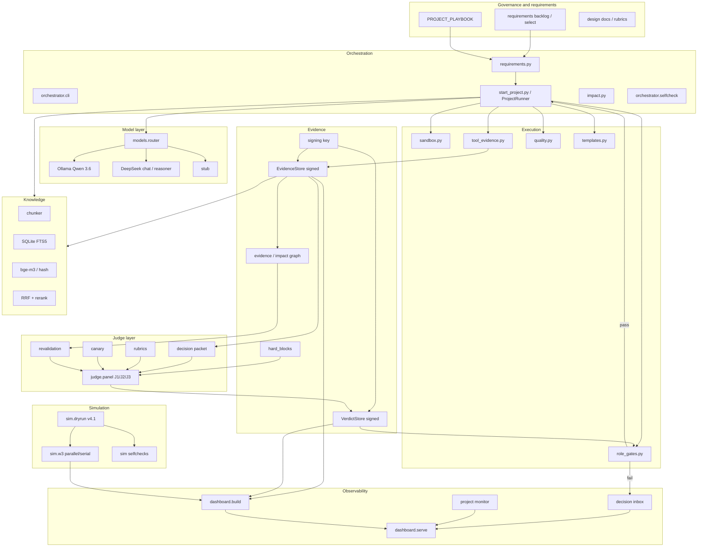

# AgentTeam 架构汇总

> 更新日期：2026-11-16
> 对应代码：v4.1 编排协议 + W1–W5 本地适配层
> 依据：仓库代码实读 + 本机运行结果（`orchestrator.selfcheck`、`sim/selfcheck.py`、W3、离线角色项目）
>
> 口径：只描述当前仓库**已经存在**的模块和能力；设计文档中的未来项在“状态矩阵”中单独标注，不写成已完成。

---

## 0. 一句话结论

AgentTeam 当前是一个**本地可运行的多 Agent 交付原型**：

- **执行**：本地 Qwen 3.6（Ollama）为主，DeepSeek 作为补充/降级；离线用确定性 stub。
- **裁判**：J1/J2/J3 外部模型裁判，无人工逐次审批；机械硬约束先于裁判。
- **证据**：测试/编译/扫描/契约检查由工具执行并签名；Agent 自述只算 claim。
- **交付**：需求选择 → 12 角色项目 runner → 角色门禁 → 沙箱 → 工具证据 → 质量分/角色记录。
- **并行**：W3 三切片并行、共享文件租约、契约变更影响图、串行基线对比。
- **展示**：W3 监控工作台、W4 决策收件箱、W5 项目角色监控。
- **验证**：golden set、金丝雀、role/prompt/KB 评测、CI、多个自检脚本。

当前不是生产级分布式集群：执行沙箱是进程级而非容器级，worktree/崩溃恢复/完整 MCP 服务端仍在后续计划中。

---

## 1. 分层架构



### 各层职责

| 层 | 主要模块 | 职责 |
|---|---|---|
| 治理/需求 | `requirements/`、`PROJECT_PLAYBOOK.md`、`agentteam*.md` | 出题、评分、非目标、验收标准、决策边界 |
| 契约 | `specs/`、`rubrics/`、`prompts/`、`templates/` | 任务卡/证据/决策包/裁决 schema、12 角色规格、门禁 rubric、项目脚手架 |
| 编排 | `orchestrator/`、`start_project.py`、`sim/` | 调度、状态、角色流水线、并行/契约影响、自检 |
| 模型 | `orchestrator/models/` | Ollama/DeepSeek/stub 统一路由、失败回退、Token/成本记录 |
| 裁判 | `orchestrator/judge/` | 决策包、rubric、J1/J2/J3、金丝雀、复核计划、裁决校验 |
| 证据 | `orchestrator/evidence/`、`hard_blocks.py` | 签名证据账本、裁决账本、哈希链、依赖图、机械硬拦 |
| 执行 | `sandbox.py`、`tool_evidence.py`、`role_gates.py`、`quality.py` | 隔离工作区、命令白名单、工具证据、角色门禁、质量分 |
| 知识 | `orchestrator/knowledge/` | Markdown 切块、FTS5、bge-m3、RRF、rerank、引用 |
| 评测 | `eval/` | 裁判/Agent/复核/角色/prompt/知识库 golden set 与回归 |
| 展示 | `dashboard/` | W3 工作台、决策收件箱、项目角色监控、HTTP API |
| CI | `.github/workflows/ci.yml` | 单测、自检、评测、schema 校验、工具证据链验证 |

---

## 2. 目录地图

```
agentteam/
├── orchestrator/                  # 核心编排与 W1/W2/W5 运行时
│   ├── models/                    # ollama / deepseek / stub / router
│   ├── judge/                     # packet / rubric / panel / backend / canary / revalidation / verdict
│   ├── evidence/                  # store / verdict_store / signing / graph
│   ├── knowledge/                 # chunker / embed / indexer / retriever / rerank / store
│   ├── config.py                  # 配置、路径、签名密钥、env/dotenv
│   ├── requirements.py            # backlog 评分与选择
│   ├── project_runner.py          # 需求 → 12 角色 → 产物/日志/状态
│   ├── role_gates.py              # 角色门禁与升级
│   ├── sandbox.py                 # 命令白名单、隔离工作区
│   ├── tool_evidence.py           # compile/unit/sast/contract/secret 证据
│   ├── quality.py                 # 角色质量分与历史
│   ├── templates.py               # 项目模板
│   ├── impact.py                  # 契约影响图
│   ├── decisions.py               # 决策收件箱 SQLite + 审计
│   ├── hard_blocks.py             # 裁判不可绕过的硬约束
│   ├── skills.py                  # 本地技能注册表
│   ├── prompts.py                 # 提示词加载/版本
│   ├── cli.py                     # check-env / demo / judge / agent / eval / kb / decisions
│   └── selfcheck.py               # W1/W2 运行时自检
├── sim/                           # 确定性预演
│   ├── dryrun.py                  # v4.1：工具证据 + 外部裁判 + 复评
│   ├── w3.py                      # 三切片并行 / 共享文件 / 契约影响 / serial baseline
│   ├── selfcheck.py               # v4.1 协议回归
│   ├── w3_selfcheck.py            # W3 回归
│   ├── _baseline_v3.py            # 人审批基线（对照）
│   └── dryrun_v4.0.py             # 上一版快照（不用于正确性判断）
├── specs/                         # 任务卡/证据/决策包/裁决/Agent 规格/OpenAPI
├── rubrics/                       # product/arch/code/acceptance/release/revalidation
├── prompts/                       # 12 角色提示词 + strict-json 候选 + registry
├── templates/                     # minimal-api 脚手架
├── requirements/                  # backlog、选择脚本、示例 selected.md
├── projects/                      # 角色运行示例（离线/真实）
├── eval/                          # golden set、W2/W4 评测
├── dashboard/                     # W3 工作台、W4 收件箱、W5 项目监控
├── skills/                        # 本地技能注册表（引用 RAG-Agent-Toolkit）
├── config/                        # config.example.yaml（不含密钥）
├── data/                          # 账本/知识库/决策库（运行时，忽略提交）
├── tests/                         # unittest 单测
├── start_project.py               # 项目启动入口
├── start.bat                      # Windows 启动器（ASCII）
└── .github/workflows/ci.yml       # CI
```

---

## 3. 五条运行链路

### 3.1 预演链路（不调用真实模型）

```
sim/dryrun.py (v4.1)
  → 切片 DAG / 4 并发 / 条件依赖 deps_any
  → 机器确定性检查（compile/unit/contract/sast/out_of_scope）
  → 工具签名证据（subject_hash + baseline_fp + signed_by）
  → 决策包 → 裁判 J1/J2/J3 → 六态裁决
  → 门禁凭证 → 证据失效 → 复评门禁
  → sim/out/v4/{events,timeline,metrics,auto-report}
```

- `sim/w3.py` 继承 v4.1，模拟三切片并行、共享文件锁、X1 契约 v1.1 变更、影响图与串行基线。
- `sim/selfcheck.py`、`sim/w3_selfcheck.py` 覆盖正常/无故障/重复 ID/DAG 环/重试上限/预算。
- 预演器是**协议验证器**，不是真实模型质量评测；真实链路在 `orchestrator/`。

### 3.2 裁判与门禁链路（W1/W2）

```
确定性检查（工具） 
  → hard_blocks（失败/缺证据/未签名/越界/高危/无回滚/注入）
  → build_packet（决策包，内容隔离）
  → JudgePanel
       J1 快速裁判
       J2 第二家族裁判（高风险/分歧）
       J3 强裁判（L3/终裁）
  → verdict schema 校验 + 证据引用校验 + 签名
  → VerdictStore（哈希链）
  → 门禁凭证 / need_evidence / reject / defer
  → 输入哈希变化 → 证据与裁决失效 → revalidation judge → 复评门禁
```

关键点：

- **失败关闭**：超时、格式错误、无 Key、无证据引用都不批准。
- **家族分离**：执行 Agent 用本地 Qwen；J1/J3 用 DeepSeek；J2 用本地 Qwen（不同家族）。
- **裁判只能加严**：复核计划可以追加检查，不能删除强制项，不能把过期证据判为有效。
- **硬约束优先**：`hard_blocks.py` 在裁判之前执行，裁判无权覆盖确定性失败。

### 3.3 角色交付链路（W5）

```
requirements/backlog.example.yaml
  → orchestrator.requirements select（价值/战略/工作量/风险/依赖评分）
  → selected.md
  → start_project.py
  → ProjectRunner
       prepare：目录、模板、baseline_fp、project.json
       for role in [pm, product, ui, arch, backend, frontend,
                    review, qa, security, ops, kb, retro]:
         加载角色 prompt（prompts/roles/<role>.md）
         组装 user message（需求、前置摘要、KB 引用、调整要求）
         ModelRouter.execution（Qwen 主 / DeepSeek 回退 / stub）
         JSON schema 校验（最多两次修复）
         代码角色：写文件 → 沙箱 → 工具证据 → 角色门禁
         产物：prompt.md / request.md / output.json / summary.md / meta.json
       logs/events.jsonl、state/roles.json、README.md
```

- 代码角色写文件时可选 `--sandbox`：在隔离副本中执行工具与门禁，通过后才 promote；不通过则 stash 到 `artifacts/<role>/rejected/`。
- 门禁不通过会写入决策收件箱（`data/decisions.db`），生成 upgrade 决策。
- `quality.py` 记录角色质量分与历史，供看板趋势使用。

### 3.4 知识检索链路（W4）

```
docs/specs/rubrics/skills/prompts
  → Markdown-aware chunker（标题/段落/代码块，CJK 友好）
  → SQLite FTS5（字符 unigram+bigram，BM25）
  → bge-m3 via Ollama（1024 维；不可用回退 hash:256）
  → RRF 融合
  → 独立 rerank（dense + 查询词覆盖 + 标题命中 + 去冗余）
  → citation: path#heading
  → 注入角色上下文（--kb）
```

- `data/knowledge.db` 可重建；`eval/kb_eval.py` 用临时库跑 22 个检索用例。
- 不直接运行 RAGFlow（依赖 ES/MySQL/Redis），只复用其“解析→切块→向量→混合检索→重排→引用”的思想。

### 3.5 评测与 CI 链路

```
eval/golden/{judge,agent,revalidation,role,kb}_cases.yaml
  → eval/run_eval.py --offline          # 裁判/金丝雀/Agent/复核
  → eval/role_eval.py --offline --full  # 12 角色 × 2
  → eval/prompt_regression.py --offline # baseline vs strict-json
  → eval/kb_eval.py                     # recall@5 / MRR / rerank gain
  → CI: unittest + orchestrator.selfcheck + sim selfchecks + specs validate
```

真实模型评测需要 Ollama/Qwen；裁判真实评测需要 DeepSeek Key。无 Key 时用 `--allow-local-judge` 显式降级并记录 `family_collisions`。

---

## 4. 核心协议与不变量

| 不变量 | 实现 |
|---|---|
| 确定性检查先于裁判 | `tool_evidence.py` 产出签名证据；`JudgePanel._hard_block_verdict` 先判硬拦 |
| 裁判不能推翻确定性失败 | `hard_blocks.py` + panel 的 hard-block verdict |
| 证据必须可引用、可签名 | `EvidenceStore` 哈希链 + `signed_by=tool:/judge:` |
| Agent 自述不是证据 | `claims` 单独字段；门禁只查 evidence |
| 裁判只能加严 | `revalidation.py`：`removed_checks` 必须为空 |
| 裁决绑定输入 | `verdict.input_hash/subject_hash/baseline_fp`；变化即失效 |
| 失败关闭 | 超时/格式/无 Key/无证据引用 → 不 approve |
| 重试与预算有硬上限 | 任务卡 `retry.max_attempts`、预算 80/100% 阈值 |
| 写作用域 | `specs/task-card.schema.json` + `sandbox.py` + `out_of_scope` 证据 |
| 命令最小权限 | 沙箱 allowlist、argv-only、无 shell、环境变量清洗 |
| 家族分离 | 执行 Qwen；J1/J3 DeepSeek；J2 第二家族 |
| 无逐次人审批 | 常规门禁由裁判；人只做策略/收件箱升级/审计 |

---

## 5. 数据与账本

| 路径 | 生产者 | 内容 | 提交 |
|---|---|---|---|
| `data/evidence.jsonl` | EvidenceStore | 全局签名证据 + 哈希链 | 忽略 |
| `data/verdicts.jsonl` | VerdictStore | 裁决 + 签名 + 哈希链 | 忽略 |
| `data/decisions.db` | DecisionStore | 决策收件箱 + 审计 | 忽略 |
| `data/knowledge.db` | KnowledgeStore | FTS5 + chunk + embedding | 忽略 |
| `projects/<p>/evidence/tool-ledger.jsonl` | tool_evidence | 项目级工具证据 | 示例项目可提交 |
| `projects/<p>/logs/events.jsonl` | ProjectRunner | 角色/文件/门禁事件 | 示例项目可提交 |
| `projects/<p>/state/roles.json` | ProjectRunner | 角色状态与 meta | 示例项目可提交 |
| `projects/<p>/quality/history.jsonl` | quality | 质量分历史 | 示例项目可提交 |
| `.agentteam/signing.key` | config | 本地签名密钥 | 忽略 |
| `sim/out/` | sim | 事件/时间线/指标/报告 | 忽略 |
| `dashboard/index.html`、`data.json` | build | W3 静态看板 | 当前提交了构建产物 |

---

## 6. 模型路由

| 用途 | 主 | 回退 | 说明 |
|---|---|---|---|
| 执行 Agent（12 角色） | 本地 Ollama `qwen3.6:35b-a3b-mtp-q4_K_M` | DeepSeek `deepseek-chat` | `offline` 时用 stub |
| 裁判 J1 | DeepSeek `deepseek-chat` | 无（失败关闭） | 本地降级需显式 `--allow-local-judge` |
| 裁判 J2 | 本地 Qwen | 无 | 与 J1/J3 不同家族 |
| 裁判 J3 | DeepSeek `deepseek-reasoner` | 无 | 终裁/L3/发布 |
| 离线评测 | stub | — | `--offline` |

- 配置：`config/config.yaml`（不存在时回退 `config.example.yaml`）。
- 密钥：`.env`、环境变量或 Windows 用户变量 `deepseek-key1`；不写入配置。
- 成本：`ChatResult` 记录 input/output Token 与 `cost_usd`；裁判成本单独统计。

---

## 7. W3：并行、共享文件与契约影响

当前 `sim/w3.py --mode both` 的结果（单机、3 切片、脚本化裁判）：

| 指标 | Parallel | Serial |
|---|---|---|
| 虚拟工期 | 1,302 min | 2,815 min |
| 平均排队等待 | 12.8 min | 60.7 min |
| 峰值并发 | 4 | 1 |
| 共享文件冲突 / 锁等待 | 3 / 85 min | 0 / 0 |
| 契约变更 / 影响任务 | 1 / 6 | 1 / 6 |
| 失效证据事件 | 3 | 2 |
| 门禁首过 | 38% | 50% |
| 返工 | 7 | 6 |
| 裁判调用 / 成本 | 24 / $0.27 | 23 / $0.266 |

**并行加速比 2.16x**。代价是共享文件锁竞争（`package.json`、`shared/ui-tokens.css`）和契约变更后的跨切片复评；收益是等待时间大幅下降。

---

## 8. 看板与 API

| 页面/接口 | 内容 |
|---|---|
| `dashboard/index.html` | 首页：实时项目任务（角色/任务状态、泳道、Token、门禁、质量、证据）+ W3 并行/串行基线 |
| `dashboard/decisions.html` | W4 决策收件箱：approve / conditions / reject / defer / request evidence |
| `dashboard/projects.html` | W5 项目角色监控：角色状态、prompt、请求、输出、文件、重跑 |
| `python dashboard/serve.py --port 8765` | 本地 HTTP 服务 |
| `GET /api/health` | 健康检查 |
| `GET /api/live`、`/api/live?project=<name>` | 最新/指定项目的任务动态、指标、事件流 |
| `GET /api/decisions`、`/api/decisions/{id}`、`/api/decisions/stats` | 决策查询 |
| `POST /api/decisions/{id}/decision` | 决策动作 + 审计 |
| `GET /api/projects`、`/api/projects/{name}` | 项目列表/详情 |
| `GET /api/projects/{name}/roles/{role}` | 角色明细 |
| `GET /api/projects/{name}/file?path=...` | 文件内容（限定项目内） |
| `POST /api/projects/{name}/roles/{role}/rerun` | 单角色调整重跑 |

数据刷新：

- 首页实时面板每 3 秒请求 `/api/live`，读取 `state/roles.json`、`logs/events.jsonl`、`evidence/tool-ledger.jsonl`。
- `dashboard/build.py` 会嵌入最新项目的快照，供直接打开 `index.html` 时使用；当 `sim/w3.py`/`sim/dryrun.py` 比 `sim/out/w3` 新时自动重跑 W3，避免旧模拟数据长期不更新。

---

## 9. 当前状态矩阵

| 能力 | 状态 | 说明 |
|---|---|---|
| v4.1 编排协议预演 | ✅ 完成 | 切片 DAG、工具证据、裁判、复评、预算/重试硬上限 |
| W3 并行/共享/契约影响 | ✅ 完成 | 3 切片、锁冲突、影响图、serial baseline、2.16x |
| W1/W2 模型与裁判适配 | ✅ 可用 | Ollama/DeepSeek/stub、J1/J2/J3、canary、复核 |
| 签名证据/裁决账本 | ✅ 可用 | 哈希链、签名、TTL、失效 |
| 工具证据（compile/unit/sast/contract/secret） | ✅ 可用 | basic/standard/full；semgrep/trivy 依环境 |
| 角色项目 runner | ✅ 可用 | 12 角色、prompt/request/output/meta、日志、质量分 |
| 角色门禁与决策升级 | ✅ 可用 | 机械检查 + 决策收件箱；W5 工作树 |
| 进程级沙箱 | ⚠️ 部分 | allowlist/argv/环境清洗/隔离副本；无容器/网络隔离 |
| 真实 Qwen 全流程 | ⚠️ 部分 | 示例跑通 5 角色；全量 12 角色真实评测按预算 |
| 真实 DeepSeek 裁判 | ⚠️ 部分 | 适配器与评测可用；生产需 Key、金标准集校准 |
| 知识库混合检索 | ✅ 可用 | FTS5 + bge-m3 + RRF + rerank；本地小库 |
| Role/prompt/KB 评测 | ✅ 可用 | golden set + CI；真实全量需单独跑 |
| 决策收件箱 | ✅ 可用 | SQLite + 审计 + API/UI；示例 seed |
| 项目角色监控 | ✅ 可用 | 列表/详情/文件/单角色重跑 |
| 容器/内核级沙箱 | ❌ 未实现 | 部署环境补 seccomp/namespace/容器 |
| 真实 git worktree/租约/合并冲突 | ❌ 未实现 | W3 是内存租约模型 |
| 崩溃恢复/持久调度 | ❌ 未实现 | 现有 runner 是单进程顺序执行 |
| 完整 MCP 服务端 | ❌ 未实现 | 技能只作为参考文档注入 |
| 生产部署/发布流水线 | ❌ 未实现 | 生成代码的 CI/CD 仍需接入 |
| 医疗/金融等合规签核 | ❌ 不适用 | 这些领域需要人工/法务签核 |

---

## 10. 启动与运行

### 10.1 Windows 启动器

仓库根目录的 `start.bat` 是 ASCII-only 启动器：

```bat
start.bat              :: interactive menu; option 1 starts a project from a design document
start.bat project      :: choose/drag a design or requirement file, then start a project
start.bat project requirements\examples\csv-export\selected.md my-app offline
start.bat project "C:\designs\ledger.md" ledger-app real
start.bat check        :: environment + selfcheck
start.bat sim          :: v4.1 simulation + selfcheck
start.bat w3           :: W3 parallel/serial + dashboard build
start.bat dashboard    :: serve dashboard on http://localhost:8765
start.bat test         :: unit tests + selfchecks + spec validation
start.bat eval         :: offline evaluation suite
start.bat demo         :: offline 12-role sample project
start.bat real         :: real local Qwen sample project
start.bat kb           :: build/query knowledge index
start.bat setup        :: create local config/.env + install deps
start.bat all          :: check + sim + W3 + dashboard build
```

`project` 的交互流程：

1. 拖入或输入设计/需求文档路径（`.md/.yaml/.yml/.txt`），支持任意位置。
2. 输入项目名（留空自动生成）。
3. 选择离线 stub 或真实本地 Qwen。
4. 真实模式再选核心 5 角色或全部 12 角色。
5. 若 `data/knowledge.db` 存在，自动加 `--kb`。
6. 调用 `start_project.py`，产物写入 `projects/<name>/`，随后可在 `projects.html` 查看角色记录。

### 10.2 直接命令

```bash
python -m orchestrator.cli check-env --offline
python -m orchestrator.selfcheck
python -I sim/dryrun.py
python -I sim/selfcheck.py
python -I sim/w3_selfcheck.py
python sim/w3.py --mode both
python dashboard/build.py
python dashboard/serve.py --port 8765
python -m unittest discover -s tests -v
python eval/run_eval.py --offline
python eval/role_eval.py --offline --full
python eval/prompt_regression.py --offline
python eval/kb_eval.py
python -I specs/validate_specs.py
```

---

## 11. 风险与下一步

### P0

1. **真实工具证据 + CI 覆盖每个代码切片**：当前模板与 CI 已有 basic/standard/full profile，但真实项目的 pytest/契约/扫描仍需逐切片接入。
2. **执行沙箱 + worktree**：进程级沙箱不等于容器隔离；真实生成代码需要独立 worktree、命令白名单、网络限制与崩溃恢复。
3. **角色门禁与 runner 的边界**：runner 的门禁是角色级草稿门禁，不应被误认为生产门禁；真实项目要走 tool evidence + judge + 复评。

### P1

1. 全量 12 角色真实 prompt 回归（当前真实只跑子集）。
2. 知识库 rerank 与检索用例扩容（当前 22 例）。
3. 决策收件箱自动接门禁/超时/分歧（当前示例 seed + 角色门禁升级）。
4. 角色质量分趋势与成本趋势。

### P2

1. 项目模板与可复用资产库。
2. 多项目队列/调度。
3. 更完整的 MCP 工具服务端与技能执行。
4. 生产部署/观测/回滚演练自动化。

### 架构风险

- **裁判误批**：依赖金丝雀、双裁判、门禁逃逸率与人工抽查；不能只凭“评测 11/11”上线。
- **同族盲点**：J1/J3 与执行都用 DeepSeek 时会共享盲点；当前 J2 用本地 Qwen，生产需保持家族分离。
- **证据伪造/注入**：工具签名 + 内容隔离 + 无工具权限；仍需红队与权限审计。
- **成本/延迟**：真实模型与裁判调用会放大；预算、缓存、J1 优先、包最小化。
- **脚本/模板漂移**：`start.bat` 与 README 命令需随入口变化同步更新；CI 应覆盖启动器使用的命令。

---

## 12. 本轮检查记录

| 检查 | 命令 | 结果 |
|---|---|---|
| 环境/模型/账本 | `python -m orchestrator.cli check-env --offline` | exit 0；本地 Qwen 可用；DeepSeek 可用；账本链 OK |
| 编排自检 | `python -m orchestrator.selfcheck` | ALL CHECKS PASSED |
| v4.1 预演 | `python -I sim/dryrun.py` | completed；1,252 min；59 任务；裁判 20 次；无 fatal |
| W3 预演 | `python sim/w3.py --mode both` | completed；parallel 1,302 min / serial 2,815 min；2.16x |
| W3 自检 | `python sim/w3_selfcheck.py` | 通过 |
| 看板构建 | `python dashboard/build.py` | 生成 index.html；573/550 事件；嵌入 test1 实时快照 |
| 首页实时项目 | `python dashboard/serve.py` + `GET /api/live?project=test1` | test1 completed；12/12 角色、12/12 门禁、151,094 Token、146 条证据 |
| 离线项目 | `python start_project.py ... --offline` | pm/product/arch completed；stub 3 次调用 |
| Windows 启动器 | `start.bat check/sim/test/eval/demo` | 全部 exit 0；菜单/参数模式可用 |
| 设计文档开工 | `start.bat project requirements\examples\csv-export\selected.md _launcher-project-smoke offline` | 12 角色 completed；产物写入指定项目目录 |
| 知识库 | `start.bat kb hash` / bge-m3 reindex | hash 快速索引 790 chunks；bge-m3 重建完成 |
| 单测 | `python -m unittest discover -s tests -v` | 20 tests OK；sandbox/evidence/gates/quality/rerank |
| Schema | `python -I specs/validate_specs.py` | OK |

> 仓库状态（检查时）：分支 `v4.1-protocol-fixes`；W5 相关改动（项目监控、角色门禁、沙箱、工具证据、质量分、模板）仍在工作树未提交。本轮新增 `ARCHITECTURE.md` 与 `start.bat`。
