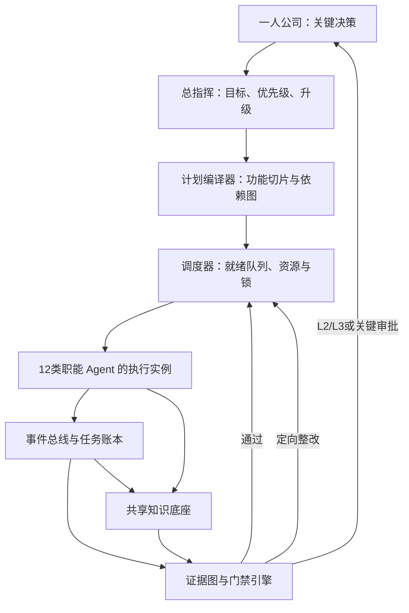

# AgentTeam v3：并行交付与共享记忆架构

> **v4 修订（2026-11-16）**：本文的切片 DAG、共享知识、证据缓存与最小协议仍适用；其中"人或关键审批"环节已由外部模型裁判（deepseekharness）取代。见 [agentteam-v4-外部模型裁判.md](agentteam-v4-外部模型裁判.md)。

## 1. 设计目标与基线

本方案基于 [agentteam1.md](./agentteam1.md) 的 12 个职能 Agent、五阶段流程、项目宪法和人控决策，以及 [agentteam2.md](./agentteam2.md) 的单 Agent 提示词。保留四层基准（产品、架构、规范、资产）、L1/L2/L3 变更分级、证据门禁和一人公司对范围、架构、发布、验收等关键事项的决策权。

原方案已经允许前后端并行，但整体仍按“整阶段完成→整阶段评审→整阶段退回”流转。代码评审在开发完成后开始，QA 在代码门禁后开始，知识归档主要发生在阶段末。这会形成等待队列、晚发现缺陷、整包返工和跨 Agent 上下文重复读取。v3 将执行单位从“阶段”细化到“可验收功能切片”，以依赖图调度，以版本化共享知识提供上下文，以机器可核验的证据做门禁。

**目标指标（试运行目标，需以首轮项目实测校准）**：任务等待时间下降 30%；因信息缺失或版本不一致导致的退回次数下降 50%；重复检查工时下降 40%；关键约束遗漏为零。质量门禁和人审批保持原有严格程度。**这些指标必须有 serial（阶段串行）基线做 A/B，否则无法验证。**

## 2. 总体架构

| 层 | 责任 | 实现要点 |
| --- | --- | --- |
| 决策层 | 人审批目标、范围、关键架构、生产发布和最终验收 | 审批对象为带版本号、差异、影响面和证据的具体方案 |
| 编排层 | 总指挥、计划编译器、调度器、门禁引擎 | 总指挥处理例外；调度和规则校验尽量由确定性程序执行 |
| 执行层 | 原 12 类职能 Agent | 角色权责不变；同角色可按任务需要开启多个执行实例 |
| 数据层 | 四层基准、任务账本、事件日志、证据图、知识索引 | 基准权威；知识条目有来源、状态、版本、适用范围 |
| 工具层 | 代码仓、CI、测试、扫描、文档、发布 | 所有写操作关联任务 ID 和授权，所有验证记录工具版本与输入哈希 |

这里的“实例”是并行执行槽，不是新增管理角色。项目总指挥仍是唯一对人接口，但不承担每条消息的人工转发。

## 3. 核心设计一：依赖图驱动的同行并发

### 3.1 切片与启动规则

产品 Agent 将需求拆成可独立验收的纵向功能切片，例如“注册”“资料编辑”，每片覆盖产品条目、界面、接口、数据、测试和发布影响。计划编译器为每片建立 DAG；边表示**真实的前置依赖**，而不是角色或阶段顺序。每个节点有负责人、输入版本、输出契约、验收证据、影响路径、风险级别、预计资源和失效条件。

调度器只启动满足以下条件的节点：前置契约已冻结到所需版本；该节点的操作已被授权；所需资源和文件锁可用；当前输出不会违反未通过的门禁。产品或架构尚待人审批时，允许可丢弃的草稿、测试设计和技术探针并行准备；不得将其当作已批准基准来实现正式功能或发布。审批后自动比较草稿依赖版本，再决定沿用或重做。

### 3.2 流水线而非整批移交

一旦某个接口契约片段冻结，前端可使用契约生成的 mock，后端实现接口，QA 编写验收用例，安全 Agent 做威胁建模，运维准备测试环境；代码评审 Agent 在每个小 PR 生成后立即评审。功能片通过自身代码门禁后即可进入测试，其他片仍可开发。项目级验收门禁在所有必需功能片与横切项完成后聚合，仍由人审批。

建议初始同时运行 3 至 5 个功能片、每个 Agent 实例最多持有一个主任务；按实际仓库冲突率和 CI 容量调整。并发上限由文件重叠、共享接口、环境容量和预算共同限制，不以 Agent 数量盲目拉满。

### 3.3 防止并发互相覆盖

每片使用独立分支或工作树；共享接口和迁移脚本实行单写者租约。提交前比对基准版本和依赖哈希，过期输出退回到“重新对齐”而非直接合并。可交换的文件变更并行合入；不可交换的契约变更由架构师裁决，并触发下游影响分析。每项整改只回退受影响的节点及其下游，未受影响功能片继续运行。

### 3.4 降低退回循环

每个任务先过轻量“就绪检查”：输入是否齐、验收标准是否可测、契约是否一致、资产是否检索、风险是否显式记录。执行中持续运行 lint、类型检查、契约测试、核心单测和安全扫描；检查失败就地修复。正式评审以具体证据、代码位置和规范条款提出问题，并给出负责角色与复验范围。相同根因第二次出现即调出相关历史处理记录；第三次触发专项复盘和流程/规范修订提案，而非原样重试。

## 4. 核心设计二：底层共享知识与增量验证

### 4.1 四层知识模型

1. **权威层**：项目宪法、四层基准、已批准 ADR、接口契约、验收标准。文档版本化且不可由普通知识写入覆盖。
2. **工作层**：任务状态、当前假设、未决问题、交接摘要、正在使用的基准版本。任务变更时立即更新。
3. **证据层**：构建结果、测试报告、扫描结果、评审结论、发布记录。绑定输入哈希、工具版本、时间、环境和责任 Agent。
4. **经验层**：已复核的缺陷根因、修复方案、复用组件、模板和反例。标明适用条件及失效条件。

知识库 Agent 负责治理、去重和晋升；每个 Agent 对自己任务产生的结构化事件负写入责任。事件流实时更新工作层与证据层，阶段末只做整理和归档，不等待归档才共享。

### 4.2 任务启动时的上下文包

检索器根据任务 ID、功能片、文件路径、接口名和风险标签生成最小上下文包：当前有效基准、相关 ADR、契约、验收项、历史同类缺陷、未决问题、最近验证结果及来源链接。Agent 必须回传所使用的版本与引用；检索不到时标记“未知”，不能把旧经验当作现行规则。若权威层与经验层冲突，以权威层为准并创建冲突事件。

### 4.3 防遗忘与免重复检查

所有结论以结构化记录保存，不依赖对话窗口记忆。Agent 恢复任务时读取事件游标和最近一次检查点，可还原“完成了什么、为何如此、还缺什么”。证据缓存键为 `主体内容哈希(subject_hash) + 基准版本 + 工具版本 + 规则版本 + 提示词版本 + 环境指纹 + 检查类型`；完全匹配且未过有效期时复用结果。输入或依赖变化时只重跑受影响的检查；发布前安全、关键端到端和生产环境验证按门禁策略重新执行，不因缓存跳过。

知识条目状态为 `候选→已复核→有效→已过期/撤销`。候选经验不能自动修改基准；涉及 L2/L3 变更仍由人审批。删除或撤销知识时保留审计记录，并通知使用该条目的活跃任务重算上下文。

## 5. 在上述两项之外的 10 个架构创新

| # | 设计 | 机制与收益 |
| --- | --- | --- |
| 1 | 契约沙盒 | 从接口契约自动生成 mock、契约测试和示例数据；前后端可提前联调，并在真实服务接入时验证兼容性。 |
| 2 | 风险自适应门禁 | 按资金、隐私、权限、数据迁移和用户影响分级；低风险改动走标准自动验证，高风险增加独立复核与人审批材料，门禁底线不降低。 |
| 3 | 变更影响图 | 建立需求→设计→接口→代码→测试→文档→发布的追踪边；基准变更自动列出必须重做的节点、估时和责任人。 |
| 4 | 反证式审查 | 对关键架构和高风险功能，单独分配 Agent 寻找“方案会失败的条件”和反例；结论连同证据进入 ADR，减少集体盲点。 |
| 5 | 可重放事件账本 | 任务分发、决策、执行、门禁、回退统一记录为不可变事件；中断后可恢复，也能复盘某次错误决策的输入。 |
| 6 | 缺陷指纹与定向路由 | 按堆栈、接口、代码路径、症状和根因聚类缺陷；重复缺陷关联旧单，自动找到负责切片和最小回归集合。 |
| 7 | 弹性执行配额 | 保留 12 类角色，按队列长度临时增加同角色实例；由预算、冲突率和 CI 容量限制，减少单角色排队。 |
| 8 | 交付可观测性 | 持续计算等待时间、返工率、门禁首过率、知识命中率和证据复用率；异常时调整切片大小或并发度。 |
| 9 | 渐进发布单元 | 功能片绑定特性开关、灰度指标和回滚脚本；发布可按风险逐步扩大，异常只关闭受影响功能。 |
| 10 | 决策包生成器 | 需人裁决时自动汇总选项、差异、成本、风险、验证结果和建议；人面对具体方案一次决策，减少往返澄清。 |

## 6. 运行流程

| 时点 | 并行工作 | 放行条件 |
| --- | --- | --- |
| 启动 | 产品拆片、复盘查历史、知识底座推送、UI探索、架构风险探针 | 人确认目标和大致范围 |
| 产品定义 | 各功能片验收标准、原型、风险点同时形成；QA 提前审查可测性 | 产品基准完整，人审批范围 |
| 架构定义 | 接口、状态机、安全威胁、测试策略、环境方案同行；契约沙盒生成 | 架构基准和契约通过，人审批关键架构 |
| 实现 | 多片开发；每片前后端、QA、评审、安全、运维按依赖交错运行 | 每片代码、测试、安全证据满足本片门禁 |
| 集成验收 | 已通过片持续集成；QA 做跨片流程；变更影响图确定回归范围 | 所有必需验收项与横切要求通过，人验收 |
| 发布与复盘 | 灰度监控、知识晋升、复盘并行准备 | 人批准生产发布；线上验证后确认项目闭环 |

**失败路径示例**：QA 在“资料编辑”片发现权限漏洞，缺陷事件绑定接口和代码提交。调度器暂停该片的合并与发布，安全 Agent 给出修复标准，后端修复，契约测试和权限回归按影响图重跑。其他无依赖功能片继续工作。若修改涉及共同认证契约，影响图扩大到相关功能片；核心契约调整按 L2/L3 提交人审批。

## 7. 最小可执行协议

每个任务卡至少包含：`task_id`、`project_id`、`slice_id`、`owner_role`、`input_refs`、`baseline_versions`、`dependency_ids`、`deps_any`（条件依赖）、`output_contract`、`acceptance_ids`、`risk_level`、`write_scope`、`locks`、`evidence_required`、`budget`（tokens/usd/minutes）、`retry`（max_attempts/backoff/on_exhaust）、`idempotency_key`、`prompt_version`、`rollback_scope`。任务状态为 `待就绪→就绪→确定性检查中→待裁判→执行中→待验证→通过/定向整改→已合入`，另设 `阻塞`、`待人决策`、`已过期(stale)`、`已取消`、`已被复评取代`。状态变化由事件触发，并要求原因与证据链接。

每条门禁凭证包含：门禁 ID、功能片/项目范围、基准版本、检查项、证据引用、结论、失效条件、签发者和时间。总指挥只能汇总符合规则的凭证，不能替代专业 Agent 修改结论。审批后若核心输入变化，凭证自动失效。

所有 Agent 提示词在现有内容上追加统一协议：

> 接任务时读取上下文包并声明所用基准版本；开始前报告缺失输入和预计写入范围；执行中写入决策、未决问题和证据事件；提交时附可复验的输出与影响范围；发现基准冲突、过期证据或超出权限的变更时暂停相关节点并升级。不得用经验层条目覆盖权威基准，不得重复执行仍有效的同一检查。

## 8. 落地顺序与验收

1. **基础版**：统一任务卡、状态机、事件账本和四层基准版本号；选一个小功能片跑通。
2. **并发版**：加入 DAG 调度、独立工作树、契约沙盒和片级门禁；观察冲突率与等待时间。
3. **记忆版**：加入实时知识写入、上下文包、证据哈希、失效传播；验证中断恢复和增量复测。
4. **优化版**：接入风险分级、影响图、缺陷指纹、灰度发布和决策包；根据实测数据调并发配额。

试运行时对同类项目或连续迭代记录：总交付周期、排队时间、返工次数、门禁首过率、重复检查时长、知识命中率、证据误复用次数、线上缺陷数。只有在周期缩短且误复用与漏检均未增加时，才扩大并发。若发生冲突或质量下降，先缩小切片、减少共享写入，再调整配额。
