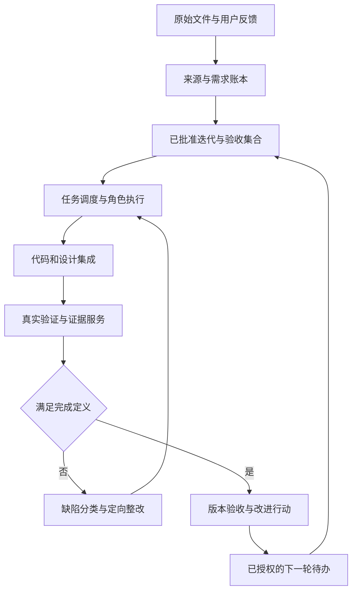

# 第二篇：目标架构、状态归属与统一数据协议

## 1. 改造目标的可验证表述

目标是在现有仓库上形成一个能围绕同一项目持续工作的小型工程团队：读取来源、理解与确认需求、制定可验收切片、实现并集成、运行验证、处理缺陷、更新文档、推进下一轮。十二类职能可以保留，但不再以每类角色返回一次作为进度单位。进度由已批准用户任务的完成情况表达，角色只是完成任务的执行资源。

单轮成功的必要条件是承诺验收项全部有当前有效证据，阻塞问题全部解决，交付产物可以运行，必要决策已经完成。项目持续活跃不意味着进程无限运行；它意味着待办、事件、授权和恢复条件持久存在，调度器启动后能继续执行就绪工作。没有授权的新需求保留为提案，没有工作时保持空闲，预算耗尽时明确停止本次执行。

为避免过度设计，初期维持单机进程、SQLite 和文件产物，不引入分布式消息系统。进程内调度器与数据库事务足以实现第一批目标；只有实际吞吐和隔离需求出现后才拆服务。所有新增架构都应能在离线确定性测试里验证状态行为，再通过少量真实模型评测观察内容质量。

## 2. 六层职责

来源层负责原始文件、版本、结构单元和解析告警；需求层负责事实、假设、决策、原子需求、场景与验收；执行层负责任务、尝试、工具调用、产物和变更；验证层负责证据、发现、门禁和完成定义；迭代层负责 Backlog、优先级、缺陷与改进行动；呈现层负责解释当前状态及人工决策。

这六层不必对应六个进程。建议分别放在小模块，通过显式函数和数据库对象协作。模型不直接写项目状态为 completed，Dashboard 不直接把门禁切成通过，知识检索器不修改权威需求。状态变化必须由领域服务根据条件执行，并记录原因与版本。



## 3. 身份模型：项目、迭代、运行、任务、尝试

project_id 表示长期维护对象，不随每次启动变化。iteration_id 表示一次明确承诺的交付范围。run_id 表示调度器从开始到退出的一次执行会话。task_id 表示持久任务，attempt_id 表示该任务某次执行。原有 role 字段只表达执行者职能，不能继续充当唯一任务键，因为同一角色一轮内可能执行多个任务，也可能对一个任务多次整改。

举例：同一个游戏项目在迭代 I02 承诺“损坏存档恢复”，任务 T17 负责来源和产品补充，T18 负责设计，T19 负责实现，T20 负责回归。T19 第一次失败后 attempt_2 修复，任务 ID 保持不变。程序重启产生新 run，但不创建重复 T19。否则历史统计会把失败尝试计算成新的完成任务，完成率被拆任务动作抬高。

建议 ID 使用 UUID/ULID 或数据库分配的无碰撞键；展示编号可以另设短名称。已有时间戳和角色拼接的 task_id 可保留为 legacy_id，不能仅以秒级时间戳保证唯一性。所有外键同时携带 project_id 或使用全局唯一 ID，跨项目引用应被拒绝。

## 4. 新增数据表的最小集合

`source_documents` 保存 doc_id、content_hash、original_path、media_type、parser_version、created_at；`source_units` 保存 unit_id、doc_id、version_hash、locator、content、kind、parse_status；`requirements` 保存 requirement_id、revision、statement、priority、status；`requirement_sources` 关联需求和来源并记录关系类型。

`scenarios` 保存 actor、goal、preconditions、steps、postconditions；`acceptance_items` 保存可观察断言、环境、数据夹具和必需级别；`design_states` 保存页面/组件、状态、动作、反馈和转移；`trace_edges` 保存需求、场景、设计、接口、代码和验收之间的类型化边。

`iterations` 保存批准范围、成功标准和预算；`tasks` 保存 owner_role、依赖、输入指纹、允许写入范围、状态和优先级；`attempts` 保存模型、提示词、上下文、开始结束时间、失败原因和输出引用；`artifacts` 保存路径、内容哈希、产物类别、生产者与所属版本。

`findings` 保存症状、严重度、根因分类、证据、责任任务与关闭状态；`improvement_actions` 保存触发事件、措施、目标验证与关联任务；`events` 保存不可变领域事件；`event_outbox` 保存需要异步投递但尚未确认的事件。证据和决策优先复用现有结构，再增加当前版本引用，不重复建设第二套互不相通的账本。

## 5. 统一 JSON 外壳与角色专用内容

保留 `agent-output.schema.json` 的通用外壳，但新增 schema_version、task_id、attempt_id、input_fingerprint、consumed_refs、deliverable_refs 和 findings。每个角色再挂载专用 payload schema。产品的 payload 是需求与场景，设计是状态图与规范，实现是变更摘要与测试引用，QA 是实际用例结果；不要求每个角色都用 claims 数量证明工作完整。

```json
{
  "schema_version": "2.0",
  "task_id": "T-019",
  "attempt_id": "A-019-02",
  "role": "backend",
  "status": "ready_for_verification",
  "input_fingerprint": "sha256:...",
  "consumed_refs": [{"id": "REQ-SAVE-03", "revision": 2}],
  "deliverable_refs": [{"artifact_id": "ART-054", "hash": "sha256:..."}],
  "finding_refs": [],
  "summary": "已实现损坏主存档后加载备份的逻辑，等待独立复验。"
}
```

上述示例是目标协议，不可直接塞入现有 schema 后声称兼容。任务卡会安排先新增版本化 schema，再写适配器，最后迁移执行器。模型自报 status 只是建议状态，领域服务仍根据证据决定最终任务状态。没有输入指纹、引用不存在、角色不匹配或 ID 越界时，应返回明确校验错误而非自动补成成功。

## 6. 指纹与版本规则

输入指纹应覆盖当前任务真正依赖的需求修订、设计状态、接口、代码基线、工具/提示词和环境配置。不同证据使用不同依赖集合：编译结果不依赖产品提示词，但依赖编译对象与工具链；产品语义审查依赖原文、需求版本、提示词、模型和审查规则。不要沿用一个全项目哈希让任何 Markdown 修改都触发全部测试，也不要漏掉真实依赖造成旧结果继续有效。

产物文件一旦登记就有内容哈希；路径可以变化，身份和来源必须可追溯。审批绑定待批准对象版本和操作范围，而不是笼统绑定项目名。新的需求版本不会删除旧版本，而是标记 superseded 并生成影响事件。引用已失效产物的任务暂停相关动作，已完成历史任务保留“当时完成、现已过期”的区别。

## 7. 原子事务与事件一致性

新增 finding 和创建修复任务应在同一数据库事务中完成，避免缺陷出现但没有工作项。任务完成、产物登记与发出 task.completed 事件也应一致提交。外部工具或文件写入不能直接放进长事务，应先登记意图，在隔离工作区执行，验证后登记结果并提升产物。

采用 outbox 的目的不是搭建消息中间件，而是在进程崩溃后能恢复“数据库已更新但事件未投递”的状态。每个事件有 event_id、aggregate_id、aggregate_version 和 causation_id；消费方记录已处理 ID，重复事件不重复创建任务。失败重试可以再次投递，但不能再次发布同一版本或重复迁移数据。

SQLite 写事务保持短小，配置合理的 busy timeout。对状态使用 compare-and-swap：只有状态版本仍是领取时的值才能提交完成。两个执行者争抢同一任务时，一个领取成功，另一个返回竞争失败；不得都认为自己获得任务然后最后一次文件写入覆盖前一次。

## 8. 状态机的精确定义

任务建议状态为 draft、ready、running、awaiting_verification、needs_revision、completed、blocked、awaiting_decision、failed、cancelled。running 只能由持有有效租约的 attempt 进入；completed 必须经过验证；failed 表示本次任务自动处理已终止，不等于取消范围；cancelled 必须记录批准的范围变更或用户指令。

迭代状态为 proposed、approved、executing、verifying、accepted、blocked、cancelled。项目状态为 active、idle、awaiting_decision、paused、archived。项目 idle 说明暂时没有就绪工作，不说明目标全部结束。用户暂停后不自动恢复；预算补充、依赖完成和新事件可以唤醒未暂停项目，但不能越过人的显式停止。

需要把进程退出码与领域状态分开。CLI 完成当前指定命令可以返回零，但若命令目标是完成整个迭代，仍有必需任务未通过就应返回非零或明确的非成功状态。报告中必须说明运行目标，不能用“本次命令执行完毕”替换“项目交付成功”。

## 9. 接口边界与兼容策略

建议新增 `orchestrator/domain/` 放数据类型和状态规则，`orchestrator/persistence/` 放 SQLite 仓储与迁移，`orchestrator/context/` 放上下文组装，`orchestrator/execution/` 放工具与模型循环，`orchestrator/iterations/` 放计划和反馈处理。现有 `project_runner.py` 逐步退为兼容入口，不一次性拆散所有代码。

旧 Dashboard 继续读取导出的 JSON 视图，新服务以数据库为权威状态源。导出 JSON 内注明 snapshot_version、generated_at、source_run_ids；旧文件不得被 Dashboard 当成可写状态。历史项目首先只读导入，缺少来源或模型记录标记 unknown，不生成虚假的 current_verified 字段。

每个迁移都有 forward 和可执行回退策略。若迁移只是新增表列，可用旧版本只读原字段；若发生语义变化，采用双读比较一段时间，再切写入。迁移过程不调用模型，不通过模型“猜测历史真相”。不兼容历史记录应提示需要重验，而不是为方便让所有旧门禁自动通过。

## 10. 架构验收

第一个架构里程碑不是新增目录齐全，而是用三个任务跑通来源→需求→实现→验收→反馈→修复。中途杀掉进程后能够恢复，重复投递反馈不重复建任务，修改需求使相关证据失效，当前失败不被历史成功掩盖。若这些行为通过，才说明数据协议对实际团队协作有作用。

第二个里程碑将同样协议同时用于 Web 和游戏。它们共享项目、任务、证据和迭代状态，但各自拥有不同产物画像和验收插件。这样既保留仓库已经积累的模板，又避免用某个游戏示例的硬编码约束支配所有未来项目。
