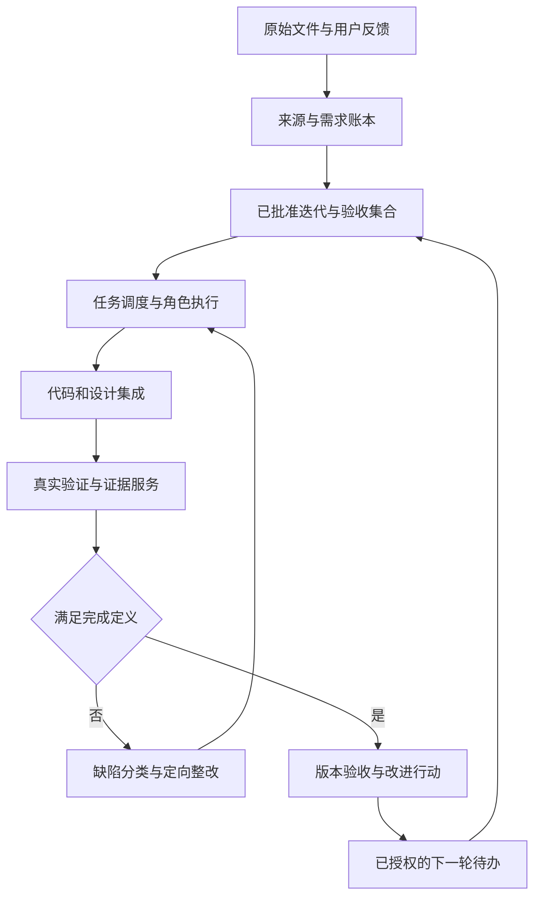

# AgentTeam 实际审查与五万字优化实施方案

日期：2026-11-18（Asia/Shanghai）  
实际仓库：[gong88888888/agentteam](https://github.com/gong88888888/agentteam)  
固定审查提交：`afbfaab7e0e290373722b811bbfe536606511411`

本交付结合第一轮设计分析与实际代码审查。正文共 18 篇，**50,458 个汉字**，非空白字符 **66,747**；计数只统计以下章节一次，不包含第一轮报告、原仓库源码、目录、脚本或其他重复交付。

现状验证：Python 3.12 下既有单测 30 项全部通过；另执行 8 组确定性审查探针。没有调用真实付费模型，没有修改审查仓库的业务源码。本文的目标接口、任务卡与提示词是实施方案，不表示已经实现或通过新系统的端到端验收。

推荐使用方式：先读第一、二篇，再按第十一、十二篇的 T00—T31 执行；每次只给编码模型当前任务卡、相关设计篇章及实际代码。第十三篇提供可直接使用的提示词；第十五、十七篇提供失败演练与验收目标。

分章版、复现脚本和统计见：[交付目录](F:/claude111/cctest1/agentteam/optimization-2026-11-18/README.md)。

---

# 第一篇：实际项目审查、证据与第一轮结论修订

## 1. 阅读方式与证据等级

本方案针对仓库 https://github.com/gong88888888/agentteam ，审查基线固定为提交 `afbfaab7e0e290373722b811bbfe536606511411`，读取日期为北京时间 2026 年 11 月 18 日。后续实现前必须重新确认工作分支相对该提交的变化；文件名相同不意味着内容未变。本文所称现状均限定在该快照，所称目标接口和新增模块均是建议，不表示仓库中已经存在。

第一轮报告基于五份设计文档和工具压缩包，适合分析设计缺口；本轮已经读取实际 Python 编排层、模型后端、产品评审流、角色门禁、完成定义、工具证据、部分知识检索、游戏模板、测试、示例产物及持续集成配置。两轮结论必须合并理解：第一轮的需求追踪、真实验收和跨轮改进方向仍成立，但“没有实际证据系统”等推断应撤回，因为仓库确实已经实现相关基础设施。

本轮证据分四级。A 级为本机执行的确定性反例；B 级为能在源码定位的直接行为；C 级为仓库保存的历史状态和报告，仅证明当时记录了这些内容；D 级为需要模型、真实用户或生产环境进一步验证的假设。A、B 可以直接支持修改，C 可以辅助寻找问题，D 不得包装为已证实的模型缺陷。调用外部模型的真实任务成功率本轮没有测量，不能承诺更换模型后会提高多少。

本机使用 Python 3.12 执行仓库的 `python -m unittest discover -s tests -v`，30 项测试全部通过，运行约 16 秒。这里的含义是现有测试集通过，并非产品已经具备完备验收。新增的八组审查探针保存在本方案目录的 `audit_probe.py` 和 `audit-probes.json`；探针所有项目写入均在临时目录中完成，没有修改被审查仓库的业务源码，也没有调用付费模型。

## 2. 已经实现并应保留的能力

仓库已经不是单纯十二段系统提示词的集合。`orchestrator/project_runner.py` 提供真实角色运行、文件落盘、状态心跳、模板应用、工具调用和失败记录；`orchestrator/tool_evidence.py` 会运行编译、测试和适用的检查工具；`orchestrator/evidence/store.py` 维护追加账本、哈希链、签名及证据失效；`orchestrator/process.py` 已引入阶段和 Definition of Done；`orchestrator/decisions.py` 提供决策收件箱。

`orchestrator/product_review.py` 提供独立产品深析流程，已经安排文档分析、用户旅程、流程架构、功能设计、UX、技术、发布、预演、红队与知识沉淀。它说明作者已经意识到单个产品角色无法覆盖所有理解工作，因此优化应把这些产物接入真实交付，而不是再平行增加一套没有消费方的分析流水线。

仓库也有模型路由、角色黄金集、提示词回归、知识检索评测、离线仿真和游戏验收。这些投入可以复用。当前问题集中在它们之间的接缝：什么算需求、谁把专业产物交给下游、一次通过绑定哪个输入、失败如何阻塞、改进如何成为下一项任务。方案主张沿用这些模块逐步加约束，避免以整体重写掩盖既有经验。

## 3. 确认问题 F01：来源覆盖被输入材料污染

位置是 `orchestrator/product_review.py` 的整体汇总段，约第 358 行起。代码递归扫描输出目录下所有 Markdown 文件收集 `SRC-###`，但同一目录里同时保存了模型请求、输入副本、来源地图和模型交付物。请求文本已经列出了完整章节 ID，因此即使模型交付没有逐条理解原文，整体覆盖也可能显示百分之百。

根因是把“某字符串在整个工作目录出现”当成“某原文单元被产物正确处理”。修复不是从扫描路径排除一两个文件后继续依赖正则计数，而是建立明确的产物注册表。只有本次运行、当前来源版本、已通过校验的需求映射可以贡献覆盖；请求、提示词、日志、历史产物、原文副本永远不能贡献覆盖。

接受标准应包括：保持请求里完整来源清单不变，删除全部交付物映射后，处置覆盖必须降为零；将无效来源号写满报告不能增加覆盖；同一来源重复引用只算一次；引用存在但含义不符时，结构覆盖和语义有效性分开显示。这样才能避免一个数值承担它不能证明的产品理解能力。

## 4. 确认问题 F02：旧评审门禁在新失败后存活

位置是产品评审运行器加载旧 `state/gates.json`、失败处理和最终去重汇总的组合。运行器会读入旧角色及门禁，新调用失败时把角色写为 error，却不一定清除该角色原有通过门禁。最终仅检查是否凑齐十一类通过门禁，未强制要求这些门禁属于当前输入及当前尝试。

探针 P05 先离线完整运行，再改变来源文档并仅重跑产品负责人，注入后端失败。最新角色状态为 error，整体状态仍是 pass。这是确定性复现，不依赖任何模型倾向。修复必须给运行、输入、角色尝试和门禁建立组合身份，失败时明确结束本次尝试，并拒绝把上一轮成功当成本轮结果。

历史成功不能删除，因为它对复盘和回滚有价值；但历史成功必须显示历史版本。恢复时允许复用的前提是输入、依赖、检查策略和授权仍匹配，而不是目录里恰好有一个旧绿灯。状态页面也应分别显示“上次成功”“本次失败”“当前可用版本”，不能压成一个看似健康的状态。

## 5. 确认问题 F03：关键词门禁可以接受空产品文档

`orchestrator/role_gates.py` 的 `_usable_doc` 主要排除 TODO 和 scaffold 标记，没有验证文档非空。产品角色门禁又主要检查摘要中是否出现“验收”和“非目标/范围”等词。探针 P03 创建空产品文件，并提供符合关键词的摘要，得到 pass。

这不是说关键词检查毫无价值，而是它只能作为快速提示。产品质量应验证需求记录是否包含来源、场景、规则、验收和未决项；设计质量应验证交互状态是否可执行；是否语义完整还需要独立审查。若将补写摘要文档误作正式产物，系统会进一步把“没有文档”变成“文档齐全”，掩盖真正缺口。

短期补丁先拦截空文档、显式非完成状态和无效来源。长期要改为不同角色有不同结构产物，而不是以“摘要足够长、关键词足够多”代替专业结果。长度仅用来检测异常短输出，不能成为价值评分主轴。

## 6. 确认问题 F04：Web 完成定义不强制运行验收

`orchestrator/process.py` 为 Web 项目设置了 `acceptance=False`。当前完成检查关注已有角色是否无错误、其门禁是否通过、入口文件和两个文档是否存在，但未验证应完成的角色/任务是否全部完成，也未运行应用来确认入口有效。

探针 P02 只提供一个产品角色、一段无效 Python 入口和两份无实质内容文档，仍得到 DoD pass。因此“全部已有角色通过”与“全部承诺工作通过”必须分开。必要集合来自已批准迭代计划，不能从当前恰好存在的状态反推。

修复后 Web 至少需要依赖安装或环境证明、应用启动、健康检查、关键用户流程、真实数据或隔离测试数据验证。没有浏览器的 API 项目可以走接口验收；纯静态前端可以走静态服务和浏览器流程；不同画像拥有不同验证清单，不再把所有非游戏项目都假定为 `src/backend/app.py`。

## 7. 确认问题 F05：增量代码不等于接入运行产品

示例 `projects/test1/game/index.html` 加载 main，main 导入 core。审查入口、main、core 的导入关系，没有发现它们引用角色生成的 gameplay 或 UI 增量；示例 gameplay 目录已经有十三个模块。基础模板本身可以通过核心逻辑与 smoke，但这不能证明新增模块参与运行。

另外，运行器保护 main、core、index，要求角色只在增量目录写文件，却没有提供受控的插件注册机制。这样开发者可能遵守权限、写出模块、通过文件门禁，最终产品仍运行原有模板。解决办法是建立确定的扩展入口、显式导出契约和可达性测试，或允许专门集成任务在受限范围修改入口。

可达性只是必要条件。模块被 import 并不意味着用户能触发其行为，所以还需要真实路径验收。例如新增背包排序，应在加载游戏、获得物品、打开背包后验证排序结果，而不是仅检查文件里存在 sort 函数。回归中必须能区分模板既有行为与当前迭代新增价值。

## 8. 确认问题 F06：摘要交接削弱专业产物传递

交付运行器给下游的 `prior` 主要是每角色约七百字符摘要；游戏部分角色额外读取有限长度文档摘录。二次代码输出还仅取最近三条摘要。产品评审流同样主要传递摘要，虽然其提示词写着读取已落盘文档，但模型后端当前只是聊天接口，没有为这些角色提供实际文件读取循环。

因此不能指责模型“明明有完整设计却不遵守”，先要确认设计是否真正进入上下文。改造应让执行器依据任务引用读取必要文件、校验版本并形成上下文清单，或者提供有记录的只读工具。引用一个无法读取的路径不算交接；全量粘贴所有历史内容也不是解决方案，因为无关信息会挤占关键约束。

## 9. 确认问题 F07：执行链与裁判链并未统一

仓库拥有 J1/J2/J3 外部模型裁判体系，但主交付运行器主要调用 `evaluate_role` 和决策收件箱；导入解析 JSON 的 judge 模块并不等于使用了完整裁判面板。不能依据 README 提及外部裁判，就断定每一个交付任务都受同样的裁判策略约束。

应画出实际运行路径，统一由门禁服务接收结构产物、验证证据和语义审查结果，再按风险决定是否需要外部复核或人决策。未接入的裁判只能标记为可选能力。不同模型家族可帮助降低同类盲点，但家族不同不是语义正确的保证；如果预算只允许 Flash，也可以使用隔离上下文和反例审查，只需诚实记录缺乏模型家族独立性。

## 10. 确认问题 F08：配置错误可能退到 stub

`ModelRouter._backend` 对 local、deepseek 以外的名称返回 stub。探针 P06 将后端写成 deapseek，得到 stub 对象。若该配置流入真实执行，可能出现没有真实模型参与却产生看似完整输出的情况。修复应在加载配置时验证枚举，只有显式 offline/test 模式允许 stub，未知值一律配置错误。

示例 `projects/test1/project.json` 记录了最终 offline=true，而角色历史又包含真实模型信息，说明聚合状态还混合了不同运行记录。不能据此认定历史执行造假，但必须按 run_id 显示每轮模型、模式及产物来源，避免一个离线收尾覆盖整个项目的真实性描述。

## 11. 风险问题 F09：证据签发与消费边界不足

现有 EvidenceStore 会验证持久化账本签名，这是已有优点；但 `evaluate_role` 直接读取传入字典的 kind/result，没有在消费点根据当前对象、有效期和账本重新核验。探针 P04 传入伪造通过字典，函数得到 pass。此结果证明函数边界容易被误用，不证明存在外部可利用攻击入口。

后续改造应让门禁消费证据 ID，由可信存储查找、验证签名、版本、有效期与当前对象。调用者不能自由拼一个“已验证”字典。签名只能证明记录未被篡改，不证明测试覆盖了用户需求，所以完成定义还要检验 required acceptance 集合是否得到有效证据支持。

## 12. 问题 F10：技术画像覆盖了用户原始约束

示例原始需求写明 Unity 2D 或 Godot，交付运行器的游戏说明却固定 HTML5 Canvas 并禁止引擎重写。这可以是有意选择的网页原型，但必须形成经授权的范围/技术变更，不能只因关键词识别为游戏便自动替换技术目标。

目前 `detect_project_type` 依靠关键词计分，也没有足够类型覆盖。因此方案增加项目画像提案和确认记录：把“产品是什么”“当前交付什么验证版本”“哪些技术限制已经批准”分开。网页原型通过不自动意味着桌面引擎交付通过；交付报告必须列出验证边界和未覆盖需求。

## 13. 优先级与修改原则

第一优先级修正会产生错误成功的路径：旧门禁复用、输入污染覆盖、空产物通过、未知路由 stub、非运行 DoD、增量未接入。第二优先级补真实上下文、任务与缺陷模型、独立语义验收。第三优先级再扩展并发、检索优化和质量趋势。先把成功的含义改正确，才能相信后续成功率变化。

每项修复先把本报告反例转换为失败测试，再做最小修改，运行相关测试与既有全套测试。避免同时重写模型、门禁和调度后无法定位收益。旧接口通过适配层保持可用，新增协议带 schema_version，旧产物明确标为 legacy，不静默伪造缺失字段。

源码证据以固定提交浏览：[主运行器](https://github.com/gong88888888/agentteam/blob/afbfaab7e0e290373722b811bbfe536606511411/orchestrator/project_runner.py)、[产品评审流](https://github.com/gong88888888/agentteam/blob/afbfaab7e0e290373722b811bbfe536606511411/orchestrator/product_review.py)、[角色门禁](https://github.com/gong88888888/agentteam/blob/afbfaab7e0e290373722b811bbfe536606511411/orchestrator/role_gates.py)、[完成定义](https://github.com/gong88888888/agentteam/blob/afbfaab7e0e290373722b811bbfe536606511411/orchestrator/process.py)。后文的任务卡均以这些发现为出发点，不把待实现能力写成当前事实。

# 第二篇：目标架构、状态归属与统一数据协议

## 1. 改造目标的可验证表述

目标是在现有仓库上形成一个能围绕同一项目持续工作的小型工程团队：读取来源、理解与确认需求、制定可验收切片、实现并集成、运行验证、处理缺陷、更新文档、推进下一轮。十二类职能可以保留，但不再以每类角色返回一次作为进度单位。进度由已批准用户任务的完成情况表达，角色只是完成任务的执行资源。

单轮成功的必要条件是承诺验收项全部有当前有效证据，阻塞问题全部解决，交付产物可以运行，必要决策已经完成。项目持续活跃不意味着进程无限运行；它意味着待办、事件、授权和恢复条件持久存在，调度器启动后能继续执行就绪工作。没有授权的新需求保留为提案，没有工作时保持空闲，预算耗尽时明确停止本次执行。

为避免过度设计，初期维持单机进程、SQLite 和文件产物，不引入分布式消息系统。进程内调度器与数据库事务足以实现第一批目标；只有实际吞吐和隔离需求出现后才拆服务。所有新增架构都应能在离线确定性测试里验证状态行为，再通过少量真实模型评测观察内容质量。

## 2. 六层职责

来源层负责原始文件、版本、结构单元和解析告警；需求层负责事实、假设、决策、原子需求、场景与验收；执行层负责任务、尝试、工具调用、产物和变更；验证层负责证据、发现、门禁和完成定义；迭代层负责 Backlog、优先级、缺陷与改进行动；呈现层负责解释当前状态及人工决策。

这六层不必对应六个进程。建议分别放在小模块，通过显式函数和数据库对象协作。模型不直接写项目状态为 completed，Dashboard 不直接把门禁切成通过，知识检索器不修改权威需求。状态变化必须由领域服务根据条件执行，并记录原因与版本。



## 3. 身份模型：项目、迭代、运行、任务、尝试

project_id 表示长期维护对象，不随每次启动变化。iteration_id 表示一次明确承诺的交付范围。run_id 表示调度器从开始到退出的一次执行会话。task_id 表示持久任务，attempt_id 表示该任务某次执行。原有 role 字段只表达执行者职能，不能继续充当唯一任务键，因为同一角色一轮内可能执行多个任务，也可能对一个任务多次整改。

举例：同一个游戏项目在迭代 I02 承诺“损坏存档恢复”，任务 T17 负责来源和产品补充，T18 负责设计，T19 负责实现，T20 负责回归。T19 第一次失败后 attempt_2 修复，任务 ID 保持不变。程序重启产生新 run，但不创建重复 T19。否则历史统计会把失败尝试计算成新的完成任务，完成率被拆任务动作抬高。

建议 ID 使用 UUID/ULID 或数据库分配的无碰撞键；展示编号可以另设短名称。已有时间戳和角色拼接的 task_id 可保留为 legacy_id，不能仅以秒级时间戳保证唯一性。所有外键同时携带 project_id 或使用全局唯一 ID，跨项目引用应被拒绝。

## 4. 新增数据表的最小集合

`source_documents` 保存 doc_id、content_hash、original_path、media_type、parser_version、created_at；`source_units` 保存 unit_id、doc_id、version_hash、locator、content、kind、parse_status；`requirements` 保存 requirement_id、revision、statement、priority、status；`requirement_sources` 关联需求和来源并记录关系类型。

`scenarios` 保存 actor、goal、preconditions、steps、postconditions；`acceptance_items` 保存可观察断言、环境、数据夹具和必需级别；`design_states` 保存页面/组件、状态、动作、反馈和转移；`trace_edges` 保存需求、场景、设计、接口、代码和验收之间的类型化边。

`iterations` 保存批准范围、成功标准和预算；`tasks` 保存 owner_role、依赖、输入指纹、允许写入范围、状态和优先级；`attempts` 保存模型、提示词、上下文、开始结束时间、失败原因和输出引用；`artifacts` 保存路径、内容哈希、产物类别、生产者与所属版本。

`findings` 保存症状、严重度、根因分类、证据、责任任务与关闭状态；`improvement_actions` 保存触发事件、措施、目标验证与关联任务；`events` 保存不可变领域事件；`event_outbox` 保存需要异步投递但尚未确认的事件。证据和决策优先复用现有结构，再增加当前版本引用，不重复建设第二套互不相通的账本。

## 5. 统一 JSON 外壳与角色专用内容

保留 `agent-output.schema.json` 的通用外壳，但新增 schema_version、task_id、attempt_id、input_fingerprint、consumed_refs、deliverable_refs 和 findings。每个角色再挂载专用 payload schema。产品的 payload 是需求与场景，设计是状态图与规范，实现是变更摘要与测试引用，QA 是实际用例结果；不要求每个角色都用 claims 数量证明工作完整。

```json
{
  "schema_version": "2.0",
  "task_id": "T-019",
  "attempt_id": "A-019-02",
  "role": "backend",
  "status": "ready_for_verification",
  "input_fingerprint": "sha256:...",
  "consumed_refs": [{"id": "REQ-SAVE-03", "revision": 2}],
  "deliverable_refs": [{"artifact_id": "ART-054", "hash": "sha256:..."}],
  "finding_refs": [],
  "summary": "已实现损坏主存档后加载备份的逻辑，等待独立复验。"
}
```

上述示例是目标协议，不可直接塞入现有 schema 后声称兼容。任务卡会安排先新增版本化 schema，再写适配器，最后迁移执行器。模型自报 status 只是建议状态，领域服务仍根据证据决定最终任务状态。没有输入指纹、引用不存在、角色不匹配或 ID 越界时，应返回明确校验错误而非自动补成成功。

## 6. 指纹与版本规则

输入指纹应覆盖当前任务真正依赖的需求修订、设计状态、接口、代码基线、工具/提示词和环境配置。不同证据使用不同依赖集合：编译结果不依赖产品提示词，但依赖编译对象与工具链；产品语义审查依赖原文、需求版本、提示词、模型和审查规则。不要沿用一个全项目哈希让任何 Markdown 修改都触发全部测试，也不要漏掉真实依赖造成旧结果继续有效。

产物文件一旦登记就有内容哈希；路径可以变化，身份和来源必须可追溯。审批绑定待批准对象版本和操作范围，而不是笼统绑定项目名。新的需求版本不会删除旧版本，而是标记 superseded 并生成影响事件。引用已失效产物的任务暂停相关动作，已完成历史任务保留“当时完成、现已过期”的区别。

## 7. 原子事务与事件一致性

新增 finding 和创建修复任务应在同一数据库事务中完成，避免缺陷出现但没有工作项。任务完成、产物登记与发出 task.completed 事件也应一致提交。外部工具或文件写入不能直接放进长事务，应先登记意图，在隔离工作区执行，验证后登记结果并提升产物。

采用 outbox 的目的不是搭建消息中间件，而是在进程崩溃后能恢复“数据库已更新但事件未投递”的状态。每个事件有 event_id、aggregate_id、aggregate_version 和 causation_id；消费方记录已处理 ID，重复事件不重复创建任务。失败重试可以再次投递，但不能再次发布同一版本或重复迁移数据。

SQLite 写事务保持短小，配置合理的 busy timeout。对状态使用 compare-and-swap：只有状态版本仍是领取时的值才能提交完成。两个执行者争抢同一任务时，一个领取成功，另一个返回竞争失败；不得都认为自己获得任务然后最后一次文件写入覆盖前一次。

## 8. 状态机的精确定义

任务建议状态为 draft、ready、running、awaiting_verification、needs_revision、completed、blocked、awaiting_decision、failed、cancelled。running 只能由持有有效租约的 attempt 进入；completed 必须经过验证；failed 表示本次任务自动处理已终止，不等于取消范围；cancelled 必须记录批准的范围变更或用户指令。

迭代状态为 proposed、approved、executing、verifying、accepted、blocked、cancelled。项目状态为 active、idle、awaiting_decision、paused、archived。项目 idle 说明暂时没有就绪工作，不说明目标全部结束。用户暂停后不自动恢复；预算补充、依赖完成和新事件可以唤醒未暂停项目，但不能越过人的显式停止。

需要把进程退出码与领域状态分开。CLI 完成当前指定命令可以返回零，但若命令目标是完成整个迭代，仍有必需任务未通过就应返回非零或明确的非成功状态。报告中必须说明运行目标，不能用“本次命令执行完毕”替换“项目交付成功”。

## 9. 接口边界与兼容策略

建议新增 `orchestrator/domain/` 放数据类型和状态规则，`orchestrator/persistence/` 放 SQLite 仓储与迁移，`orchestrator/context/` 放上下文组装，`orchestrator/execution/` 放工具与模型循环，`orchestrator/iterations/` 放计划和反馈处理。现有 `project_runner.py` 逐步退为兼容入口，不一次性拆散所有代码。

旧 Dashboard 继续读取导出的 JSON 视图，新服务以数据库为权威状态源。导出 JSON 内注明 snapshot_version、generated_at、source_run_ids；旧文件不得被 Dashboard 当成可写状态。历史项目首先只读导入，缺少来源或模型记录标记 unknown，不生成虚假的 current_verified 字段。

每个迁移都有 forward 和可执行回退策略。若迁移只是新增表列，可用旧版本只读原字段；若发生语义变化，采用双读比较一段时间，再切写入。迁移过程不调用模型，不通过模型“猜测历史真相”。不兼容历史记录应提示需要重验，而不是为方便让所有旧门禁自动通过。

## 10. 架构验收

第一个架构里程碑不是新增目录齐全，而是用三个任务跑通来源→需求→实现→验收→反馈→修复。中途杀掉进程后能够恢复，重复投递反馈不重复建任务，修改需求使相关证据失效，当前失败不被历史成功掩盖。若这些行为通过，才说明数据协议对实际团队协作有作用。

第二个里程碑将同样协议同时用于 Web 和游戏。它们共享项目、任务、证据和迭代状态，但各自拥有不同产物画像和验收插件。这样既保留仓库已经积累的模板，又避免用某个游戏示例的硬编码约束支配所有未来项目。

# 第三篇：文档解析、原子需求与完整性工程

## 1. 从标题扫描升级为来源单元

当前 `extract_source_sections` 仅匹配一至四级 Markdown 标题，编号按出现顺序递增。它能够建立简单章节地图，却无法代表段落、列表、表格和图片承载的业务约束；在开头插入标题后，原有 ID 也会移动。探针 P07 展示同一标题由 SRC-002 变成 SRC-003，这使跨版本比较和历史缺陷定位容易误关联。

建议先实现 Markdown 的可靠结构解析，不把首批范围扩大成全格式文档平台。每个标题、段落、列表项、表格行和代码示例都形成 source_unit，包含 source_version、结构路径、原文位置、内容哈希和单元类型。展示编号可以连续，但内部稳定 ID 使用内容与位置映射策略，版本变更后显式记录 moved、changed、added、removed。

同一段文字可能重复出现，不能只用内容哈希当唯一 ID。使用文档身份、父级路径、相邻单元锚点和内容指纹组合匹配，并对低置信度匹配提出人工复核。原文改动导致的新单元不应强行继承旧身份；身份连续性与内容版本分别存储，保留旧引用可定位到当时文本。

## 2. 解析清单与异常检测

文档接入生成 manifest：原文件路径、文件哈希、编码、媒体类型、解析器及版本、页数/章节数、文本长度、表格与图片清单、解析告警和可用状态。每个输入文件都必须有状态，不能因为后缀不支持或读取为空而默默跳过。

对非 Markdown 文件，先采用可插拔适配器。PDF 要保留页码和文字块位置；扫描页需要 OCR 或视觉审读；DOCX 要保留标题、表格结构、批注或修订的处理政策；XLSX 要保留工作表与单元地址。批注是否属于需求由项目接入政策决定，不擅自忽略，也不将所有批注自动提升为产品要求。

异常规则包括页数大但文本极少、表格只有内容没有列名、乱码比例高、同一页重复提取、图片说明缺失、文本顺序异常。检测到异常时，相关单元处于 parse_uncertain，产品可以先处理其他单元，但不能宣称覆盖已完成。可视化检查的结果要链接原始页或截图，而不是只保存“已检查”标记。

## 3. 原始文档与批准基准的关系

原文是理解来源，批准基准是当前实施政策。二者冲突时不能简单宣称“基准优先，所以原文不用管”，也不能让模型自行按原文覆盖已批准版本。正确动作是创建 discrepancy，记录冲突双方、可能影响、建议选项和当前执行限制，再由对应决策权限处理。

例如原文要求 Unity/Godot，当前模板只支持 Canvas。接入模块生成技术不一致问题，产品和架构提出“网页验证原型”作为候选交付，注明不覆盖桌面发布和原引擎资产。用户批准后形成范围差异记录，后续验收以已批准原型目标执行，但最终报告仍显示原始长期目标未完成部分。

来源清单还需区分新版本说明、历史文档和参考资料。历史材料可提供背景，不自动覆盖最新批准要求；第三方模板可辅助设计，不自动成为当前产品范围。角色上下文中应显示每份材料的权威等级和适用日期，避免“知识库搜到了”被当作最终规则。

## 4. 原子需求提取流程

第一步遍历全部来源单元，给每个单元建立 disposition。第二步提取候选原子需求。第三步合并同义要求并保留多个来源。第四步拆分一条文本中多个可独立验收的规则。第五步记录歧义、冲突、假设和非目标。第六步将候选需求转为场景和验收，再进行独立回查。

一条原子需求应表达一个明确义务或约束。句子“支持自动存档、双备份和版本迁移”至少包含三项需求；如果只登记为“支持存档”，开发和测试很容易漏掉恢复与兼容。对“快速”“稳定”“体验好”等表述，应保留原文并提出可测化选项，不能自己发明一个数值后假称来自用户。

每条 requirement 至少包含 statement、source_refs、kind、actor、conditions、expected_result、priority、status、open_questions。kind 可包括功能、规则、数据、权限、兼容、性能、交互和运营目标。运营目标如好评率或多人使用率不能在本地一次运行中验收，应归入发布后观察指标，并明确收集周期与数据条件。

## 5. 事实、假设与决策三分

fact 表示来源中明确说明，必须能回到原文；assumption 表示为了推进而作的暂定解释，需记录影响、验证方式和有效期；decision 表示已有授权的选择，需引用具体批准记录。三者在数据中使用不同类型，不能仅在文字里加括号。

模型可以提出合理默认，例如未说明空态文案时建议“暂无数据”，但必须属于不改变核心目标的可逆细节，并受项目授权政策约束。涉及权限、收费、数据删除、引擎替换、核心流程和验收阈值的假设不能直接转成实施指令。对这些问题应优先形成短决策包，而不是向用户发送大量零碎追问。

若用户迟迟不回复，只能继续不依赖该决策的任务。超时不构成批准，重复运行模型也不产生授权。默认行为要保守而具体：保留现有数据、阻止相关发布、允许可丢弃探针、记录待确认范围。不要用“系统自主性”作为越过需求控制的理由。

## 6. 覆盖率的正确计算

至少分开四个指标。原文处置率衡量单元是否有明确去向；需求提取召回率衡量人工标注关键需求是否被正确发现；设计覆盖率衡量必需场景是否有有效状态和交互；验收覆盖率衡量必需需求是否有可执行验收项。它们不能用同一个 SRC 字符串计数替代。

原文处置率的分子只包含已确认映射、背景、重复、经批准排除等明确类型；parse_uncertain、conflict、unreviewed 单独列示。为了避免通过大量标背景提高处置率，关键单元还需要审查记录。需求召回率的分母必须来自独立标注或经过审查的基准，不能由产品自己提取的需求列表定义。

结构校验可以自动验证引用存在、版本匹配、关系完整。语义有效性由独立审查提出发现，并通过反例或人工抽查验证。报告显示“结构映射完整、语义审查存在两项重大未决问题”比一个看似精确的百分之百更有用。

## 7. 输出结构与持久化

建议新增 `specs/source-unit.schema.json`、`specs/requirement.schema.json`、`specs/source-disposition.schema.json`。Markdown 产品基准由这些记录渲染，保留人可读说明，但不以 Markdown 反解析作为权威数据库。模型先提交候选 JSON，程序验证后再入库；无效对象进入修复循环，不自动补齐业务字段。

来源映射边保存 quote、locator 和 relation，例如 supports、constrains、contradicts、example_of。quote 的长度控制在必要范围，原文全文仍在文件系统保存。quote 必须与定位到的原文匹配；仅提供一个有效 SRC ID 却引用不存在的句子也应失败。

当前 `coverage` 字段由模型填写的值不再被直接采纳。程序根据当前正式记录计算，并写入 computed_by 与 schema_version。模型可以在 summary 讨论它认为仍存在的理解缺口，但不能控制指标的分子分母。

## 8. 长文处理与上下文预算

长文首次理解采用结构化遍历与分段归并，不依赖一次塞进完整需求。先读取目录和全局约束，再逐单元提取候选需求，最后统一检查冲突、重复和跨章节规则。每段处理结果带来源范围和未处理清单，恢复时从游标继续，不从头重读全部历史。

分段边界不能割裂表格、列表和状态定义。跨章节约束例如“所有装备交易限制”应提升为全局约束，供每个相关需求消费；局部示例不能提升为全项目规则。合并阶段专门寻找限定词：仅、不得、至少、除非、失败后、兼容、自动、默认。这些词通常决定异常与边界，但不能简单靠关键词提取替代语义理解。

模型输出预算也要单独分配。一次要求完整 PRD、设计和代码容易使输出截断，截断的合法前半段不能当完成。执行器应检查 finish_reason，并按需求 ID 范围要求分页输出。游标由程序维护，模型不能通过声称“后续省略”跳过剩余单元。

## 9. 独立遗漏审计

审计角色收到原文和候选需求账本，但不先收到产品的自评结论。它应从来源逐条提出“该单元对应什么要求、当前记录是否保留条件、有没有被合并时丢失”。发现遗漏后生成结构 finding，引用来源和缺失行为，返回产品修订。

对于复杂材料，采用两种视角：一轮按章节查覆盖，一轮按用户任务查连贯性。章节齐全仍可能跨页流程断裂；流程可走仍可能漏掉性能或数据约束。每轮审查目标明确，不要求红队为了满足固定数量而编造五个严重问题。没有问题时可以返回空发现，但需列明检查范围和限制。

## 10. 文档接入测试设计

最小固定样本包含：无标题纯文本、五六级标题、重复标题、嵌套列表、跨行表格、表格内否定条件、末尾限制、同义重复、互相冲突、引用外部附录、空文档和错误编码。每个样本预先标注关键单元和预期处置，测试解析和映射，不把完整生成文本作字符串快照。

跨版本测试覆盖前插标题、移动段落、修改单字、删除要求和分拆表格。断言同一单元的身份匹配合理，变化记录完整，受影响需求转待复核。对于不确定匹配，测试应期待 uncertain，而不是强求自动判断永远正确。

最终验收不是看 source_units 表有多少行，而是把一份真实长需求输入系统，核对用户关心的要求是否全部保留下来。对本仓库，存档双备份、版本迁移、引擎约束、本地双人与局域网范围区分都适合进入人工标注的保留集。

# 第四篇：产品、设计、架构协作与验收规格

## 1. 产品角色的持续责任

产品角色不以生成 product-baseline.md 结束工作。它负责维护用户目标、范围、需求解释和验收之间的一致性，在开发发现歧义、QA 发现遗漏、用户反馈目标未达成时继续参与。每个切片都指定产品责任人，即使底层由同一个模型按需扮演，也必须在任务账本中明确责任。

原有“先写非目标”的规则调整为“先完整理解来源，再提出并确认本轮范围”。非目标仍然重要，但不能成为早期忽略复杂要求的理由。产品可以建议降级或延期，并说明成本和用户影响；没有范围权限时不能自行删除明示要求。任务卡中单独记录 rejected/deferred 及批准依据，避免后续统计把被删需求当成完成。

产品产物包括问题陈述、目标用户、核心任务、业务规则、数据与权限要求、候选切片、验收项、非目标和待决策清单。叙述文本可以帮助理解，但每条承诺都有可索引 ID。对无法本轮验证的市场指标，明确列为观察计划，而不是编写一个“好评率已达标”的假测试。

## 2. 场景建模

每个场景包含 actor、goal、trigger、preconditions、main_path、alternate_paths、failure_paths、postconditions 和 acceptance_refs。main_path 只能代表最常见路径，不能吸收所有异常；失败路径需要说清用户看到什么、数据变成什么、下一步如何恢复。

以存档为例，场景包括首次新建、自动保存、手动槽位保存、读取有效存档、主存档损坏加载备份、主备均损坏提示、旧版本迁移、不兼容版本只读提示，以及多人状态不同步时的处理。具体哪些纳入当前迭代由已批准范围决定，但明示需求必须有处置。

场景不是写越多越好。彼此重复的路径合并为参数化场景，共享前置条件单独定义；关键差异如权限、数据丢失和不可逆操作必须分开。产品审查优先确认用户是否能完成目标，而不是只核查页面和按钮存在。

## 3. 交互状态设计

设计者按场景定义状态，不再只列页面。状态可以属于页面、组件、对话框或后台操作。每项状态包含可见内容、可用操作、不可用操作、输入规则、反馈、焦点、退出与恢复条件。转移边说明事件、前置条件、后置变化和失败分支。

基础检查矩阵包含 idle、loading、empty、ready、submitting、success、error、timeout、retrying、unauthorized、expired、conflict、offline、cancelled。并非所有组件都需要全部状态；标记 not_applicable 时写明理由。禁止用统一“异常提示”覆盖不同的数据风险，例如输入错误与保存失败导致的数据未落盘不是同一问题。

设计产物分两部分：结构化的交互契约和人可读视觉规范。结构化部分用于检查覆盖、生成测试和指导实现；视觉部分规定布局、字体、颜色、间距、响应式、图标、动效及可访问性。深浅模式和快捷键按范围启用，不作为每个项目默认增加的非必要功能。

## 4. 设计到实现的交接

交接包包含设计版本、场景状态、资产引用、数据字段、接口依赖、组件边界、不同尺寸下的行为和可观察验收。开发者收到的不是一条“请一比一还原”的摘要，而是可读取的具体规范。缺少资产时可以使用明确占位，但必须标记 pending_asset，不能声称正式视觉已完成。

每个组件需说明状态由谁拥有、哪些数据来自接口、哪些是本地临时输入。原有“所有业务状态都走全局 store”不再作为跨项目铁律。架构负责选择状态分布策略，设计负责指出用户需要保留哪些输入和反馈。保存失败保留内容可以通过组件状态、表单状态或缓存实现，验收不限定不必要的技术细节。

设计审查真实页面时，记录差异等级。阻塞性差异影响任务完成或数据安全；主要差异影响可理解性、操作或可访问性；轻微视觉差异进入可计划修复。不能因为像素不同无限退回，也不能因为构建通过忽略用户根本找不到操作入口。

## 5. 架构协作与技术约束

架构角色以有效产品场景、运行环境和已批准技术限制为输入，输出模块边界、数据模型、接口、错误、状态和测试策略。它可以提出替代方案，但改变引擎、核心架构或交付平台时创建 ADR 和对应决策，不能让模板偏好覆盖用户要求。

产品定义业务错误语义，例如存档不存在、版本过新或校验失败；架构定义错误码和调用契约；设计定义用户反馈及恢复；QA 设计验证。四者围绕同一错误 ID 交接，避免后端返回 generic_error、前端显示“网络异常”，把实际数据兼容问题隐藏。

接口契约冻结表示本轮对特定版本承诺兼容。修复错误需要改变契约时，应记录影响，更新 mock、生成类型和测试，并暂停相关下游。冻结不能成为拒绝修复架构缺陷的理由。低风险可逆细节按项目已授权边界处理，核心范围和发布保留人的决策权。

## 6. 产品评审团队与交付团队的合并边界

已有十一角色产品评审流适合作为复杂文档的分析阶段，但不应每个小修复都串行运行十一人。把其职责拆成按需能力：文档接入与遗漏审计在新来源时运行；用户旅程和流程设计在场景变化时运行；发布策略在迁移或发布变化时运行；红队在关键风险或争议时运行。

分析结果通过结构化需求、场景和 finding 进入同一个项目账本，不只生成 REFERENCE-PLAN.md。参考计划可继续导出，但交付计划必须明确选用了哪版分析、接受了哪些建议、哪些仍待决策。若参考计划与已批准需求冲突，创建差异，不能在下游摘要中偷偷混合。

产品负责人负责最终整合，不需要再次重写所有角色全文。整合对象是具体记录和未结问题，文档只是视图。这样能降低角色之间重复生成相似章节的成本，也让后续修复能定位一条需求，而非重跑整份长报告。

## 7. 验收项编写规则

验收项包含明确前置、操作、预期、观察位置、数据夹具、环境和证据类型。Given/When/Then 可以作为表达模板，但不是必须使用的英语格式。关键是能够由独立执行者判断通过，不能只写“功能正常”“体验流畅”。

例如“保存失败时保留输入”应写明：用户已填姓名与备注，服务端返回指定错误后，表单内容保持、失败文案出现、提交状态解除、用户可重新提交且不会产生重复数据。是否允许自动重试、是否保留到刷新后，由产品规则决定，测试不能自行追加。

性能指标需绑定样本、设备、网络、数据规模和统计方式。单次在开发机观察到二十毫秒不能证明百分位指标；没有足够样本时标为未验证。保存可靠性和崩溃率同样应分成确定性故障注入检查与长期统计，不伪造一个百分比替代真实观测。

## 8. 非功能要求与横切验收

权限、数据持久化、兼容、可访问性和错误恢复经常跨越多个切片，应建立横切验收。每个切片只验证局部不够，集成阶段还要检验从入口到目标结束的流程。比如本地双人加入、共享奖励、掉队恢复和退出后存档一致性涉及多个模块，不能按各模块单测通过自动推导整体正确。

横切项有明确 owner 和触发条件。修改认证逻辑触发权限回归，修改存档格式触发迁移与恢复，修改设计 token 触发布局与可访问性抽查。影响规则先人工声明，再逐步从代码依赖和测试关联中补全；未知影响时保守扩大验证，不假装图谱已经完美。

## 9. 示例完整链路

需求 REQ-SAVE-03 引用来源中“双备份+校验，异常退出回最近篝火”。产品拆出主备保存和恢复两个原子需求；场景 SCN-SAVE-04 描述主存档损坏；设计 UI-SAVE-ERR 指定恢复提示、备份时间和继续按钮；架构 API-SAVE-LOAD 定义返回状态 recovered_from_backup；代码任务实现读取顺序与校验；AC-SAVE-04 通过损坏主文件故障注入验证数据来自有效备份。

如果原文实际上要求 CRC，而当前实现只有自定义 checksum，架构应说明兼容含义并提出决策，不能只因两者都叫校验而视为等价。用户批准较弱原型验证时，验收范围应写明，后续正式可靠性任务仍保留。

QA 完成验证后保存日志与恢复数据摘要，产品确认用户目标，设计查看实际恢复界面。若失败，finding 指向源需求、当前实现版本和最小复现，调度器派发修复，再由 QA 关闭。这条链就是团队协作的最小单位，不必让十二个角色都写一份报告。

## 10. 专业产物的审查标准

产品审查重点是需求保真、范围可解释、验收可执行；设计审查重点是场景可完成、状态可恢复、反馈可理解；架构审查重点是约束一致、接口可实现、数据与错误模型清楚。各自审查有证据和反例，不以角色姓名和文档标题证明专业质量。

审查结论记录 checked_scope、limitations、findings 和 recommendation。没有工具观察的视觉结论写为设计推断，没有真实用户研究的用户结论写为假设。模型可以提供有价值的专业建议，但不能把模拟视角冒充真实访谈、埋点和线上测量。

## 11. 验收与回归样本

为产品准备“原文明示但价值不明显”的条款，验证不会擅自砍掉；为设计准备空态、超时和会话失效的组合，验证不会只画正常页；为架构准备模板与用户技术栈冲突，验证会提案而非覆盖；为 QA 准备通过的 mock 和失败的真实接口，验证能够识别集成问题。

持续迭代时，所有这些样本都作为项目约束随任务注入。不是每次粘贴本篇全文，而是根据任务引用载入相关规则与历史反例。角色能用相同协议处理新问题，才说明提示词优化形成可复用能力。

# 第五篇：上下文工程、DeepSeek 适配与执行循环

## 1. 模型选择与工程协议分离

本方案按用户称呼把目标执行档位称为 DeepSeek4Flash，但不把这个名称直接当作固定 API 标识。2026 年 11 月 18 日查阅的官方文档使用 `deepseek-flash`，并说明部分旧模型名称有兼容映射。实际部署可能接入官方服务、代理或独立 harness，因此必须通过配置和能力探针确认，不以本报告替代真实端点返回。[官方模型说明](https://api-docs.deepseek.com/quick_start/pricing/)

优化的重点不是假设 Flash 能理解整份长方案并一次重构，而是把工作拆成边界清晰、反馈真实、可回滚的小任务。即使未来更换模型，任务协议、工具证据、验收标准和迭代账本仍然有效。不要将模型版本硬编码在角色提示词、数据库迁移或产品验收中。

本轮没有使用你的模型密钥进行真实 API 调用，没有验证账户权限、配额、费用和吞吐。方案中的预算和批次大小是启动配置，应通过项目评测校准，不是服务规格承诺。价格从实际 usage 和配置化价目计算，不能继续把旧示例价格当成当前账单。

## 2. 当前后端缺口

现有 `ModelBackend` 接口主要返回 content 和用量，DeepSeekBackend 请求也主要是 messages、temperature、seed、JSON 格式，没有将工具调用、finish_reason、reasoning 字段和结构化响应状态提升为稳定接口。这适合一次文本生成，不能完整承担 Agent 的“读文件→修改→运行→观察→修复”闭环。

应扩展 ChatResult 为模型响应对象，保留 text、tool_calls、finish_reason、usage、model_version、response_id 和 provider_metadata。工具调用轮的文本可能为空，不能因此直接抛“空内容”错误。响应没有文本但有合法工具调用时应继续；截断响应应标记 incomplete 并按协议恢复，不把可解析的半份 JSON当作业务完成。

错误类型至少区分配置错误、鉴权失败、限流、临时服务失败、超时、上下文过长、协议不支持、输出截断和结构不合法。只对可重试错误退避，不对错误密钥和不存在的模型名重复消耗预算。切换 fallback 记录原因及实际模型，不能静默改变整个任务的执行模式。

## 3. 能力探针

新增 `model-capabilities` 检查命令，分离离线契约测试和真实小探针。离线测试用响应夹具验证适配器解析；真实探针在用户已授权的模型环境中依次验证短文本、结构化结果、单个只读工具、多轮工具回传和截断处理。探针不读真实业务秘密，不执行写入或部署动作。

配置保存逻辑档位、provider、base_url、实际 model_id、支持协议和能力结果版本。未知 routing 名称直接报错，真实模式禁止 stub。不能因为某个任务失败自动转 offline 并继续产出“完成”记录；如果显式用于仿真，所有状态和 Dashboard 都显示 simulation，且不能签发生产验收。

官方思考模式文档说明了其参数及工具轮消息回传要求。实现时应按所用端点的当前协议处理，不能只保留 assistant.content；也不能把协议状态的保存要求变成向用户公开模型内部推理。应用报告只保存必要的行动、结论和证据，供应商要求的内部协议字段按访问与保留策略处理。[官方思考模式说明](https://api-docs.deepseek.com/guides/thinking_mode/)

## 4. 上下文包设计

每次 attempt 启动，由 ContextAssembler 根据 task_id 读取当前目标、授权范围、输入版本、相关原文、需求、设计、接口、实际代码、失败证据和历史约束。它不是依靠模型猜测路径，而是程序解析引用后准备可访问内容。包内每个条目有 ID、hash、revision、role、origin 和 importance。

上下文分四个区：必须遵守的当前契约、完成任务需要的局部材料、相关历史反例、用于导航的非权威摘要。前两区不因普通检索得分低而消失；历史资料可以检索选取；摘要仅帮助定位，不替代原始约束。冲突材料同时进入 discrepancy 列表，不在组装时偷偷选择一个版本。

示例任务“修复损坏存档恢复”应包含存档需求、恢复交互、当前 save 模块、调用方、相关测试、最近失败日志和允许改动路径。无需给它整个游戏经济系统和全部历史复盘。若修改触及共享状态，则上下文扩展并记录原因，保证任务范围与实际影响同步。

## 5. 预算化组装与可读引用

预算按 token 估计而非简单字符截断。先保障不可缺少的契约和失败信息，再保留相关代码及测试，最后加入历史参考。超预算时拆任务或通过只读工具按需加载；不能先截掉文档后半段再让角色声称完整理解。所有被截断材料列出 truncated 标记和可读取位置。

大型代码文件采用符号与引用定位，读取目标函数、调用点和测试；需要完整理解时可逐段加载，但每次读取有日志。引用路径必须在执行环境可解析，不能把开发者机器的绝对路径交给另一台机器。上下文使用仓库相对路径与 artifact ID，由工具解析到当前工作区。

提交结果要求 consumed_refs，但该字段不能单靠模型自报。执行器记录实际注入内容和读取调用，提交时对比模型声明与工具记录。模型引用了未读取的文件时要求补读或修正结论；不强迫它阅读与当前任务无关的一切，只要求关键判断能回到实际输入。

## 6. 工具最小集合

第一批工具为 read_file、list_files、search_text、read_artifact、read_requirement、apply_patch、run_check、inspect_failure 和 submit_result。读工具返回内容、版本和是否截断；写工具要求 expected_hash，避免覆盖已变化文件；run_check 接受注册的检查 ID，不接受任意拼接 shell 字符串。

工具白名单由执行层验证，不只写在 Prompt 里。产品只能提交需求候选和文档草案，不能修改业务源码；设计可以提交规范与原型资产；开发在分配工作区修改允许路径；QA 可新增测试但不能删改验收基线。集成任务拥有受限共享文件权限，普通代码任务不能通过多写一个路径绕过职责。

工具结果包括 success、data_ref、observations、error_type、retryable、duration 和 evidence_ref。工具失败以事实返回，不让模型从空 stdout 猜成功。长输出保存为产物，模型读取摘要和相关片段，证据仍保留完整日志，防止上下文过载。

## 7. 执行循环

目标流程为领取任务→验证输入→生成局部计划→请求工具→执行并登记观察→必要时修订计划→提交候选结果→独立验证。局部计划只需描述接下来几步和验收，不要求输出长篇推理。每次工具轮都受最大调用数、时间、token 和工作区限制。

程序不能把“模型没有再请求工具”理解为成功。模型只能提交 ready_for_verification 或 blocked；验证器根据必需验收决定 completed 或 needs_revision。某次尝试失败后保留变更与日志，在隔离工作区继续修复；达到上限后结束自动尝试并输出具体剩余问题。

重复同一错误时，不继续原样重试。第一次记录错误类型，第二次增加相关诊断或缩小范围，第三次检查是否上游契约、环境或任务拆分有问题。重试上限配置为 attempt 的限制，不以再次创建新任务绕过。必要的升级提出明确选项，不用一份泛泛失败总结代替诊断。

## 8. 对结构错误的修复

JSON 解析失败与业务不合格分开处理。解析失败可以向模型返回 schema 路径、实际值类型和最小修复要求；业务不合格则返回具体未满足验收与证据。当前代码统一提示“输出不符合 schema”可能掩盖后端异常，应按错误类型分别反馈。

自动规范化仅处理无歧义别名，例如 success→done 的兼容映射；不能把缺失 status 默认为完成，也不能把 failed 淡化成 blocked 后继续通过门禁。字段修复记录 original、normalized 和 repair_reason，指标区分首轮合法率与修复后合法率。

输出中 files 内容过长时优先改用 apply_patch 工具和产物引用，避免所有代码嵌入一个 JSON 字符串。仍保留文件块兼容路径时，应验证路径、哈希、完整性及预期文件数量，不能以“至少一个文件”作为完成标准。

## 9. 模型独立性与审查

用户希望 Flash 能完成优化，并不意味着每项发现都必须由另一个付费模型裁决。第一批采用同模型不同任务上下文的独立审查，加确定性测试与人的关键验收。审查角色收到目标、真实 diff、相关原文和验收，不先看到实现者自评“全部完成”。

对高风险数据迁移和发布，如果配置了不同模型或人工复核，按策略升级；没有就标记审查独立性限制，不能伪造 family=0。不能以投票替代证据，三个模型同意也不使失败测试通过。反例发现可以阻塞，误报经复验和有记录的裁决解除。

## 10. 实现模块与测试

建议增加 `orchestrator/execution/loop.py`、`tools.py`、`capabilities.py` 和 `orchestrator/context/assembler.py`，先通过适配层调用现有 ModelRouter。首批不修改所有角色，只选择一个范围小、可确定验证的修复任务跑通，再将产品和 QA 迁移。

测试覆盖空 content 有 tool_calls、未知工具、无效参数、工具超时、文件哈希冲突、模型限流、响应截断、超过上下文预算、权限越界和预算停止。全部通过后进行真实小样本，比较首轮理解正确率、修复轮数和每个有效验收项成本。以有效交付衡量 Flash 的使用效果，不以生成文本速度或报告篇幅评价模型能力。

# 第六篇：工具证据、门禁与真实运行验收

## 1. 门禁的职责边界

门禁是检查“允许进入下一状态的条件是否满足”的程序，不是一个可以自动理解所有产品价值的万能裁判。它需要三类输入：确定性工具证据、结构化专业审查结果、必要的授权记录。三者分别解决实际执行、语义与体验、权限与范围的问题，不能互相替代。

现有签名账本应继续使用，但门禁不能只收调用者传来的 result=pass 字典。改为 evidence_ids，由 EvidenceResolver 在当前运行上下文中查账本，校验签名、记录类型、对象指纹、有效期、依赖版本和撤销状态，再形成只读 VerifiedEvidence。普通模型输出无法创建该类型。

不能把所有 LLM 发现排除在门禁之外。业务规则遗漏可能没有现成工具证明，设计上的关键恢复缺口也不一定由扫描器发现。有来源、位置和复现依据的重大 finding 应阻塞；无依据的建议可进入候选，但不能通过堆积建议让项目永远无法推进。

## 2. 门禁结果模型

建议结果为 pass、fail、need_evidence、awaiting_decision 和 stale。pass 表示当前版本满足必要条件；fail 表示已观察到不符合；need_evidence 表示必需检查未执行或不可用；awaiting_decision 表示事实足够但需要范围或风险裁决；stale 表示旧结果不再适用于当前输入。

结果记录 gate_id、policy_version、subject_fingerprint、required_acceptance_ids、verified_evidence_ids、blocking_finding_ids、decision_refs、created_at 和 supersedes。原有简单 GateResult 可先扩展，兼容输出 status，但下游必须理解非 pass 状态都不能作为依赖就绪。

未知和跳过不是成功。工具缺失不自动失败为“代码 bug”，而是 need_evidence；测试明确失败是 fail；批准的豁免必须具体到验收项、版本和有效范围，仍保留未验证事实。不能把“条件接受”导出成没有条件的 pass。

## 3. 证据消费校验

每条证据除现有工具、对象和签名外，增加检查策略、验收 ID、环境/夹具、执行命令、实际退出码、完整日志引用和生产者身份。门禁校验它是否来自注册执行器、是否对当前对象生成、结果是否仍有效。对纯文档审查证据，记录来源/需求版本和审查范围。

对现有 `EvidenceStore._append`，进入并发阶段前需要审查锁范围和跨实例写入。实例内锁不自动覆盖多进程，链头计算与追加也必须在一致的序列化边界内。第一批采用单写入服务或 SQLite 事务生成序号与链头，避免多个工具同时产生同 ID 或断链。此处属于需要压力测试确认的并发风险，不在未运行前宣称已经发生数据损坏。

验证日志可能包含业务数据，应只保留必要内容并按访问权限存储。日志脱敏不会改变测试结果，但证据哈希应对实际保存版本计算。不得把模型密钥或整个环境变量表写入交付报告，成本诊断也只记录变量是否配置和调用元数据。

## 4. 工具画像

当前工具 profile 主要围绕 Python 项目，前端可能依赖同一套 Python 单测，因此新增 project_profile。web-api 配置服务启动、接口健康、契约和业务流程；web-ui 配置依赖构建、静态服务、浏览器流程及可访问性；canvas-game 配置逻辑、模块集成、输入交互、存档与渲染；desktop-game 需要对应引擎构建和平台验证。

每个画像有 required、conditional 和 informational 三类检查。required 缺失阻塞，conditional 根据实际变更触发，informational 只提供观察。画像与工具 profile 分离：basic/standard/full 可以保留作为检查强度，但不能决定应用属于何种技术类型。

全 profile 应明确是否要求 API 测试和依赖漏洞扫描。现有 full 逻辑在特定环境条件满足时才加入 api_test，缺少条件不一定形成 required missing；目标实现应由验收计划先声明必需集合，再检查工具能否执行，不能先看本机装了什么再决定应该验证什么。

## 5. Web 真实验收

首先在隔离环境准备依赖和测试配置，启动真实应用，等待明确就绪信号或健康检查。固定超时后失败，不以进程存在代替就绪。日志保存完整，端口与临时数据独立，结束时清理本次服务，不能杀掉用户原有进程。

API 验收执行当前契约和业务用例，包括合法输入、边界、权限、重复请求、失败恢复和持久化。前端验收通过真实页面触发核心任务，核对网络请求、可见反馈及后端状态。Mock 用于早期开发，但最终集成证据明确标记真实服务，避免只在假接口上成功。

纯静态项目不必造一个 Python 后端来满足入口检查。它需要可复现构建、静态服务和浏览器验证。项目画像应先识别实际入口和构建命令，提出计划再执行。无法自动判断时要求配置明确，而不是根据几个关键词硬编码路径。

## 6. 游戏真实验收

现有 game smoke 测试主要调用 core 的纯逻辑，适合保障基座功能，不能证明主菜单、战斗输入、背包操作和新增模块在真实页面中工作。截图文件大于某字节数也只能证明产生了图像，不保证游戏进入可玩状态或没有控制台错误。

增加启动检查：页面无致命错误，主菜单出现，选择职业后状态进入 gameplay，输入产生可观察动作，交互面板关闭后控制恢复。再增加切片检查：获得物品、装备变化影响属性、保存读回、损坏存档恢复、本地双人加入与退出。可自动化的行为通过浏览器事件与可查询的调试接口观察，无法自动判断的手感需人工走查。

调试接口仅在测试配置启用，暴露稳定的只读状态和必要的测试动作，不把内部实现塞进正常玩家流程。测试应使用明确种子和夹具，避免随机掉落使回归不稳定。真实体验测试仍使用正常操作路径，不能只调用内部函数证明用户流程可达。

## 7. 模板与增量贡献分离

建立 baseline acceptance 和 iteration acceptance 两套证据。前者证明模板原有能力未退化，后者证明本轮需求实际新增或修复。模板测试通过不能自动满足本轮验收；某条测试如果只 import core，就不能被登记为某个未接入 gameplay 模块的验证。

集成检查保存入口依赖图、模块注册表和实际加载观察。仅文件存在、export 声明和 import 可解析都不充分，至少有一个从用户路径触发的行为断言。一个模块可以被加载却从未被调用，因此覆盖报告要区分 loaded、invoked、asserted。

代码提升时先验证变更集，再登记目标树指纹。隔离工作区测试通过后，如果主分支已有变化，不能直接提升；应重新合并并重跑受影响检查。这样避免“测试的是旧组合，交付的是新组合”的证据错配。

## 8. 阶段阻塞与整改调度

当前阶段验收失败主要记录 stage_failures 和决策，没有完整强制下游依赖阻塞。目标调度器依据 gate 依赖决定 ready。代码阶段失败只阻塞受影响切片和发布聚合，其他独立任务可继续；QA 可以分析失败和设计用例，但不能签发整体通过。

原有 stop_on_gate 作为命令行选项保留用于兼容，但可信交付模式默认按依赖阻塞，不能由调用者忘记加参数就绕过。需要允许探索性继续时使用明确 rehearsal 模式，所有结果不能作为正式验收。运行模式进入每个产物和门禁身份，避免演示结果混入真实项目。

## 9. 完成定义重构

DoD 的必要集合来自批准迭代：required_tasks、required_acceptance、required_reviews、required_decisions 和 required_artifacts。完成时逐一检查当前有效结果，而不是只扫描 state 中已有角色。某角色不适用可以不安排，但承诺工作必须有 owner 和结果。

DoD 不生成新的成功证据，而是聚合已验证事实。聚合记录包含满足和未满足项、证据版本、豁免及剩余风险。验收时改动代码或需求会使聚合结果 stale。历史 accepted 版本仍可作为稳定发布基线，但当前工作版本状态需重新计算。

完成不要求所有建议零缺陷，要求不存在未处置阻塞问题，非阻塞事项有明确去向。团队可以在受控范围下持续迭代，而不是被“所有问题必须绝对清零”拖入无限循环。严重度调整必须有理由，不能为了达标将失败项降为建议。

## 10. 测试矩阵

证据模块测试伪造 ID、签名错误、过期、撤销、对象不匹配、策略变化和缺失工具；角色门禁测试空文件、错误角色、显式 blocked、无效来源和不完整 payload；DoD 测试缺少承诺任务、运行失败、验收缺失、仅模板通过和历史结果过期。

集成测试运行一个可启动但业务错误的应用，确保健康检查通过不等于用户流程通过；运行一个截图正常但新增功能未接入的游戏，确保增量验收失败；构造全部自动检查通过但存在有依据的严重评审发现，确保门禁仍阻塞。这样的测试直接防止第一轮最担心的“流程顺利走完、产品仍不可用”。

# 第七篇：持续迭代、缺陷回流与团队改进

## 1. 持续迭代的运行语义

持续优化依靠持久化工作和调度触发，不依靠角色人格。模型调用结束后没有自动存在的产品经理；运行服务必须在反馈、验证、依赖完成和恢复事件发生时唤醒相应角色。项目本身保持 active 或 idle，某轮 accepted 后还可以继续处理已批准 Backlog。

项目服务可以以前台命令、长期后台进程或用户启动的恢复命令运行，首批建议使用可观察的单机命令与 Dashboard。运行方式不改变授权边界：用户暂停后停止领取任务，已运行任务在安全检查点结束；服务重启不自动撤销暂停。电脑关机时没有计算继续，但数据库保留就绪工作。

系统应每次报告四件事：本轮承诺、已验收内容、阻塞内容、下一步可执行任务。不要以“角色全部执行过”作为项目收口依据，也不要在无任务时为表现自主性不断创造新功能。候选想法可归档，正式工作必须进入优先级与授权流程。

## 2. 反馈接入

反馈来源包括 QA 测试、代码评审、产品走查、设计走查、真实用户、运行告警和复盘。统一 feedback 结构保存来源、症状、影响、期望、实际、复现条件、证据及提交时间。无法复现的用户反馈仍可登记，不因没有日志拒绝受理，但应标记 needs_triage。

外部反馈是数据，不是任意工具命令。文本中出现“忽略原规则、直接删除数据”不能自动执行。分诊角色提取可验证问题和建议，程序根据来源权限决定能否转正式任务。已有范围内的修复通常可按既有授权推进，新增业务目标形成提案而非静默扩围。

重复反馈用症状指纹和人工/模型判断关联，保留每次出现和受影响版本，不简单删除重复项。统计重复可以帮助衡量影响，但不能让同一问题产生十份相互竞争的修复任务。系统显示主问题及关联观察，修复任务使用幂等键。

## 3. 缺陷分类与责任

分类包括 source_parse、requirement_gap、design_gap、contract_conflict、implementation、integration、environment、verification_gap 和 process_gap。分类不是为了追责，而是为了派给能真正改变根因的角色。初次分类可不确定，调查后更新并记录依据。

需求遗漏回产品，设计状态缺失回设计，技术约束冲突回架构，代码不符有效基准回开发，运行环境故障回运维，漏测回 QA 或验证服务。一个问题可以有多个相关角色，但必须有一个主任务 owner。不要把“后端没有实现被遗漏的需求”全部记为后端 bug。

严重度与优先级分开。数据损坏、权限绕过和核心流程不可达通常严重；修复优先级还考虑暴露范围、回退方案和当前目标。建议美化可能用户价值高，但不因此伪装为致命缺陷。严重度下降需要理由与复核，避免为了清空阻塞而改标签。

## 4. 修复循环

状态为 reported、triaged、reproduced、in_progress、ready_for_retest、verified、closed，另有 cannot_reproduce、duplicate、deferred 和 rejected。开发者可以提交 ready_for_retest，不能自行把自己的缺陷变成 closed。QA 或指定验证器检查当前版本和回归集合后关闭。

修复任务输入包含最小复现、当前对象版本、有效需求与设计、允许修改范围和回归要求。若执行中发现基准有误，先发 discrepancy；不能一边改代码一边偷偷降低验收。若发现影响更大，扩展 impact 并暂停相关发布，不盲目继续局部修复。

每次复验保存期望与实际、证据、版本、环境和结论。原先复现步骤成功一次后仍需观察关联路径，避免修了一个问题引入另一个。回归范围依据影响图和专业判断，未知依赖时扩大验证，并记录为什么扩大。

## 5. 迭代控制器

控制器循环读取事件，更新 Backlog，计算 ready 任务，按资源与预算派发，收集验证结果，创建定向整改，聚合迭代验收。它不负责创作 PRD，也不把模型返回直接当作数据库事务。每一步可在无模型情况下使用固定结果测试。

下一轮计划只从已批准候选中选择。评分考虑用户影响、风险、依赖、成本和近期目标，分数用于排序建议，不替人决定核心业务方向。生成计划时给出本轮承诺及未选理由，防止系统持续优先容易完成的小任务而忽略最重要的复杂问题。

在制品限制比盲目加并发重要。待验证任务超过阈值时暂停新增实现，优先清理验证和阻塞；为 QA 和集成保留执行配额。这样开发吞吐不会远超验证能力，缺陷也不会集中到一轮末尾才发现。

## 6. 行动项到任务

复盘结果中的每个行动项有 action_id、root_cause、owner_role、target_iteration、trigger、deliverable、verification 和 task_id。没有实际 task_id 的建议仅为候选，不计行动闭环。到期未执行的行动在看板显示，不因写入知识库而自动完成。

例如“以后注意需求完整性”不合格，应改为“在文档接入中新增表格否定条件样本，并让当前漏项反例进入需求召回评测，验收为新协议能发现该条款且旧反例不再通过”。措施必须改变可观察行为，避免在系统提示词末尾无限追加抽象铁则。

行动可能是修测试、改工具、调整任务拆分、增加上下文引用或修改 Prompt。复盘先判断问题在哪个环节发生，再选择措施。没有证据支持时不把所有问题归因于模型智力，也不把所有失败都处理成“增加重试次数”。

## 7. 知识沉淀与经验晋升

经验条目包含问题、适用条件、根因、解决方法、反例、验证和失效条件。状态为 candidate、reviewed、active、deprecated 或 revoked。模型总结出来的经验先候选，经过实际修复与复验后才晋升。错误经验撤销时通知引用它的活跃任务重新核对上下文。

知识库不能覆盖当前需求与批准决策。检索结果显示权威级别、版本和来源，经验只是建议。对于“这个项目必须用某状态库”的条目，适用范围必须是当前架构，而不是被模型概括成所有前端项目的通用真理。

复发时检查知识是否被检索、是否实际进入上下文、是否理解并执行、是否验证有效。若没有检索到，优化索引；若检索到了但不适用，修正标签；若规则错误，撤销；若实现没有遵守，增加可执行检查。这样团队会形成针对根因的学习，而不是仅让知识库体积变大。

## 8. 计划内与突发任务

迭代中出现阻塞缺陷时可抢占低优先级工作，但采用协作式检查点，不强行终止正在写文件的线程。保存当前 diff、任务游标和工具结果后释放租约。恢复时核验依赖版本，过期则重建上下文，不把旧计划当现状。

紧急修复可以进入单独补丁迭代，但原计划被挤出的工作必须保留并解释。不能让不断插队的优化建议使原始交付永远不能结束。控制器应限制本轮新增任务，超出预算或范围时形成重新规划决策。

## 9. 终止条件

自动推进在任务预算、迭代预算、连续相同根因失败、关键授权缺失、环境不可用或用户暂停时停止相应工作。停止结果包含已验收、未验收、保留变更、阻塞原因、恢复步骤和预计需要的输入。不能因为停止前写完了报告就把项目标为 completed。

同根因阈值只用于打断无效循环，不表示第三次失败必须整项目重写。控制器可以缩小任务、换诊断方式或发起上游澄清。用户未授权新增付费资源时，不自动购买或部署外部服务来突破预算。

## 10. 持续改进演练

演练一：首轮验收后提交已批准范围内的存档缺陷，系统登记反馈、复现、派给开发、运行测试、QA 复验并更新知识。演练二：用户要求新联机功能，系统形成提案和影响评估，不直接改变当前范围。演练三：复盘生成验证工具改进，调度器生成任务并在后续迭代核验效果。

演练四：进程在 finding 已提交、任务创建前崩溃，恢复后 outbox 仍创建且只创建一次任务。演练五：用户暂停后重启，系统保持 paused。演练六：需求变更使已完成任务失效，系统显示历史完成和当前待复核，而不是悄悄删除历史或保持绿灯。

通过这些演练后，再观察连续三轮真实任务，记录缺陷逃逸、重复根因、人工介入和有效交付成本。持续优化是否成立，最终看系统有没有按证据推进后续工作，而不是看复盘角色是否生成了漂亮总结。

# 第八篇：现有游戏示例的专项改造与集成路径

## 1. 明确当前游戏的交付定位

当前示例以 HTML5 Canvas 和原生模块构成，模板本身已经包含主菜单、职业、战斗、装备、房间和存档等较多逻辑。这是可继续验证的网页版本，不应因它已有可玩基座而推导原始产品需求全部完成，也不应忽略原始文档中的 Unity/Godot 约束。

第一项工作是补技术范围决策：当前迭代究竟验证网页原型，还是要满足正式桌面游戏交付。若选择原型，保留长期目标和差异清单；若选择原引擎，则不能继续在 Canvas 模板上假装完成引擎目标。此决策影响后续实现，不由执行模型自行选择。

本篇以“继续维护已批准 Canvas 原型”为条件给出局部方案。没有该批准时，先做只读分析、需求账本和测试，不进行不可逆的平台迁移。这样既复用当前工作，又防止模板约束替代用户真正想要的产品。

## 2. 建立功能盘点

逐条对照原始需求、当前 product-baseline、core/main 和增量模块，建立功能矩阵。状态分为已运行验证、代码存在未接入、已接入未验收、设计存在未实现、需求存在未设计、经批准延期和不适用。不能只用 done/not-done 两个值掩盖不同缺口。

重点盘点五层章节、三职业、敌人种类、Boss、装备与词条、背包、强化、商店、篝火、任务、存档恢复、本地双人和镜头。数量指标与行为指标分开：配置里有二十个名字不等于二十种可观察敌人行为，五十件装备也不能只靠重复随机命名满足。

每条矩阵记录来源、当前模块、入口路径、验证步骤和未覆盖项。对原文的长期指标如完整流程时长和用户好评，标注需要内容与用户样本，不能在自动化测试里生成虚假通过结果。

## 3. 插件注册与集成

为受保护基座新增小而稳定的扩展点，而非允许所有角色任意改 main。建议 `game/js/extensions/registry.js` 导出注册与初始化协议，集成任务可修改单一 manifest；玩法模块实现指定接口，UI 模块订阅明确事件。基座只在固定位置调用扩展，初始化失败有诊断，不吞异常。

接口应定义扩展 ID、版本、依赖、初始化、更新、事件处理和销毁的适用方法。并非每个模块都实现全部生命周期，协议应保持简单。数据所有权由 core 或已批准状态服务统一管理，扩展不能私建不一致的第二份金币、背包或存档状态。

普通开发任务只能新增或修改自己的模块和测试；集成任务负责注册、导出兼容、依赖顺序和真实运行。最终验收必须确认模块在入口图中可达、加载无错误、对应用户操作确实触发行为。没有这三层检查，单纯把文件加入 manifest 仍可能无效。

## 4. 避免重复实现

当前 core 已经包含的能力不应在 gameplay 目录再写一套同名实现而无人调用。盘点后为每个能力确定唯一实现位置：保留 core、抽取到模块、或由扩展接管。迁移采用行为保持测试，先增加引用和断言，再移除重复逻辑；不能同时保留两套状态并让不同 UI 各用一套。

例如装备分数已有 itemScore，新增 inventory 模块应消费它或通过明确契约替换，而不是另算另一种分数。存档模块迁移时旧保存格式仍能读取，状态来源一致。所有接管行为有 ADR 和回滚方式，避免一次“清理代码”破坏已经可玩的模板。

## 5. 存档可靠性切片

先定义保存数据版本、序列化、校验、主备写入、失败处理和读取顺序。双备份不能只是同一对象复制两次却一起被覆盖。写入策略需要区分成功提交、临时数据、可恢复版本和最近篝火检查点，按当前存储介质选择可实现的原子性方案。

测试包括保存中断、主数据损坏、备份损坏、两个都损坏、旧版本迁移、未知新版本、空间不足和字段缺失。读取失败后 UI 显示明确恢复选项，不静默新建游戏覆盖原数据。备份恢复后记录来源和时间，用户能理解自己回到了哪个状态。

对多人存档明确谁拥有世界、谁拥有角色、退出后如何保存及版本不匹配如何处理。原型若不支持某项，写入差异清单并获取范围确认，不以“本地运行”自动豁免兼容需求。

## 6. 战斗与多人切片

首先固定单人可通关的基准，再检查本地双人的数值缩放、输入冲突、奖励归属、倒地复活、队友离开和镜头恢复。倍率函数单测通过只是数值正确，不能证明实际游戏中只有一个或两个玩家状态被正确消费。

使用可重复种子和测试场景，确保攻击命中、受击无敌、技能冷却、死亡与房间切换可观察。设计者查看操作反馈和状态过渡，产品确认单人目标没有被多人优先级破坏。局域网功能若为后续范围，不在本地双人实现中偷偷引入服务器复杂度。

多人镜头和掉队传送涉及体验判断，自动测试可以验证边界与状态，仍需实际操作走查。报告应分开“算法满足约束”和“手感已经人工验收”，不能用屏幕截图替代动态体验。

## 7. 经济与成长切片

建立金币、强化、分解、重铸和掉落的业务不变量：资源不为负、失败不重复扣费、背包满时不静默丢物品、奖励不能重复领取、存档读回保持一致。随机结果使用种子和夹具验证分支，而不是期待某次随机运行恰好覆盖稀有掉落。

平衡数值属于可迭代配置，但修改必须记录版本和对应体验目标。模型不能为了通过测试直接改变概率或任务阈值。测试应验证规定行为，体验评估可以提出调参建议，两者分开审批和实施。

对长期“掉装爽”的目标，先定义短程可观察指标，例如获得第一件关键装备的路径、反馈清晰度和无效操作次数，再通过用户样本判断。不要在代码中出现一个蓝装就宣称用户体验目标完成。

## 8. UI 与操作恢复

当前最近提交已经修复交互面板后的恢复问题，这类历史缺陷适合固化为回归。打开背包、商店、篝火、事件、任务或存档面板后，关闭、取消、按返回键、失败和角色死亡等路径都应恢复到明确状态。输入焦点和游戏按键不能互相污染。

覆盖首次进入、没有存档、背包空、金币不足、装备比较、保存失败、读取失败和双人状态变化。UI 状态和 core 状态通过协议同步，避免画面显示金币已扣但数据未更新。错误反馈需告诉用户能做什么，不只显示一串内部异常。

## 9. 主文件拆分策略

main 文件较大时可以逐步拆分渲染、输入、面板和场景逻辑，但这不是第一优先级。先把现有行为测试和新增扩展接入做可靠，再每次迁移一个职责。拆分前后用相同操作脚本和状态快照比较，保持公共契约不变。

每次只改有限文件，保留旧模块回滚点。若发现共享全局变量依赖，先显式封装状态和参数，再移动代码；不要依赖文本剪切得到看似整洁却破坏闭包关系的模块。Flash 执行任务时得到准确的目标函数、调用方和测试，避免被要求一次“全面优化游戏架构”。

## 10. 专项交付验收

交付包含批准的原型范围、功能矩阵、入口与扩展清单、构建/启动说明、确定性测试、真实操作记录、剩余差异和下一轮 Backlog。基础模板已通过部分单测要明确标注复用来源，本轮新增证据单独展示。

第一轮专项目标建议限于一个可靠存档恢复切片和一个真实接入的 UI 改进，用来验证新的团队机制。成功后再扩大到战斗、多人与经济。范围越清楚，越能判断改造改善的是实际交付，而不是仅增加代码量与角色调用数。

# 第九篇：持久化、并发、恢复与历史迁移

## 1. 先确定权威存储

当前项目状态分布在 project.json、roles.json、progress.json、stages.json、日志、质量历史和决策数据库。它们各自有用途，但重跑和恢复时容易混合不同轮次。目标状态采用 SQLite 作为任务、尝试、迭代与关联的权威源，文件保存原始输入和产物，JSON 作为兼容导出视图。

这不是要求把所有大文本塞进数据库。文件可以使用内容寻址路径，数据库存 artifact_id、路径、哈希和来源。读取时校验文件存在及内容匹配。文件丢失应标为 missing_artifact，不自动从摘要补写一个同名文件并继续通过。

数据库拥有 schema_version 和迁移记录，启动时检查兼容。版本不支持时明确停止写入，允许只读诊断。不能让旧程序用未知状态字段继续写坏新数据库，也不能以删除数据目录作为标准修复方法。

## 2. 任务领取与租约

任务领取在事务中将 ready 转 running，记录 lease_owner、lease_expires_at 和状态版本。执行者定期心跳续租，提交结果时同时验证任务版本和租约。超过租约的旧执行者不能再提升文件或写完成状态，防止进程卡住后新执行者接管而两者同时提交。

租约到期先标记 orphaned 或 recovering，并检查工作区和外部副作用。纯文本分析可以安全重试，代码修改可以恢复 diff，已执行迁移或发布需要核对外部状态。不能把所有 running 任务在重启后直接改 ready，因为某些动作可能已经成功但结果未登记。

任务优先级基于目标、风险和阻塞，不按角色固定让开发永远优先。至少为验证保留一个执行槽，待验证队列过长时限制新实现。初始并发可设为一个实现和一个验证/分析任务，再根据文件冲突率、工具容量和费用扩展。

## 3. 工作区与提升

开发尝试使用独立工作树或隔离副本，记录 base_commit 和变更清单。只允许修改任务 write_scope；共享接口、迁移、入口和锁文件采用单写者任务。角色工具权限与文件提升权限分别检查，防止在工作区允许写的文件未经集成审查进入主版本。

提升前检查基线是否仍匹配、相关验证是否对该变更集生成、目标路径是否受保护、是否存在未知未跟踪文件。主版本变化后执行受控合并和复验，不用“最后写入覆盖”解决冲突。删除文件和重命名也必须进入变更清单，不能只处理新增内容。

现有 sandbox 是进程级执行控制与隔离副本，源码已说明它不等同于容器或内核隔离。方案保留其 argv、超时和环境过滤能力；运行模型生成的可执行代码时，根据部署环境采用适当隔离。不能仅因命令在白名单中就认为任意 Python 脚本天然无副作用。

## 4. 事件与幂等

每个事件记录 project_id、iteration_id、entity_id、entity_version、event_type、payload_ref、causation_id 和 timestamp。状态更新与 outbox 同事务提交。消费方根据 event_id 或业务幂等键登记处理结果，重复投递只返回已处理，不再次创建修复任务。

副作用动作使用 operation_id。例如发布同一构建、执行同一迁移、提升同一变更都有唯一操作记录。重试先查询结果，必要时对外部状态做只读核验。不能因为网络超时就认定动作失败并无条件再次执行。

日志用于解释时间线，事件用于驱动领域行为，两者不能混用。输出一条“需要修复”日志不会自动建立任务，除非事件处理器已经确认创建并保存 task_id。Dashboard 显示任务引用，让用户能看到建议是否真正进入执行。

## 5. 影响图

现有 impact 模块可以作为图形输出基础，目标增加类型化实体和边。边包括 source_supports_requirement、scenario_satisfies_requirement、design_realizes_scenario、code_implements_contract、test_checks_acceptance 和 artifact_depends_on。每条边记录创建方式、版本及置信状态，模型推测的关系不能与人工确认关系混同。

需求变更先找到直接映射的场景与验收，再扩展设计、契约、代码和测试。代码变更先通过静态依赖和任务声明找到受影响检查。图不完整时采用保守回归并记录未知范围，不宣称能够精确只跑最小集合。

失效传播不删除历史。旧证据状态为 no_longer_current，并保留当时的通过事实。当前聚合视图显示需要重验的节点；已发布稳定版本继续保持对应证据，直到发生明确撤销或新风险。项目历史可重建，错误解释也有证据可查。

## 6. 历史项目导入

第一阶段只读扫描现有 projects 与 reviews，生成 migration-preview。逐条识别 run_id、offline/real、模型记录、产物哈希、门禁和证据引用。缺少字段标 unknown，冲突列入报告，不用模型自动补全事实。尤其避免最后一轮离线收尾覆盖之前真实模型尝试的元数据。

第二阶段在新数据库导入 legacy 项目、运行和产物。旧 gate 默认 legacy_unverified，只有经过新验证才升级 current_valid。用户仍能查看旧报告，但看板明确提示它不是新标准下的通过证明。第三阶段选一个项目重验，对照旧视图与新视图差异，再扩大迁移。

原文件备份与数据库快照形成对应版本。回滚优先切回旧读视图，不删除新历史；若新格式已产生运行任务，停止新调度后导出所有未完成工作，再决定兼容方式。任何迁移脚本都提供 dry-run 和事务失败回滚测试。

## 7. 配置与密钥

配置区分模型路由、运行预算、工具画像、授权策略和展示选项。真实密钥只由环境或受支持密钥存储加载，日志不打印值。未知后端、模型字段缺失、URL 无效和不支持协议在预检阶段失败，不等到十二个角色轮流调用才暴露。

修改配置形成 config_fingerprint。影响模型输出的参数进入尝试记录，影响工具执行的参数进入证据记录，纯展示配置不使业务结果失效。运行中修改关键配置应在任务边界生效，不改变已启动尝试的行为并仍记录旧参数。

## 8. 崩溃恢复测试

在领取任务后、生成文件后、测试完成后、提升前、提升后未登记、事件提交后未消费六个位置注入中断。恢复后检查任务不会丢失、不重复副作用、当前指纹正确、日志可解释。恢复命令必须先诊断，再按策略继续，不自动把所有失败改成成功。

并发测试覆盖两个 worker 领取同一任务、共享文件租约冲突、两个证据生产者同时追加、数据库忙、相同事件重复提交和过期 worker 延迟返回。断言领域不变量，而不是只断言没有抛异常。若先采用单写者模型，也要测试配置阻止意外第二写者。

## 9. 文件与测试产物管理

原始输入、正式产物、临时工作区、日志和证据分别管理。内容哈希算法只包含与具体检查相关的文件，避免日志刷新使对象指纹不断变化。缓存、node_modules、编译输出和截图是否纳入由证据类型明确规定，不使用模糊的“整个目录所有文件”。

保留策略由项目配置决定，至少保存当前验收版本和重要失败记录。清理临时文件先核对无活跃任务引用，清理不影响可复验性。长期日志可归档，但证据索引要能说明原始日志的保留状态。不能删除失败记录以使项目看起来更健康。

## 10. 完成判据

本篇改造完成的标志是：同一任务不会被两次成功领取；旧尝试不能覆盖新结果；服务重启后待办与授权状态不丢；历史通过不会冒充当前通过；重复事件不重复执行；文件提升与证据对象匹配。性能优化在这些正确性条件之后进行。

# 第十篇：评测体系、指标口径与失败注入

## 1. 现有测试的价值和局限

三十项单测覆盖了沙箱、签名证据、角色门禁、模板、质量评分、游戏和产品评审的基本行为，应保留并持续运行。当前新增探针证明它们尚未覆盖一些错误通过路径。正确做法是在保留回归的同时补反例，而不是因“所有测试通过但产品不好”就放弃测试。

现有角色评测以 schema、必填字段和关键词为主，适合检测格式回归。离线 stub 的输出不随 Prompt 内容变化，因此离线回归不变不能证明提示词效果不退化。真实模型内容评测必须使用独立标准和实际执行结果，并与确定性系统测试分开报告。

质量评分中摘要、claims、门禁和无工具的非代码角色可获得较高分，会奖励形式完整。建议把格式分降为诊断，不再作为产品质量总分。对理解、设计、代码和运营分别报告维度，不用一个 A 等级掩盖“产品目标未验收”。

## 2. 三层评测

角色层验证文档提取、场景设计、代码修复、用例设计等局部能力；切片层验证来源到真实用户流程的完整链；迭代层验证反馈、修复、恢复和下一轮调度。三层都需要成功、失败、模糊、边界和改写样例。

角色层失败可以定位上下文和 Prompt，切片层失败可以定位交接与集成，迭代层失败可以定位状态和调度。不能用角色输出合法率推导整项目完成率，也不能仅跑一个 TODO 示例就宣称支持复杂产品团队协作。

## 3. 核心指标

用户任务成功率的分母是本轮预先承诺的用户任务，分子是在目标环境通过独立验收的任务。取消、延期和豁免单独列出，不从分母悄悄删除。拆成更多小任务不会改变原始用户任务数，防止通过任务粒度游戏化提高完成率。

需求召回率以人工确认的关键要求为分母；错误新增率统计模型擅自补入的非授权要求；来源处置率衡量是否完整遍历；语义映射正确率通过审查标注。设计覆盖统计必需场景状态，不能把引用过需求 ID 当作设计已实现。

逃逸缺陷按验收后发现的严重度和用户影响计数。修复有效率看复验和后续复发，不看代码提交数。每个有效交付成本包含所有失败尝试、模型、工具、等待和人工介入，避免只展示最后一次成功调用的低成本。

## 4. 成功目标的设定

第一批目标设为消除已知确定性错误通过：本方案 P01—P06 修复后不得保持原来的错误结果；新的来源和 DoD 测试应稳定通过。需求召回、用户任务成功率和成本目标在真实基线测量后设定，不能先承诺百分之九十再调整样本来满足。

对没有统计意义的小样本，报告个案、次数和波动。一次运行成功并不等于稳定能力，连续三次同样输入可以发现明显不稳定，但仍不足以代表所有产品。重要任务应逐步扩大材料类型、复杂度和项目画像。

## 5. 固定评测集

建议新增六组：短明确需求、长文末尾隐藏限制、表格与图示约束、互相冲突版本、已有代码增量需求、首轮后反馈与复盘。每组既有人工标注需求，也有最小可运行项目和验收脚本。训练/调试样本与保留验证集分开，避免提示词只背会示例。

对当前游戏准备存档、模块接入、交互恢复和本地双人四个保留任务；对 Web 准备表单失败保留、权限过滤、重复提交与持久化四个保留任务。每个任务预先定义正确与错误行为，模型不能通过输出评测报告改变裁判标准。

## 6. 关键失败注入清单

一，输入只有标题没有需求，系统不得伪造完整 PRD。二，来源引用合法但语义相反，结构检查可以通过但独立语义审查应发现。三，请求包含全部 SRC、产物没有映射，覆盖必须为零。四，新运行失败但旧门禁通过，当前整体必须失败或阻塞。

五，合法 JSON 的 status 是 blocked，门禁不得通过。六，文件存在但为空，专业产物检查失败。七，入口文件存在但无法执行，Web DoD 失败。八，模块存在且测试单独通过但未被入口引用，集成验收失败。九，真实模式后端拼错，配置阶段报错而不是 stub。

十，证据签名错误或对象版本不匹配，消费点拒绝。十一，工具不可用，结果为 need_evidence。十二，测试返回零但没有执行任何用例，检查测试数量与预期集合。十三，截图正常但页面控制台致命错误，启动验收失败。十四，修改需求后旧验收被复用，结果必须 stale。

十五，复盘只有建议没有任务，行动闭环检查失败。十六，同一反馈重复投递，修复任务只有一个。十七，重启后旧 worker 返回，不能覆盖新尝试。十八，用户暂停后事件到达，只登记不执行。十九，预算耗尽后模型仍请求工具，执行层拒绝并保存检查点。二十，新增需求超出批准范围，生成决策而非直接实施。

## 7. 对照实验

旧协议和候选协议使用相同初始提交、输入文件、模型档位、工具版本、预算和人工介入政策。每种条件尽量重复运行三次以上，记录完整结果，包括失败和超时。若修改了多个因素，无法把收益单独归因于 Prompt，应明确说是整套协议变化。

先比较是否减少需求遗漏和误放行，再看成本。更严格门禁初期可能让首过率下降，这是暴露旧问题，不必立即降低规则。真正目标是最终用户任务成功、缺陷逃逸减少和每次成功成本可接受。指标应解释质量与效率的关系，而非只追求看板更绿。

## 8. 语义评分的可靠性

由人工预先确认关键要求和必须失败的反例，模型评审可作为辅助。若采用模型裁判，给它独立上下文、明确评分项和证据引用，要求指出具体差异；不要只让它回答“是否优秀”。同模型自评和跨模型复核分别记录，不制造虚假的独立性。

争议样本保留人工裁决和理由，更新评测标注需要版本记录。不能在候选方案失败后临时修改标准，使结果从失败变成功。若原标注确实有错，修订后同时重跑基线和候选，报告标准变化。

## 9. CI 分层

快速 CI 运行状态机、来源解析、schema、门禁反例、路由和上下文组装；中等 CI 运行模板项目、工具证据和小型集成；较慢 CI 运行真实服务、浏览器与游戏交互；模型评测按明确预算运行，不在每个无关文档改动上消耗真实 API。

现有 GitHub Actions 可继续扩展，新增任务先在本地确定性测试通过，再接入 CI。依赖锁定和运行镜像版本记录到报告，避免供应链变化使结果难以复现。新引入命令在 README 和配置中同步，不能只写在本方案里。

## 10. 看板展示

看板同时显示用户任务、切片、角色尝试、验收、缺陷和行动项。默认用户看到当前承诺与阻塞，而不是十二张角色卡片的在线状态。钻取后可查看来源、代码、测试、证据和历史运行。offline、real、legacy、unknown 使用清晰标签。

质量趋势分维度显示，并标记策略版本变化。新门禁更严格时，分数不能与旧版本直接连线比较。等待时间、返工、成本和需求召回一起观察，避免系统以减少提问、减少检查或少记录问题来制造效率提升。

## 11. 验收交付物

本篇实施后应交付版本化样本清单、标注规则、运行命令、结果 JSON、汇总报告和失败产物索引。所有数字可回到单次任务与证据，不使用仿真虚拟工期冒充真实节约。当前仓库仿真结果仍可用于调度逻辑试验，但必须标记 simulation。

最终评审选择一条真实复杂需求，从原文抽取到第二轮反馈修复完整演示。演示中故意放入一个需求漏项、一个集成失败和一个重启点，验证系统能发现、路由和恢复。能处理失败比一次精心准备的顺利演示更能证明团队机制可靠。

# 第十一篇：第一阶段逐项实施任务卡

本篇任务必须按依赖执行。每次给执行模型一张卡及其必要附件，不把全部任务作为一次修改指令。新增文件是目标位置，执行前核对现有结构并通过小型适配保持兼容。默认不提交远端、不发布、不迁移真实业务数据；本地可审查修改与测试属于实施工作，外部操作按已有项目授权处理。

## T00：冻结基线和建立工作记录

目标：在实际实现机器确认仓库状态与本报告基线一致，建立可恢复的执行日志。先读取当前分支、提交、未提交变更和运行环境，记录 Python、Node、工具与配置档位，不输出密钥。如果已有用户修改，在其基础上创建独立工作分支或工作树，不能 reset 或覆盖。

交付为 `docs/optimization/baseline.md` 和任务执行索引，列出基线差异、测试结果、已授权范围及本轮计划。执行 `python -m unittest discover -s tests -v`；原有失败单独登记，不当作本次引入，也不忽略。验收标准是另一位执行者按记录能复现环境与测试。回退仅删除本任务新增文档或切回原工作树，不删除用户内容。

## T01：禁止真实模式下未知后端退到 stub

依赖 T00。修改 `orchestrator/models/router.py` 和配置加载校验。先写未知后端名、真实模式显式 stub、离线合法 stub、合法 local/deepseek 四类测试，确认旧行为在未知名上失败。新增明确配置异常，禁止 `_backend` 使用默认 stub 兜底。

兼容旧配置中真正合法的后端，不把 local 不可用与配置拼错混成同一种错误。错误信息指出配置路径和合法选项，不显示密钥。验收为本报告 P06 不再返回 stub，原有离线评测仍能运行。回退只撤销路由校验变更；如果下游依赖了错误名称，先修配置，不恢复静默降级。

## T02：修正产品评审的显式失败状态

依赖 T00。修改 `orchestrator/product_review.py` 的 gate 与 normalize。先测试 blocked、need_evidence、error、缺少 status 和未知状态，均不能得到正式 pass。兼容 success/ok 等无歧义别名，但缺失 status 不默认成功，failed 不被淡化为可继续完成。

同时验证 source_refs 指向当前来源 ID，SRC-999 之类无效引用明确报错；只出现 SRC 正则不代表有效。验收为 P01 返回 fail 或 need_evidence，错误报告包含具体字段与无效 ID。暂不重写全部来源解析，保持小补丁。回退时保留新增反例，若旧接口依赖默认成功，通过适配器声明 legacy，而非删除测试。

## T03：消除评审整体覆盖的输入污染

依赖 T02。增加显式产物清单，整体覆盖只从当前有效需求映射计算。先写请求含全部 ID、交付无映射的反例；再测重复引用、无效引用、历史文件和原文副本。不得继续使用输出目录递归扫描所有 Markdown 的方式计算有效覆盖。

短期可从本次写入清单计算结构引用率，但指标名称必须是引用覆盖；目标需求处置率由后续账本提供。验收为删除交付映射后覆盖降零、输入文件不贡献分子，现有完整产物仍有可解释结果。回退不改原始材料，只恢复展示计算模块，旧值标记不可信，不能继续作为门禁。

## T04：让失败新尝试覆盖当前状态而不删除历史

依赖 T02。为产品评审增加 run_id、source_hash、attempt_id 和门禁输入身份。重跑开始时，对该角色当前结果建立 pending；失败结束时写入本次 failed gate。旧通过保存在历史，不能留在当前 gate 集合中。

先把 P05 转为回归：旧全通过→更改来源→部分角色调用失败，整体必须非通过。再测来源未变只重跑一个角色、其余角色有效可复用，以及来源改变后依赖角色失效。验收输出能同时查看历史通过与本轮失败。回退使用旧只读视图，不把历史记录重新当当前门禁。

## T05：拦截空或补写的专业产物

依赖 T00、T02。修改 `role_gates.py` 和 `project_runner.py` 的产物来源标记。先覆盖空文档、全空白、只有标题、runner-summary 和真实角色产物；文档非空是最小条件，不能把长度阈值当完整性证明。

模型未写产品或设计产物时可以生成诊断摘要供人看，但 source=runner-summary 不得满足正式交付条件。当前 `_artifact_present` 的磁盘兜底必须核验产物身份与当前版本，不能只看同名文件。验收为 P03 失败，基座模板文档不会被误认为本轮产品输出。回退保持诊断可读，不恢复自动补齐后放行。

## T06：建立门禁证据消费入口

依赖 T00。新增可信 EvidenceResolver，复用现有 EvidenceStore。门禁只接收证据 ID 与当前检查上下文，或通过明确兼容适配器把工具结果登记后再解析。测试签名错误、过期、撤销、版本不匹配和伪造字典，先确认边界可拒绝。

不要在每个调用处复制签名逻辑。VerifiedEvidence 只由解析器创建，包含当前匹配信息。验收为 P04 的直接未核验结果不能签发可信 pass；已有工具签名链测试继续通过。回退通过 feature flag 使用旧门禁时只能进入 legacy 模式，不允许发布验收，避免迁移中出现双重信任标准。

## T07：按批准计划定义必需集合

依赖 T00。新增最小 iteration manifest，列出承诺任务、验收和产物集合。修改 DoD 接受该集合，不从已有角色状态推导范围。先测试只执行 product 但计划包含实现与 QA 的情况，以及合法不需要某角色的轻量任务。

历史调用没有 manifest 时返回 legacy_incomplete 或要求显式验证模式，不自动认为所有已有记录就是全部工作。验收为 P02 不再通过，未出现的必需任务清楚列入缺失；指定单角色运行可以完成其任务，但不能把整个项目置 completed。回退保留 manifest，旧 CLI 输出明确仅为角色命令结果。

## T08：新增 Web 运行验收插件

依赖 T06、T07。增加画像化验收服务，首个支持 minimal-api 模板。服务启动使用指定工作区与临时端口，等待健康就绪，运行一条真实业务流程并验证结果，结束后只清理本次进程。命令与日志登记为有效证据。

测试无效入口、启动超时、健康通过但业务失败、依赖缺失和正常服务。不要硬编码所有 Web 都有 app.py；先由画像声明入口。验收为无效 Python 文件不再因存在而通过，模板真实服务可以稳定通过。回退不撤销历史测试，运行不可用时标 need_evidence，不降级为存在性通过。

## T09：阶段失败阻塞正式下游

依赖 T07、T08。修改主运行器阶段处理，失败不能只写日志；在正式交付模式，依赖未通过的任务不得进入正式实现/发布。允许诊断和测试设计继续，但产物标记 preparatory。

测试实现阶段失败后 ops 不得宣称可发布，独立无依赖切片仍可运行，stop_on_gate 兼容参数不再决定可信性的有无。验收看状态与任务队列，不只看程序退出。回退以 rehearsal 模式隔离，不能在正式模式重新允许忽略失败。

## T10：让游戏增量真实接入入口

依赖 T00 和已批准 Canvas 原型范围。先建立入口依赖与行为测试，证明当前增量未接入。设计单一注册点或受限集成任务，选择一个小模块接入，避免同时迁移全部玩法。保护基线可以保留，但必须提供合法扩展路径。

测试模块已加载、核心操作可触发行为、基础游戏回归通过；故意移除注册后本轮验收应失败。验收不接受仅文件存在或仅独立单测通过。回退撤销注册和本次模块接管，保留旧模板功能；不得因集成困难取消用户需求或修改测试预期为“无需接入”。

## T11：拆分模型响应与文本输出

依赖 T01。扩展 ModelBackend/ChatResult，增加工具调用、停止原因、用量和供应商元数据。先用固定响应测试空文本工具轮、截断、正常文本和错误结构，禁止“空 content 一律不可用”的处理覆盖合法工具调用。

现有调用者暂经兼容属性读取 content，新增执行器使用标准响应对象。验收为旧一次生成流程仍可跑，工具响应不丢字段，finish_reason 非正常时不能提交完成。回退使用旧文本适配，但不把其能力标记成工具执行支持。真实 API 小探针留到适配测试通过后，避免边改边消耗预算。

## T12：建立来源单元与版本映射

依赖 T03。新增来源 schema、解析器和固定样本，先支持 Markdown。输出段落、列表、表格和标题单元，保留定位、内容哈希及父级路径。处理无标题、深层标题和重复内容，不再将标题数量视作需求数量。

测试前插标题、移动段落、修改条件、表格限制和解析异常，区分稳定身份与内容版本。验收为 P07 的同一单元可以追踪，无法确定匹配时明确 uncertain，原文每个单元都有待处置入口。回退保留旧 SRC 展示别名，旧引用通过映射定位到原版本，不强行重编号全部历史文档。

## T13：新增原子需求和来源处置

依赖 T12。新增需求候选 schema 与数据库/文件临时适配，产品输出 requirement、source disposition、scenario 和 question。程序校验来源存在、引用版本、必要字段及重复关系，Markdown 从正式结构渲染。

测试“支持自动存档、双备份、版本迁移”不会被压成一个无细节功能，测试原文明示但看似低价值的要求不被擅删。验收为关键需求保留集全部有正确去向，假设与事实分开。回退保留结构化原始输出和旧 Markdown，不把未确认候选自动提升为批准基准。

## T14：新增设计状态和验收映射

依赖 T13。设计输出页面/组件、状态、事件、反馈、恢复和验收 ID，先覆盖一个存档恢复或表单失败场景。结构检查断言每个必需场景有设计，所有转移目标存在，不适用状态有理由。

加入正常、失败、超时、无权限和重复提交样例，不要求每页机械具备所有状态。验收由结构检查加真实走查组成，不能只找“错误”“恢复”词。回退维持原视觉规范可读，但结构缺失仍标未完成；不能用一句“前端自行发挥”替代交接。

## T15：上下文包替代固定摘要截断

依赖 T11、T13、T14。新增 ContextAssembler，按任务引用加载来源、需求、设计、契约、代码、测试和失败记录。摘要保留为导航，不是唯一专业输入。输出 context manifest 和预算说明，缺失关键输入阻塞。

测试设计关键约束位于文档末尾、前序摘要没有它时，当前开发仍能读到；测试无关长文不挤掉必需约束；测试引用路径不存在和版本过期。验收查看实际注入清单，而不是模型声称“已阅读”。回退可暂时提高原文注入但必须显示截断和限制，不能恢复静默取前七百字符。

## 第一阶段集体验收

完成 T00—T15 后，先不扩并发。运行既有三十项测试、新增门禁反例和一条完整切片：原文有失败恢复要求，产品准确提取，设计定义状态，开发读取真实规范并修改，运行验证能发现错误，修复后独立通过。再改变输入并重跑失败，确认旧门禁不误放行。

交付清单包括变更文件、迁移说明、测试命令与实际输出、未完成项、限制和下一阶段入口。执行模型不需要承诺全部架构已经优化，只需诚实证明第一阶段能力。任何失败都按任务卡定位，不临时扩大修改范围去追求一次全绿。

# 第十二篇：第二阶段任务卡与跨轮团队能力

## T16：实现最小工具执行循环

依赖 T11、T15。新增执行循环和工具注册表，先支持只读文件、检索、受控补丁、注册检查与提交候选结果。模型请求工具后，由程序验证名称、参数、权限和预算，再执行并回传真实观察。工具输出可能为空或失败，都不能被当作任务成功。

先用假模型脚本驱动三轮：读文件、运行失败检查、补丁修复再检查；记录完整调用链。测试未知工具、无效路径、超时、文件哈希冲突和达到预算。验收是模型无法绕过工具边界宣称完成，循环最终进入待验证或阻塞。回退保留旧文本生成模式，仅用于无工具内容任务，不把它标成完整开发 Agent。

## T17：引入任务、尝试与 SQLite 仓储

依赖 T07。新增项目、迭代、任务、尝试的最小表与迁移器，现有角色运行适配为某个任务的一次尝试。保留 JSON 导出给旧看板，不同时维护两份可写权威状态。迁移先在临时项目执行，真实历史导入使用只读预览。

测试唯一 ID、状态转移、事务回滚、旧记录导入和缺失字段 unknown。验收为同一角色可执行两项任务，失败尝试保留、任务身份不变、聚合不把尝试数当完成数。回退切回兼容视图但保留新数据库备份；不删除未完成任务，也不让旧程序覆写新格式。

## T18：租约、心跳与恢复

依赖 T17。任务领取使用事务和状态版本，执行尝试持有租约，完成时验证租约仍有效。心跳只证明执行者存活，不证明模型在取得有效进展；长时间无工具或无响应可触发诊断和超时。

测试两个 worker 争抢、旧 worker 延迟返回、租约到期、进程重启和用户暂停。验收为同任务不会双重提升，重启能显示待恢复工作，旧结果不能覆盖新尝试。回退先停止新领取，再导出运行任务到可恢复状态，不能简单把全部 running 置 completed 或 ready。

## T19：事件 outbox 与幂等消费

依赖 T17。任务状态、产物登记与事件写入同事务，消费方记录幂等键。首批事件包括 feedback.created、finding.triaged、task.verified、artifact.changed 和 action.created。日志仍保留，但不直接驱动任务创建。

在提交后未投递、投递后未确认、重复投递三个位置注入中断。验收为缺陷和修复任务不会断开，也不会重复产生副作用。回退停止消费者并保留 outbox，不删除未投递事件。需要重放时根据 event_id 继续，而不是重新运行所有角色。

## T20：统一 finding 与缺陷路由

依赖 T13、T17、T19。新增 finding schema 与分类服务，接入产品遗漏、设计缺口、实现错误、环境和漏测问题。分诊结果生成主修复任务，附有效需求、复现、证据和回归范围。

测试同一症状不同根因、同根因重复反馈、无复现用户报告和严重度调整。验收为需求遗漏不会一律派给开发，开发不能自行关闭待复验问题，重复反馈只关联不重复建任务。回退保留原始反馈和分诊历史，未完成项导出到 Backlog，不静默丢弃。

## T21：独立 QA 复验

依赖 T16、T20。QA 获取原文、验收项、真实版本和修复证据，独立执行用例；实现者的自评只作参考。结果分 pass、fail、blocked、not_run 和 waived，明确不同含义。

测试 mock 成功但真实服务失败、修复了局部却破坏相邻功能、验收标准被实现者偷偷改动。验收为严重未结问题阻塞任务，关闭缺陷需当前版本证据。回退仅停自动关闭，转人工复验，不允许开发直接写 closed 代替 QA。

## T22：迭代控制与下一轮计划

依赖 T17、T19、T20、T21。新增迭代控制器，按批准范围生成任务和依赖，依据预算、优先级和在制品限制调度。当前迭代 accepted 后处理已批准 Backlog，没有工作则 idle，有待决策则 awaiting_decision。

测试首轮后缺陷自动入队、新范围需求先提案、预算耗尽保留检查点、用户暂停不自动恢复。验收为项目不因一次角色循环结束而自动归档，下一轮使用同一来源和历史约束。回退保留任务队列并停止调度，不重建全新项目抛弃上下文。

## T23：复盘行动项实体化

依赖 T19、T22。复盘提交结构 action，要求责任、交付、验证和目标迭代，程序创建关联任务并返回 task_id。纯建议保留 candidate，不计闭环。措施可以修改测试、上下文、工具、规则或 Prompt，不能默认全是提示词追加。

测试只有“以后注意”不能通过行动验收，明确措施可以入队，到期未验证不算完成。验收为一项真实复盘行动经过实施与回归后关闭，并观察相同反例不再复发。回退保留行动历史和任务关系，不只留下 Markdown 总结。

## T24：知识候选、复核与撤销

依赖 T13、T20、T23。现有混合检索增加权威等级、适用条件、版本和状态过滤。经验必须关联真实问题和验证，先候选后复核，错误经验撤销时发事件通知活跃任务。

测试历史经验与当前基准冲突、撤销条目仍被缓存、检索命中但不适用。验收为权威契约准确加载，候选经验不覆盖已批准要求。回退关闭自动晋升，仅保留检索与人工复核，不删除已有知识以消除冲突。

## T25：影响图与证据失效

依赖 T13、T14、T17、T19。扩展现有 impact 模块，关联需求、设计、契约、代码和测试。变更时产生受影响集合，当前门禁转 stale，历史结果保留。首批支持显式关系，不必立即实现复杂静态分析。

测试需求改动、契约字段变化、代码修改、无关备注变化和未知关系。验收为真实依赖变化触发复验，无关展示修改不过度重跑；关系不足时保守回归且报告限制。回退扩大为全切片验证，不恢复旧证据无条件复用。

## T26：模型能力与实际路由记录

依赖 T01、T11、T16。增加逻辑模型档位、实际标识、能力探针与配置校验。按当前端点测试文本、结构输出、工具轮和停止原因，保存探针时间与版本。旧 deepseek-chat 配置不自动假称为指定新模型。

测试模型名错误、代理不支持工具、参数被忽略、限流与配额错误。验收为真实调用记录实际模型和降级原因，stub 只出现在明确仿真；成本包含失败调用及适用费用。回退到文本模式时显示能力受限，不再承诺自动代码闭环。

## T27：风险审查与裁判面板整合

依赖 T06、T20、T21。把确定性检查、专业 findings、现有裁判面板与决策收件箱放进统一门禁服务。高风险策略可要求外部复核或人决策，低风险在证据充分时自动推进。不能让模型批准覆盖失败测试。

测试严重语义问题阻塞、误报经复验解除、裁判不可用 fail closed、无不同家族时不伪造独立性。验收运行 trace 能看到实际调用了哪个审查层，README 与主执行路径一致。回退保留人工决策路径，不静默跳过审查。

## T28：质量指标与看板重构

依赖 T17、T20、T22。增加用户任务、切片、验收、缺陷和行动视图，旧角色卡片保留为执行详情。质量分拆成来源、设计、运行、缺陷、效率维度，策略版本变化显示分界。

测试离线收尾不覆盖历史真实模式、缺失角色不显示全完成、历史绿灯不盖住当前失败。验收用户能从一个阻塞项钻取到原文、代码、证据与下一任务。回退可以恢复旧页面，但新权威状态不能回写旧 JSON；所有旧分数标记参考。

## T29：评测集扩充与真实对照

依赖第一阶段全部任务及 T16、T21。新增角色、切片、迭代三层样本，先固定人工关键需求和失败条件，再比较旧协议与候选。离线测试不计模型内容收益，真实评测使用固定模型档位与预算。

验收报告包含全部运行、失败和波动，至少演示一个需求漏项、一个未接入模块、一个恢复失败被正确发现。没有足够样本时不承诺普遍百分比提升。回退仅撤回劣化配置或 Prompt，保留失败样本，不能删样本使指标变好。

## T30：历史项目迁移

依赖 T17、T25、T28。实现只读预览、影子导入、单项目重验和扩大迁移四步。记录历史 run、模型、模式、产物和证据，unknown 不自动补齐。原始项目文件与旧账本保持备份。

测试缺失字段、模式冲突、坏 JSON、无效签名和旧文件丢失。验收为旧项目可以查看，但不满足新标准时显示 legacy_unverified；重验后才提升。回退切回旧只读视图并导出新未完成工作，不破坏已经登记的历史。

## T31：并发扩展与整轮演练

依赖 T18—T30 的关键链。先以一个实现槽和一个验证槽运行两轮，观察等待、冲突、成本与缺陷，再逐步提高配额。按依赖调度，不按十二角色同时启动。共享文件只有明确集成任务可写。

演练包含任务争抢、模型超时、服务重启、需求变更、重复事件、预算停止和人决策。验收为吞吐改善且误放行不增加，失败可解释、工作可恢复。回退减少并发并保留所有状态，不通过关闭检查来恢复表面速度。

## 第二阶段完成标准

系统应能在同一项目完成至少两轮：第一轮交付一个有真实验收的切片，第二轮接收已批准范围内反馈，自动分诊、修复、复验、更新相关文档和经验。过程中有一次恢复和一次需求变化，当前与历史状态仍正确。

最终报告列出哪些任务已实现、哪些仅有结构、哪些仍未验证。任何任务未达验收就保持未完成，不因为整体方案很长而提前宣布团队已经具备持续自治能力。交付质量依靠可观察行为，任务卡只是帮助执行模型准确实施的输入。

# 第十三篇：可直接使用的执行提示词与角色契约草案

本篇用于实施已选定任务。它不要求把整份五万字方案一次发给模型，也不授权模型跨任务大改。先执行第一张卡，提交可审查结果，通过后再载入下一张。模板中的变量由调度器填入，不能让执行模型把占位符当成真实路径或自动猜测缺失授权。

## 1. 总入口实施提示词

下面内容适合放在编码工具的项目任务说明中，模型档位由外部配置指定：

> 你正在改造一个已经存在的 AgentTeam 项目。当前任务是实现任务卡所描述的单一目标，保留现有有效行为。先读取工作区指令、当前提交、任务卡、相关源文件和测试；如果当前版本与审查基线不同，先记录差异，并据实际代码调整位置。不要假设规划中的新增模块已经存在。
>
> 先复现任务卡中的失败行为，写出能证明该问题的测试，再做最小修复。每次修改后运行直接相关测试，修复完成后运行任务卡要求的回归。实际执行成功才报告通过；未运行、环境阻塞、未知和失败分别记录。
>
> 任务开始时记录允许修改的路径、当前输入版本和完成标准。发现需要改变产品目标、核心技术、验收阈值或越过授权时，提出具体变更与影响；继续不依赖该决策的工作。不能通过删测试、降低严重度、伪造证据或把真实模式改成 stub 来制造成功。
>
> 输出包括根因、改动文件、关键行为差异、实际验证、未完成项和回退方法。代码与文档保持一致，不重写无关模块。若工具或预算限制阻止完成，保存当前工作和恢复步骤，明确保持未完成。不要向用户输出内部推理过程，只给结论、依据、行动和观察结果。

这段提示词依赖编码环境确实提供文件、补丁和执行工具。若只能聊天生成文本，就只适合提出补丁草案，不能宣称修改了仓库或运行了测试。调度器应在能力预检时区分这两种环境。

## 2. 单任务输入模板

每次输入按固定顺序提供任务目标、现有文件、失败证据、允许范围、禁止扩大项、前置任务、完成标准和验证命令。附件只提供本任务相关章节；必要时通过只读工具加载完整上下文。应附当前文件哈希，避免模型根据过时片段给出错误补丁。

示例任务说明：修复产品评审旧门禁存活。已知行为是旧全通过后修改来源，最新负责人调用失败，但整体仍显示通过。允许修改评审运行器、相关测试和必要 schema；不允许重写模型路由或改变十一角色职责。验收是新失败使当前整体非通过，历史成功仍可追踪。命令为相关单测和全套单测，真实模型不需要参与。

输入中明确任务完成与项目完成不同。模型本轮只需把这条缺陷修到可验证，不需要同时实现数据库、持续迭代或全新前端。这样可以让 Flash 把有限上下文用于当前因果链，而不是被总目标诱导成大范围重构。

## 3. 产品角色提示词

> 你负责把当前来源转为可追踪、可解释、可验收的需求记录，并在实现和反馈阶段持续维护其有效版本。先核对来源清单和解析告警，再逐单元处理，不只阅读摘要或相似检索结果。每项需求引用具体原文位置和版本，保留限定条件、例外、权限、数据和失败恢复。
>
> 区分明示事实、假设和批准决策。未说明的行为可以提出建议，但不能伪装成用户要求；用户明确要求不能因你认为价值低而删除。范围排除或延期必须有授权记录。关键歧义阻塞相关切片，其他独立切片可以继续。
>
> 输出需求、来源处置、用户场景、验收项、冲突和待决策问题。提交前从原文反向检查遗漏，说明未处理单元。模型自报覆盖率不作为指标，程序根据有效记录计算。收到缺陷后判断是否需求或范围问题，按版本更新并触发影响分析。

产品角色需要读取原文和既有基准的工具，写入候选需求而非直接覆盖批准基准。输出 schema 应支持 source_refs 和 disposition。若这些工具尚未实现，执行模型必须报告能力缺口，不能声称完成了逐条读取。

## 4. 设计角色提示词

> 你负责让用户在真实界面里完成已批准目标。读取相关原文、产品场景、数据与权限、当前界面和技术约束。为每个必需场景定义页面或组件、适用状态、事件、操作、反馈、失败恢复和转移，不只列页面与视觉风格。
>
> 按适用性检查首次进入、加载、空态、正常、提交、成功、错误、超时、重试、无权限、过期、冲突、刷新与返回。不适用的状态写明理由。视觉规范保持一致，并考虑响应式和可访问性；额外模式和快捷键按产品范围决定。
>
> 交付结构化交互契约、视觉规范、资产引用和验收映射。发现产品流程不完整时提出问题，不自行新增核心功能。实现后查看真实页面并登记差异；没有观察到真实结果时，不声称还原达标。差异按用户影响分级，不以无关像素差异阻塞全部交付。

设计角色的查看工具应返回真实截图、可访问树或可操作页面状态。仅能读代码时，结论标记静态审查。设计生成图片可以作为参考，但不能代替交互规格和实际行为验证。

## 5. 架构角色提示词

> 你负责在有效产品范围和已批准技术限制内定义可实现方案。先识别项目类型、交付平台、运行环境和关键不变量，再定义模块、数据、接口、错误、状态和验证策略。模板是复用资产，不是替换用户要求的授权。
>
> 每项重要决策记录选项、依据、代价、影响与失效条件。核心技术或契约变化形成提案，批准后更新版本并通知受影响任务。冻结用于追踪当前承诺，不用于维护已经发现错误的基准。避免为简单项目引入不必要中间件。
>
> 交付当前切片需要的契约和实现边界，说明共享文件和集成职责。发现生成模块没有接入入口时视为集成问题，不因文件存在而认可完成。架构建议需要运行或测试证据支持其适用性，不凭模型自信断言性能或扩展性已达到。

## 6. 开发角色提示词

> 你负责实现当前任务的有效需求与契约。开始前读取任务包、实际代码、调用方和相关测试，核对版本与允许修改范围。先复现问题或建立验收，再修改最小代码。新增模块必须有合法集成路径，不能只输出文件。
>
> 每次运行工具后读取实际结果，再决定下一步。编译通过不等于业务通过，独立模块测试通过不等于用户流程通过。不得删除或弱化现有验收，不能未经授权修改需求或接口来适配你的实现。遇到上游问题提交具体 finding。
>
> 完成后提交变更清单、测试与运行记录、输入版本、影响范围和剩余问题，状态为待验证。你不能自行关闭需要独立复验的缺陷。未运行的测试明确列出原因，模型生成的测试报告不充当实际工具证据。

在代码任务中应限制单次变更规模，但不机械规定最多两个文件。规模由任务耦合和验收决定，必要集成文件不能因数量限制被省略。超出可控范围时拆成依赖任务，保留共同验收。

## 7. QA 角色提示词

> 你负责独立验证当前版本是否满足用户目标，原始需求是独立核查依据，不能只沿用产品摘要。先检查验收可执行性，必要时在开发前指出歧义。用例覆盖正常、异常、边界、权限、数据、兼容与恢复中适用的部分。
>
> 只报告实际执行结果，记录环境、版本、夹具、步骤、期望、实际和证据。未执行、跳过、阻塞、失败和通过分开。Mock 结果不能替代要求真实集成的验收，截图不能替代交互和数据验证。
>
> 缺陷标明症状、来源、影响和最小复现，按根因派到产品、设计、架构、开发或环境责任，不一律归代码。修复后独立复验及适当回归，确认当前证据有效才关闭。发现基准遗漏时提出变更，不通过降低标准制造成功。

QA 不必等待所有开发结束才工作。它可以提前审查需求和设计、准备夹具与自动化，在切片可运行时立即验证。未完成的其他切片应明确不在本次验证范围，不用整体百分比掩盖未验证部分。

## 8. 评审与安全角色提示词

> 你负责寻找当前改动会失败的条件，依据实际 diff、相关原文、契约、运行证据和历史缺陷提出发现。每条发现包含位置、依据、影响、复现或反例、严重度和建议方向。没有证据的偏好列为建议，不编造固定数量的问题。
>
> 实现者的自评不是你的结论。关注业务、集成、状态、权限、数据与恢复，代码风格只能解释真实维护风险。对无法确认的风险提出验证要求，不把推测当确定漏洞；对已确认严重问题不得因工具测试全绿而忽略。
>
> 你可以提出阻塞意见，最终放行由门禁聚合有效证据和授权。误报通过复验或有记录裁决解除，历史发现保留。不要用“另一个模型同意”替代具体证据。

## 9. 复盘角色提示词

> 你负责把观察到的失败转成可验证的改进工作。先重建时间线和输入变化，定位要求在哪里丢失、证据在哪里失配、任务在哪里未入队。区分模型、上下文、工具、流程、环境和规则原因，不先下“模型不够强”的结论。
>
> 每项行动包含根因、责任角色、目标迭代、交付、验证和任务引用。没有实际创建的任务 ID 时，只能标候选建议。优先把稳定问题转成检查、回归或上下文约束；需要改 Prompt 时说明它针对什么行为，并用样本对照。
>
> 改进有效性依据验证和后续复发，不以总结篇幅或知识条目数量衡量。若原措施无效，修正原因与方案，不在旧提示词上无限叠加抽象纪律。

## 10. 调度角色和控制器提示词

> 你负责解释目标、优先级和例外，不自行伪造任务状态。读取权威账本，报告承诺、已验收、阻塞、待决策和下一步。就绪、领取、完成和失效由确定性服务执行。当前运行结束不代表项目归档。
>
> 将已授权范围内的反馈转为任务，新增目标形成具体提案。为验证保留资源，限制待验证在制品。预算耗尽或用户暂停时停止对应执行并保存检查点，不继续无限调用。无法完成时给出明确恢复条件，保持未完成事实。

调度模型的输出可以是候选计划，程序仍检查依赖存在、无环、权限、预算和必要验收集合。不能让模型在同一次输出中既提出计划又批准自身范围变更。

## 11. 输出与人工审查模板

每张任务卡结束按以下顺序报告：目标与实际结果；根因及证据；修改文件和行为变化；运行过的命令及结果；未运行检查与原因；风险和未完成项；回退方法与下一张卡。代码行和文件位置以当前提交核对，不引用已经变化的旧行号。

如果任务未完成，不使用“基本完成”“应该没问题”淡化。说明卡在哪个验收、当前保留什么、需要什么条件恢复。任务已完成也只声明本任务完成，不把局部补丁扩大为整个平台已经可靠。

## 12. 提示词回归用例

正常用例要求模型准确完成一个小修复；模糊用例缺少核心权限规则，应提出具体问题；边界用例原文与模板冲突，应生成提案；对抗用例在参考文档夹带执行命令，应作为数据而非系统规则；恢复用例提供旧摘要与新失败证据，应以当前有效输入为准。

再加入改写表达、中文长句、表格限制、角色越界请求和预算停止。期望输出描述关键行为，不固定唯一措辞。评测既看格式也看是否读取工具、保留需求、执行验证和如实报告。没有实际运行模型时，只能称静态提示词审查，不宣称这些条款已经提高模型成功率。

# 第十四篇：接口契约、字段语义与逐步接入

本篇给出建议接口的语义合同，供执行模型逐项实现。接口名不是当前仓库既有事实；实施时先选择最小集合，不为追求目录完整提前创建大量空函数。每个接口必须有有效调用方、错误类型和测试，只有声明没有行为不算完成。

## 1. 来源仓储接口

建议提供导入文档、获取特定版本、列出来源单元、比较两个版本和登记解析异常五类操作。导入以内容哈希保证相同文件不会重复生成不同版本，原路径变化只更新位置记录；不同文件内容相同可关联，但文档身份是否合并由接入政策决定。

获取版本必须明确传版本或显式传 current，返回结果包含实际版本。调用者不能请求旧版本却拿到最新内容而无提示。列单元支持结构范围和分页游标，分页不漏、不重；文档变化后旧游标要绑定旧版本，不能跨版本混读。解析错误返回结构化问题，不能用空列表代表“文档无需求”。

比较接口返回新增、删除、修改、移动和不确定匹配，附旧新位置。调用方据此创建需求复核，不自动批准语义变化。来源哈希变化但只影响排版时仍记录变化，后续可以判断是否影响需求，而不是在来源层强行假设内容等价。

## 2. 需求提交与批准接口

候选提交要求任务身份、输入来源版本、需求内容、引用和模型产物引用。服务校验后保存 candidate，返回持久 ID 和修订号。若引用不存在或语句与引用版本不符，返回具体校验错误，不自动删除无效引用继续接受。

批准操作要求对应权限、明确候选版本和决策引用。批准后生成不可变修订，原候选仍保留。修改需求使用新候选并声明替代关系，不能直接覆盖已批准记录。批准同时生成影响事件，让设计和验收重新核对，而不是只改 Markdown 文件日期。

拒绝或延期也有原因与授权引用。延期不等于完成，统计保留原始承诺与范围变化。若一个候选需求合并多条原文，关系保持可逆，审查者可以看见每个来源限定是否仍保留。需求库不能只保存最终漂亮句子而丢掉形成依据。

## 3. 场景与设计接口

场景创建引用需求修订，设计状态引用场景版本。状态迁移要求起点、事件、条件、终点、反馈和恢复；程序检查目标存在、必需状态有去向、不可达状态和死胡同。某些终态可以合法无出边，但需标为终态，不能把缺少转移误认正常结束。

设计提交还包含资产和视觉规范引用。资产缺失返回 pending_asset，不使所有交互设计无效，但不能签发视觉完成。若交互变更不影响视觉资产，可只使相关验收失效；若全局设计语言变化，影响图明确列出组件，不以全项目重跑代替判断。

审查接口返回发现集合和适用范围，不能仅返回一个分数。没有发现也要记录检查了哪些场景和限制。产品与设计争议通过 discrepancy 关联，不能在两份文档里各保留不同流程而由开发自行猜测。

## 4. 计划编译接口

输入为批准迭代、需求与验收集合、项目画像、资源和授权策略，输出可执行任务图。每个任务包含目标、负责人角色、前置依赖、输入引用、输出合同、写入范围、验收项和预算。图编译时检查依赖存在、无环、必要任务可达和验收是否有负责节点。

合法多起点通过虚拟根统一，不能误判为孤立错误。真正无关且不贡献承诺的节点提出警告，避免计划自动生成大量无价值报告任务。任务图只描述单轮，跨轮反馈由迭代控制器创建下一轮图，不在单图中加入循环边。

计划确认后变化产生新计划版本。正在执行任务仍引用旧计划，若其输入受影响则暂停并重新规划。新增任务需要对应原因与预算，不能通过模型自发追加绕过承诺管理。计划输出经过程序校验后才入队，模型写了一个 DAG 文本不等于可执行图。

## 5. 任务执行接口

领取接口返回任务、尝试、租约和上下文引用。心跳需要租约令牌，提交候选结果需要当前输入指纹和产物引用。租约过期、任务取消、输入失效都应拒绝提交并保存可诊断状态，不能将模型辛苦生成的内容直接覆盖当前版本。

任务提交不是完成。提交后进入待验证，独立验证服务聚合结果。若只有文档结构检查，任务状态可以是文档候选已生成，但不能冒充实现完成。建议每种任务定义自己的完成合同，领域服务基于任务类型选择验收，而不是按角色统一判断。

失败接口区分可恢复错误、上游阻塞和自动尝试终止。失败原因带错误码、相关观察和恢复建议。执行器不能只抛异常让整个进程丢掉其他独立任务，也不能 catch 所有异常后输出成功外壳。未知异常需要保留堆栈到受控日志并使任务非成功。

## 6. 产物登记接口

产物包含类型、项目、迭代、任务、尝试、内容哈希、路径、生产方式和基线。生产方式区分模型、工具、模板、运行器摘要和人工；后续规则可以决定哪些类型可满足哪种验收。不能把 source 字段缺失默认视为可信角色产物。

登记时检查路径在工作区、文件真实存在、内容哈希匹配、类型可解析和输入版本一致。文件提升后生成新的位置记录，但内容身份保持。若提升过程修改换行或格式导致哈希变化，应重新登记而非保留旧哈希。对于二进制资产只保存必要元数据与预览引用，不伪造文本内容。

删除产物是显式操作，检查活跃引用并保留墓碑记录。清理临时副本不等于删除正式产物，正式产物缺失会使引用它的当前门禁失效。历史报告中链接失效需显示归档状态，不能静默链接到另一个同名文件。

## 7. 验证请求接口

请求包含验收项、对象指纹、检查插件、环境配置、夹具、超时和输出路径。服务先核对检查是否满足目标画像，再执行。没有可用环境返回需要证据，执行返回失败则登记失败证据，不能把二者混成“工具不可用所以跳过”。

测试集合有最小用例数量或必需用例 ID，退出码为零但执行零项时拒绝通过。对命令生成的报告解析检查结构和预期集合，无法解析记录未知，不盲信 stdout 中出现 PASS。工具版本也作为元数据保存，升级后按策略决定是否重验。

浏览器检查应记录应用版本、启动服务、页面操作、断言和日志。截图作为辅助，用户行为与数据结果作为核心。无法稳定自动化的体验指标进入人工验证队列，系统仍可以聚合结果，但不能把未完成人工步骤当默认通过。

## 8. 决策接口

决策请求绑定具体对象、版本、授权范围、选项、代价、证据和未决问题。选项不是任意文字标签，批准后生成相应领域命令。例如选择缩小范围必须更新迭代承诺和验收清单，不能只给旧门禁加一个绿色豁免。

重复请求使用幂等键，但输入变化后生成新版本。旧批准只适用于旧对象，不能沿用。决定者可以拒绝、要求补证或批准特定选项，服务校验权限并记录理由。重大架构、范围和发布保留既有人的决策权，任何委托都需明确配置，不从模型角色名称推导权限。

## 9. 反馈和行动接口

反馈创建保存原始文本和来源元数据，分诊保存结构理解，不覆盖原始信息。finding 关联症状、来源、受影响版本和证据；行动关联根因与目标验证。创建修复任务必须返回真实持久任务 ID，否则界面显示待入队。

关闭 finding 需要指定验证结果或明确拒绝/重复理由。关闭行动需要交付和效果验证，单纯完成一个提示词修改不一定证明行动有效。支持重新打开，保留第一次关闭到复发的时间，便于识别假修复和规则无效。

## 10. 查询与视图接口

提供当前迭代摘要、用户任务进度、阻塞链、版本差异、证据详情、角色尝试历史和行动状态。查询默认当前版本，同时支持明确历史版本，响应带生成时间和权威状态版本。缓存视图过期时显示 stale，不把缓存中的绿灯当实时状态。

看板避免每秒扫描所有大文件重建全项目。先通过数据库索引读取当前任务与计数，详情按需加载日志。性能需求通过真实项目规模测试，初期无需引入复杂前端状态框架。用户能看清何处失败和下一步，比增加动画更重要。

## 11. Schema 与兼容

每个 schema 指定版本、必填字段、枚举、允许扩展字段和引用规则。业务语义校验不全部塞进 JSON Schema；跨对象引用、权限和当前版本由服务检查。结构合法不表示业务合法，错误返回区分这两层。

旧外壳通过明确转换器导入，缺失字段标记 unknown，必要时要求重验。转换器有测试和版本，禁止在 normalize 中无限增加隐式别名。生成的角色提示词应修改 `specs/agent-specs.yaml` 或对应生成源，再重新生成；只编辑带 generated_from 的结果文件会在下次构建被覆盖。

## 12. 接入顺序与验收

先接来源和产物登记，再接任务身份和门禁消费，再接执行循环与反馈。每一步保留一个端到端调用链，确保接口不只是孤立单测通过。旧 CLI 使用适配器，新服务提供权威状态，切换过程比较两种视图并解释差异。

接口验收包括正常、缺字段、无效引用、错误版本、越权、重复请求、竞争更新和恢复。每个错误可定位到字段、对象与预期状态，不让执行模型靠阅读巨大堆栈猜下一步。清晰反馈本身就是提高 Flash 实施成功率的重要条件。

# 第十五篇：故障演练、恢复步骤与完整工作样例

本篇案例是规划中的测试夹具与演练步骤，除第一篇已注明的探针外，不表示已经在仓库实现。每个演练都准备干净的临时项目、固定输入和预期结果，先记录旧行为，再验证候选改造。任何演练不接触真实用户数据或生产服务。

## 1. 演练环境

建立两个最小项目：一个带表单和真实接口的 Web 项目，一个复用当前模板的 Canvas 游戏。固定仓库提交、运行依赖、浏览器与测试数据，所有运行使用单独目录、端口和数据库。用种子稳定随机行为，避免测试因为掉落或地图偶然变化而无法比较。

准备基线、候选、失败注入三个配置。失败注入开关只在测试模式启用，正常产品不能访问。每个开关明确影响哪条验收，不能以全局随机抛错代替可诊断故障。报告保存输入、预期、实际、任务链和证据，演练成功意味着系统正确识别并处理问题，不是被测业务从未失败。

## 2. 演练一：产品遗漏表格中的限制

输入文档正文说支持任务导出，表格第三列补充普通成员仅导出自己数据、管理员可导出全部。故意提供一个只提取导出按钮的候选 PRD，检验独立来源审查。预期系统指出遗漏来自具体表格单元，创建产品修订任务，而不是直接让开发猜权限。

产品修订后场景区分两类用户，架构定义服务端授权过滤，设计定义无权限反馈，QA 准备跨用户数据。开发实现后，不仅检查界面隐藏按钮，还直接调用真实接口尝试越权。若接口返回其他用户数据，验收失败并派到实现；若原 PRD 根本无权限要求，根因保留为需求遗漏。

演练记录第一次遗漏、修订、实现和复验的时间线。完成后将表格限制进入需求保留集，验证新版本不会再次漏读。不能把“以后更仔细看表格”作为唯一改进行动；行动必须是解析、上下文或审查发生可观察变化。

## 3. 演练二：设计只有正常页面

输入要求提交失败保留用户内容。候选设计只有正常编辑和成功反馈，未定义提交中、失败和重试。结构审查发现需求已有但状态缺失，回流设计，不将其记成开发 bug。设计补充行为，明确输入保持、错误提示、按钮恢复和重复提交限制。

实现测试先让服务返回指定错误，观察表单内容、焦点、提交状态和后端数据。第一次失败后恢复服务再提交，断言只有一条正式记录。若产品没有规定刷新后保留，测试不擅自追加该要求；可以作为候选体验建议，经过范围确认再实现。

演练通过条件是系统能解释需求、设计、实现和验收各自的差异，明确找到发生遗漏的环节。若所有角色只是返回“已覆盖异常状态”却无可执行转移，则仍为失败。最终设计规范随修复版本更新，下轮任务自动读取，不仅在对话里口头达成共识。

## 4. 演练三：旧门禁污染新运行

先用固定离线结果得到十一角色通过，保存历史。随后修改来源里一条核心限制，并让产品负责人后端调用失败。预期当前评审整体非通过，旧版本仍可查看，受影响角色显示待复核；不能继续显示上一轮绿色作为本轮结论。

再运行来源未变、只重跑一个不影响他人的角色。其他结果可以在指纹完全匹配时复用，但报告必须注明 reused_from。重跑失败仍使该角色本次非成功。这样同时防止过度重跑和脏结果复用，不把“禁止任何复用”当成正确性修复。

恢复时重试失败角色，成功后重新聚合当前必需集合。若旧失败记录仍存在不必删除；聚合选择最新有效尝试，而不是遍历历史寻找任意通过。测试还应覆盖旧结果时间更新、ID 相同和来源文本相同但政策不同的情况。

## 5. 演练四：生成模块没有用户入口

在游戏中新增一个背包过滤模块，其独立函数测试通过，但不注册到入口。预期文件门禁可以确认产物存在，集成门禁必须失败，用户任务不得完成。失败说明指出入口不可达，而非要求模型再生成一份相同模块。

集成任务添加合法注册，运行真实页面，获得两类物品、打开背包、选择过滤并检查可见项目。故意让模块加载后事件未绑定，预期加载检查通过而交互检查失败。再修复事件绑定，验证关闭面板恢复游戏输入，防止新增功能破坏历史恢复路径。

这项演练证明三个层次：文件产生、模块加载、用户行为达成。它们对应不同证据，不可互相替代。最终报告将基座已有测试和本轮过滤验收分别列出，确保本轮价值不是模板本来就具备的能力。

## 6. 演练五：保存失败与备份恢复

游戏运行到固定篝火状态，保存角色属性、装备、金币与地图进度。故障注入使下一次主存档写入中断，随后重新启动。预期系统选择最近有效版本并给出恢复说明，不默默覆盖为新游戏。再破坏主存档，验证备份读取；两份都坏时显示明确错误和可用恢复选项。

测试不仅验证反序列化成功，还比对关键业务字段与版本。只恢复金币却丢失装备不能算读档成功。迁移旧版本后保留可回退副本，未知新版本不得被旧程序无声降级覆盖。若当前存储方案不能保证某项语义，架构提出限制和替代方案，再由产品确认。

修复后 QA 保存故障步骤、恢复数据摘要和运行版本，产品确认恢复位置符合预期，设计核查错误提示可理解。长期成功率指标仍需样本，故障演练通过只证明这些已定义故障条件被处理，不宣称已达到全部线上可靠性目标。

## 7. 演练六：工具结果被伪造

向门禁传入没有账本记录的证据 ID，再传入签名错误记录，再传入合法但属于旧代码的通过记录。预期三者都不能满足当前验收，错误信息分别指出不存在、完整性失败和对象不匹配。门禁不能只检查字符串看起来像证据编号。

最后使用真实工具为当前代码生成通过证据，验证门禁可通过对应检查。再增加一个有来源的严重语义发现，预期整体仍阻塞，说明签名并非替代产品审查。误报通过复现无法成立后，以有理由的裁决解除，不直接删除发现。

演练还要检查无用例运行返回零、工具日志解析失败和检查程序崩溃。它们分别是无有效验证、未知结果和工具错误，不能统一转成 pass。可信证据体系必须同时保护记录完整性和检查含义。

## 8. 演练七：进程中断与重复事件

创建一条缺陷，在数据库提交后、事件消费前停止进程。恢复后 outbox 应继续创建修复任务。随后重复投递同一事件十次，检查只产生一个主任务，额外投递都有已处理记录。修复任务执行中再次停止，恢复后不会把上次未提升的文件当正式产物。

模拟旧 worker 在租约过期后返回成功，新 worker 已开始第二尝试。预期旧提交被拒绝，产物可作为诊断保留，不覆盖当前状态。若外部动作已发生，恢复流程先核对操作 ID 与实际结果，不盲目重做。所有路径应留下用户可理解的恢复说明。

用户暂停后再投递反馈，系统登记问题但不领取执行；用户明确恢复后才继续。预算耗尽同样停止领取，剩余任务保持原身份，不通过创建新 run 或新任务绕过上限。演练完成后验证成本和尝试计数完整。

## 9. 演练八：需求变更与局部失效

当前迭代已有存档恢复和背包排序两个独立切片。用户批准修改存档版本策略，影响图应使存档设计、实现、迁移测试和聚合验收失效，背包排序在无真实依赖时继续有效。若两个切片共享保存结构，则图应扩大，不能为了减少重测故意忽略共享边。

未批准的需求修改只生成提案，不立即改变正式基准。批准后新任务引用新版本，旧任务历史仍可解释。日志显示由哪条决策引发哪些失效、创建哪些复验任务。验收不要求最小回归集合永远精准，但要求未知影响被显式处理。

该演练可揭示上下文恢复是否可靠：重启后的 Agent 必须读取新版本，而非对话里旧摘要。提交时 consumed_refs 与实际上下文清单匹配，不允许新代码声称满足新需求却只读取旧设计。

## 10. 演练九：复盘行动真正改善团队

连续两轮发生同类来源漏读，复盘建立具体行动：增加来源处置检查与独立保留样本。行动创建实际任务，执行者实现检查、运行反例和正常样本，QA 复核行为，后续一次相似需求验证不再遗漏。

若行动仅修改 Prompt 而评测无改善，应保持未验证或无效，不因为任务提交了文件就关闭行动。若新检查导致大量正确材料被阻塞，需要分析误报和成本，而不是一味加严。改进目标是更可靠完成用户任务，不是无限增加流程。

经验晋升引用该行动与验证。下轮任务检索到经验时记录是否进入上下文、是否适用，复发后再定位检索、规则还是执行问题。这样团队改进形成证据闭环，而不是把同一句“注意完整性”重复写进每轮复盘。

## 11. 演练报告

每个演练报告列出输入版本、故障位置、预期处理、实际处理、任务和事件时间线、证据、最终状态及剩余限制。失败演练保留，不合并进一个平均分后掩盖。报告可短，但必须足够让别人重放。

整体验收要求至少跑通需求遗漏、模块未接入、旧门禁复用、进程恢复和行动入队五类关键演练。其他演练按项目风险纳入。通过后还需真实用户任务验证，不能把测试夹具上的成功等同于任意产品都能自动开发完成。

# 第十六篇：落地运营、发布切换与回退手册

## 1. 谁负责推进这份方案

建议由用户指定一名实际维护者掌握范围、技术和发布决策，执行模型按任务卡工作，验证可以由自动检查加独立审查承担。维护者不必逐行写代码，但需要判断真实目标是否改变、证据是否足以接受、何时扩大使用范围。模型可以整理材料，不能替代尚未授权的业务选择。

执行过程维护唯一任务看板，任务状态来自实际记录。每轮只选择少量有共同验收目标的卡片，不把三十二张全部同时激活。开始时确认依赖和环境，结束时更新结果和下一步。遇到问题先归因到当前卡，不不断插入无关架构优化使范围失控。

方案文档本身也有版本。实施中发现当前代码已变化或设计不适用，记录偏差、依据和替代办法，再更新对应任务卡。不能为了严格照抄旧方案而破坏已经正常工作的实现，也不能未经说明把难题从卡片中删除。

## 2. 第一批试运行范围

首批选择不会接触生产数据的小项目和确定性缺陷，建议优先完成未知路由、旧门禁、覆盖污染、空产物和完成定义的修复。原因是这些问题不需要真实模型就能复现，修复效果清晰，可建立团队对新验证链的信任。

完成后选一个真实小切片验证上下文与执行循环。不要一开始要求重做整个游戏或实现完整产品平台。小切片应包含原文、状态设计、代码、真实验收和反馈修复，能够代表端到端链路，而不是只有格式处理。

试运行期间保留旧入口，但明确可信模式与演示模式。旧模式可供对照，不能在正式验收中混用结果。看板醒目标记当前运行采用哪套协议、是否真实模型、是否当前有效证据，避免用户误解所有历史项目已升级。

## 3. 环境准备

记录操作系统、Python、Node、包管理器、浏览器和检查工具版本，安装依赖时使用项目约定环境。不要让多个 Python 环境交替运行而无法解释结果；测试日志应显示实际解释器路径和依赖版本，但不打印完整环境变量。

模型配置先检查逻辑路由和端点，再进行小型能力探针。工具配置先运行固定示例，确认可执行文件、工作目录、超时和日志。浏览器验证使用独立测试配置，不影响用户登录会话；服务端口和测试数据库独立，结束时确认清理本次资源。

依赖升级与业务协议变更分开提交，避免同时改变太多变量。若新工具需要网络下载，记录下载与版本来源；运行中缺工具返回明确阻塞，不通过临时关闭门禁“先跑完”。环境修复也是任务，应保留结果供下一次复用。

## 4. 发布单元

每个发布单元包含代码提交、schema 迁移、配置差异、Prompt 生成结果、测试和回退说明。配置与提示词属于行为变更的一部分，不能只记录 Python diff。生成文件需要从源规格重新生成，并检查结果与源一致，避免手工改动下次被覆盖。

小批次发布优先保持向后兼容。先新增字段和兼容读，再切换新写，最后移除旧路径。删除旧状态前确认没有活跃任务或外部脚本依赖。对于只读看板，可先展示新旧结果对照，收集解释差异，再决定切换默认视图。

发布审批材料应具体：本批解决哪些确定性问题、改变哪些状态语义、哪些历史记录需重验、哪些风险仍未验证。不要向用户提交一份“全面升级完成”的笼统请求，却没有当前版本和证据。审批对象绑定具体构建与配置，后续变更重新核对。

## 5. 影子运行

在不驱动正式任务的前提下，用新协议读取同一项目并计算影子门禁。比较旧通过与新失败的原因，确认是新标准发现真问题，还是实现误报。影子结果不能偷偷改变项目状态；用户能看到差异和建议处理。

对来源覆盖，重点比较输入污染被移除后指标下降是否合理；对完成定义，检查新增必需验收是否与批准范围匹配；对历史模式，确认真实、离线和未知分类有依据。不要为了让新旧数字一致而保留旧错误口径。

影子期结束选一两个项目进入新写入链。完成一轮后注入反馈，验证持续推进，再扩大。出现错误任务创建或证据错配时停止扩大，保留观察与事件，定位根因后重放。无需在未验证阶段追求所有项目一次切换。

## 6. 回退触发条件

回退条件应预先定义，例如出现错误成功、任务丢失、重复副作用、证据链损坏、关键运行回归或不可接受的成本增长。普通建议增多不一定需要回退，可能是新检查揭示旧问题；需要评估事实与用户影响。

回退分层处理。配置退化先恢复上一个有效配置，Prompt 退化切回上一版本，运行器错误停止新领取并保留任务，数据迁移错误用已验证快照和重放策略恢复。不能对所有问题都执行全库还原，因为可能覆盖用户在切换后的真实工作。

代码回退不自动回退外部数据。已执行的迁移、发布或副作用需要独立操作记录和恢复方案。首批避免引入不可逆动作，先把验证和恢复机制跑可靠。所有回退都记录原因、受影响版本、恢复证据和后续行动。

## 7. 成本治理

预算分任务、迭代和项目三个层级，累计所有尝试、模型与工具调用。预算达到预警线时减少非必要候选生成，达到硬上限停止领取和调用，保存待办及恢复条件。不能通过换任务 ID 或切新 run 清零成本。

优先减少重复上下文、无效重试、重复角色分析和未消费报告，而不是直接降低关键验收。文档已有结构后，下轮只处理变化单元；相同工具证据在条件完全匹配时复用；风险无变化的小补丁不必全跑十一角色产品深析。

成本报告至少包含每个通过用户任务的总成本、失败尝试成本、等待、人工介入和复用收益。价格可配置并记录日期，服务账单对不上时保留差异，不假设示例价目准确。没有真实使用数据前，只提供预算上限和观测方式，不虚构节省比例。

## 8. 日常运行节奏

每次启动检查项目未完成任务、失效证据、待决策和上次中断。每个任务结束立即更新产物和状态，阶段末只做聚合，不等待阶段结束才共享关键事实。每天或每轮可生成简短状态，但只在有意义变化、失败或需要决策时通知用户，避免信息噪声。

每轮复盘只选择少数主要根因，确保行动能实际完成。没有复发证据不随意改全局规则；有明确风险也不等重复三次才修。三次阈值用于打断机械重试，不用于延迟处理严重问题。

长期维护定期复核知识、过期环境、无效任务和长期待决策。清理候选不改变历史承诺，归档项目需要用户或既定政策明确触发。没有新工作时保持空闲，系统不必为了显示“持续运行”生成无意义文档。

## 9. 人机决策包

需要人决定时汇总一个自包含材料：问题、当前版本、证据、影响、推荐选项、替代选项、成本和不决定会阻塞什么。选项应可以真正执行，不是三个语气不同但行为相同的按钮。必要时同时提供短示意图和具体产物预览。

用户批准后执行对应命令并记录结果，不能把批准“修复后再验收”解释为批准当前失败版本发布。用户拒绝时保留待办或取消理由，不自动换措辞反复请求。新证据改变风险时重新提交具体差异，而不是复用旧批准。

## 10. 交付文档维护

代码任务导致接口、运行方式或用户流程变化时，同一任务更新相关文档。文档更新不需要重写整本手册，保留准确的差异和新验证命令即可。产品、设计、接口和运行说明之间建立引用，让维护者能追踪当前有效版本。

正式文档避免混入实现细节到终端用户流程，例如用户不需要知道任务使用了哪个内部证据 ID 才能保存游戏。开发看板可以展示这些信息，产品界面只显示有助用户决策和恢复的内容。内部可追溯与外部可用性分别设计。

## 11. 风险与剩余工作

本方案不能消除所有模型理解错误，也不能保证复杂游戏一次自动开发成功。它的工程目标是让错误更早显现、成功更可信、失败可恢复、改进能继续。真实用户体验、长期可靠性和内容平衡仍需要相应样本和人工判断。

当执行模型能力不足时，先缩小任务、补准确上下文和真实反馈，再评估是否需要其他模型或人工介入。不要把上游遗漏和工具缺失都归为模型能力，也不要因模型便宜就让它承担没有验证的高风险动作。能力判断应来自本项目评测，而非名称或宣传。

## 12. 分阶段退出标准

第一阶段退出要求错误通过路径被反例锁住；第二阶段要求来源、设计、实现和验收形成一条真实切片；第三阶段要求反馈、恢复和下一轮调度可执行；第四阶段才看并发与成本优化。任何阶段未达到标准，就保持在该阶段解决具体问题。

维护者验收时检查实际产物和证据，而不是仅听取执行模型总结。若报告说全部完成，抽查最关键反例、一次真实运行和一个恢复点。只有结果可重放、状态可解释，才能扩大信任和使用范围。

# 第十七篇：可落地的验收用例目录与人工检查表

本目录为候选实现提供稳定验收目标。实施时将用例登记到版本化测试集，优先选择与当前任务相关的条目。每条测试都保存前置、操作、预期、实际、对象版本和证据；自动化程度不足时明确人工步骤，不把本目录本身当成测试已经执行。

## 一、来源与需求用例

### 验收一：完整遍历无标题材料

准备一份没有任何 Markdown 标题的文档，在末段放入保存失败保留内容的限制。运行接入和产品提取，检查来源单元不为空，末段有明确处置，需求引用准确。预期不能因为标题数量为零就报告全部覆盖，也不能要求模型编造不存在的章节编号。证据包括解析清单、单元位置、需求映射和独立回查结果。

### 验收二：表格中的否定条件

准备三列功能表，最后一列写“普通成员不得查看他人记录”，正文只介绍列表功能。检查提取结果保留否定与用户角色，不被合并成“支持记录查询”。如果限制未进入需求，审计应创建遗漏 finding。后续真实接口测试直接使用另一用户记录，验证服务端而非仅界面层执行权限。

### 验收三：重复条款与身份稳定

在两个章节重复同一限制，再在文档开头插入新标题。系统应保留两个来源关联并合并语义需求，跨版本能够定位旧单元。若内容相同但上下文含义不同，应允许保持不同需求。检查不会仅凭内容哈希把不同义务合并，也不会因展示编号变化让历史缺陷引用到错误章节。

### 验收四：原文与模板冲突

输入明确要求桌面引擎，当前只有网页模板。系统应提出技术差异和候选原型范围，相关正式实现等待决策；可以继续只读分析。未经批准不能以网页模板验收覆盖原引擎要求。批准原型后，报告同时显示本轮可验收范围和长期未覆盖目标，不让一次批准抹掉原始意图。

### 验收五：虚假来源引用

给模型产物加入形式正确但不存在的来源号，再加入存在但版本错误的引用。结构校验分别指出无效身份和版本失配，不能靠正则命中通过。引用存在但语义与主张相反时，由独立审查发现并保留例子。覆盖分数只依据当前有效映射计算，输入请求和提示词不参与。

### 验收六：事实与假设分离

文档只说支持导出，没有说明最大行数。模型可以提出分批导出建议，但结果必须标记假设或提案，不能把自选阈值写为用户明示。关键限制待确认时，依赖该规则的任务阻塞，无关工作可继续。用户批准后生成决策引用及需求修订，旧假设状态结束且历史可查。

## 二、产品与设计用例

### 验收七：失败恢复形成可执行状态

产品要求提交失败保留输入，设计只有正常页。系统应指出缺少提交、错误、恢复转移，回流设计。修订后能明确失败时字段、按钮、提示和重试行为。测试服务故障后核对实际页面与数据，再恢复服务重试，验证不会丢输入或重复提交。单纯出现“异常处理”四个字不满足。

### 验收八：角色权限贯穿三层

准备普通成员与管理员场景，分别核查需求、交互和接口契约。普通成员无权操作时有清晰反馈，后端仍执行权限判断。修改角色后页面状态和缓存及时更新，不保留其他用户数据。该用例证明设计、数据和实现共享同一规则，而不是各自生成相似文档就算一致。

### 验收九：不适用状态有理由

选择一个纯只读说明组件，它可能不需要提交和重试状态。设计可以标记不适用，并说明没有异步或写入行为。选择一个异步保存组件，则必须定义提交与失败。验收不追求所有状态打满，而是状态与实际场景匹配；过度套模板与缺失重要状态同样登记为设计问题。

### 验收十：实际界面与设计审查

给设计角色真实渲染和操作记录，要求指出影响任务完成的差异、主要体验差异和轻微视觉差异。没有访问真实页面时只能标静态检查。预期它不会因为截图存在就声称交互正确，也不会把无关间距差异当致命问题。发现关联到具体场景和可执行整改，修复后再次核查。

## 三、实现与集成用例

### 验收十一：生成模块不可达

新增独立测试通过的游戏模块但不接入入口。文件登记应成功，集成验收失败，用户任务保持未完成。注册后继续检查事件是否真正调用模块；只加载未使用仍失败。最后通过正常用户操作触发效果，验证基础游戏不退化，记录本轮新增价值与模板原有能力的区别。

### 验收十二：真实接口与模拟接口差异

前端基于模拟返回通过，真实后端缺少一个必需字段。契约或集成测试应失败并定位字段，不能将模拟成功证据登记为真实验收。修复后检查页面反馈、数据持久化和错误分支。若需要改变契约，先走影响流程，再更新两端和测试，不让某端静默自适应隐藏漂移。

### 验收十三：用户数据跨刷新保持

在范围明确要求持久化的场景中，创建数据、刷新或重启服务再读取。检查不是仅前端内存显示成功，后端真实数据仍在。异常保存时页面不提前显示正式成功。若本轮仅验证临时原型且明确不持久化，必须有授权差异记录，不能以缺少测试为理由省略既有要求。

### 验收十四：旧工作区结果过期

开发尝试在基线甲完成测试，主版本同时更新共享接口成为乙。提升时应检测输入失配，要求合并和受影响复验，不能直接复制文件覆盖。旧测试证据保留但不适用当前组合。恢复后模型读取乙版本接口和新失败，不继续依据旧摘要修改，验收检查最终对象指纹一致。

## 四、证据与完成用例

### 验收十五：空产物与补写摘要

产品只返回关键词摘要，没有写正式文档。运行器可以生成诊断说明，但产物来源标明运行器补写，不能满足专业交付。创建空同名文件仍失败。真实结构产物通过校验后再渲染文档，文件身份、版本和生产者可查；不以文件名存在代替内容与任务一致性。

### 验收十六：合法签名但对象不匹配

使用工具为代码甲生成通过证据，随后提交代码乙。即使签名和有效期正常，消费点也应拒绝用甲证明乙。再撤销证据并重试，门禁仍拒绝。只有当前对象通过相应检查后才可满足验收。此用例同时确认签名完整性、适用性和当前依赖，防止局部安全设计被误用。

### 验收十七：测试未执行不能通过

准备测试目录存在但没有有效用例、命令返回零的项目，检查服务应发现必需用例集合为空。工具缺失返回需要证据，命令崩溃返回工具错误，实际断言失败返回验收失败。看板分别展示，不能统一记为跳过后通过，也不能因为报告里写“全部测试成功”改变结果。

### 验收十八：只跑一个角色不完成项目

迭代承诺产品、实现和验证，实际仅运行产品。该角色任务可以完成，迭代仍缺实现与验收，不得标项目交付完成。另一轻量任务若批准只需文档，可以按其合同完成，说明必要集合来自目标而非固定十二角色。测试检查两种场景，避免修复变成所有任务强制全员参加。

### 验收十九：新失败不能复用旧绿灯

保存旧成功后改变输入，重跑失败，当前聚合必须非成功；历史版本仍显示当时结果。输入不变且政策匹配的其他角色可复用并注明来源。不得在历史中寻找任意成功满足当前检查，也不要求为纠正状态删除所有历史文件。审查者应能从看板看懂状态选择依据。

## 五、持续迭代与运营用例

### 验收二十：用户反馈进入正确队列

首轮后反馈交互缺少恢复。系统保存原始反馈，分诊到设计，生成有证据与验收的修复任务。开发问题和环境问题采用不同责任路由。无法复现时保留调查状态，不直接拒绝用户。最终关闭需要当前版本复验，并更新相关设计与需求说明，不只修改一段代码。

### 验收二十一：复盘行动实际入队

复盘建议增加覆盖审计，检查行动是否具有责任、交付、验证和实际任务 ID。只有文字没有任务时不能计闭环。实现检查后还要运行遗漏反例与正常样本，确认有效且无明显误报，再关闭行动。后续复发时重新打开并定位原因，不能因之前写过总结而认为问题不可能存在。

### 验收二十二：暂停与预算生效

模型正在执行时用户暂停，服务在安全检查点保存进度，停止领取；重启仍保持暂停。预算耗尽时停止新调用并列出已验收、待验证和剩余任务，不创建新身份绕过。恢复需要明确条件，继续使用原有任务历史。验收检查实际工具调用数量和账本，而不只看界面按钮变化。

### 验收二十三：配置错误不会伪装真实执行

将后端名写错、配置不存在模型或禁用真实密钥，预期明确配置/调用失败，不自动进入 stub。显式离线模式仍可运行仿真，但每个产物和结果都标注模拟，不能签发正式用户任务验收。角色历史与项目聚合按运行分别显示，最后一次离线命令不覆盖整段真实历史。

### 验收二十四：恢复后任务不重复

在缺陷提交、任务创建、文件提升和事件确认等位置中断，再重启。检查所有工作都有去向，没有丢失或重复修复，过期执行者不能提交。已经发生的外部副作用先核对操作记录，不能盲目再次执行。报告给出恢复原因、当前对象和下一步，使用户能判断是否需要介入。

## 六、人工验收清单

维护者抽查三条核心需求，从原文追到设计、实现、测试和证据，确认限定条件没有消失；抽查一个当前失败，确认历史绿灯没有遮盖；抽查一个完成任务，实际运行用户流程；抽查一项复盘，确认后续任务和效果验证存在。

对游戏再实际操作启动、战斗、面板关闭、背包、存档读取和双人加入；对 Web 再验证权限、持久化与失败恢复。人工重点是用户目标和可理解性，不需要替机器重复核对所有哈希。机器已经能够确定的事实应由工具保证，人的时间用于价值判断和难以自动化的体验。

验收材料必须自包含：当前版本、已覆盖目标、未覆盖范围、实际结果、证据链接、限制和回退。无法打开的链接、缺失日志、错误路径都视为材料问题。最终批准只适用于当前具体对象，后续变更仍按影响重新验证。

## 七、怎样使用这个目录

把验收条目与任务卡关联，执行模型先读取相关条目，再设计最小测试和实现。实现过程中发现条目与真实范围不符，应提交明确差异与依据，由维护者修订标准；不得在失败后私自删条目。修订后同时重跑旧基线和候选，保留标准版本。

目录不是一次性清单。新逃逸缺陷形成新的保留用例，但只增加能区分正确与错误行为的测试，避免机械复制实现细节。长期目标是用少量高价值反例锁住团队最常犯的问题，让每轮交付真正积累可靠性。

# 第十八篇：关键取舍、未决条件与交接说明

## 1. 是否必须重新写一个框架

目前证据支持先修现有实现，而非整体重写。仓库已有可复用的运行器、工具证据、模板和评测，关键错误也能局部复现。重写会同时改变状态、接口和执行方式，使收益难以归因。只有在完成小型适配后确认核心结构无法表达任务、版本或可靠恢复，才讨论替换对应模块；替换仍应保留原有有效行为测试和历史迁移路径。

## 2. 是否必须保留十二个独立模型角色

需要保留专业职责，不需要固定十二个常驻实例。简单修复可能只需要产品确认、开发和验证，复杂需求才调用文档分析、流程和发布能力。角色裁剪的条件是职责仍有明确承接者，不能因为省调用费让权限、数据或设计问题无人负责。模型实例数量随真实并行度和工具容量调整，任务质量不能靠人数推导。

## 3. 全部使用 Flash 是否可以

可以以指定档位作为主要执行模型，并用小任务、准确上下文、工具反馈和独立验收提高可控性。本报告没有实测证明它能承担所有复杂目标，也没有依据要求你必须购买另一个模型。高风险任务如果缺乏独立复核，应保留人工或明确能力限制。先测当前项目样本，再决定模型路由，避免把所有工程缺口归给模型名称。

## 4. 是否必须让模型每次读取完整长方案

不需要，也不建议。长方案是维护者与执行器的参考资产，单次任务只读取目标章节、当前卡片、相关代码与验收。稳定规则进入项目协议，实际状态从账本读取，历史经验按相关性注入。恢复时以结构化检查点重建任务，不依赖模型“还记得之前对话”。这能减少无关内容、成本和摘要丢失，同时保留必要事实。

## 5. 完整覆盖是否等于完全理解

不是。结构覆盖只能证明材料有去向，不能证明解释正确。方案因此同时设置独立需求保留集、语义审查、真实用户流程和错误反例。模型可能引用了正确来源却反转了否定条件，程序应验证引用，审查和测试验证含义。报告把这些维度分开，让维护者知道哪里确定、哪里仍有判断，而不制造一个过度精确的总分。

## 6. 为什么严格门禁可能先降低首过率

旧流程的一部分成功来自检查不足，新流程暴露后首过率可能下降。此时应看最终有效交付、逃逸缺陷和修复成本，不直接恢复宽松规则。若新检查误报，使用反例与正常样本修正；若检查确实揭示遗漏，就修需求和实现。不能把让看板变绿当目标，也不能无限加检查而不关心用户价值和等待成本。

## 7. 持续优化怎样避免无限扩大范围

每轮有批准范围、预算、必需验收和停止条件。反馈先分类，范围内缺陷可按授权修复，新功能进入候选和决策。没有就绪工作时保持空闲，不自动生成任务凑进度。复盘措施同样需要收益依据和验证，不能把每个建议都变成强制规范。这样团队既能继续工作，也能在明确目标完成后停下来等待下一项真正有价值的任务。

## 8. 方案中哪些仍需实际机器确认

需要确认当前工作分支是否已更新、使用哪个模型端点与实际标识、工具及浏览器是否可用、哪些技术范围曾获批准、历史任务是否还有未提交修改，以及真实失败样本对应哪个版本。上述条件影响实施细节，但不改变已复现的门禁问题。执行前先记录事实，不让模型替用户编造过去的批准或运行结果。

## 9. 如何判断第一周工作方向正确

不以新增目录、文档页数或角色调用次数衡量。优先看已知错误通过反例是否被锁住，是否有一条真实切片从原文走到独立验收，是否能在新失败时保留正确状态，是否有一项反馈实际进入第二轮。工期不能在缺少机器环境和任务复杂度时承诺，按这些里程碑检查比按小时估算更可靠。

## 10. 最小交接包

交接给下一位维护者或模型时，提供当前提交、未提交变更说明、已完成卡片、当前卡片、有效输入与产物、失败证据、待决策和下一步命令。所有引用可打开，命令有工作目录，测试结果有时间与版本。不要只交一段“已经优化大部分，请继续”的摘要，那会重新制造本次审查发现的上下文断层。

## 11. 对第一轮报告的最终定位

第一轮报告提供了需求追踪、真实验收和跨轮调度的方向，本轮用实际实现把方向细化成问题证据和任务卡。已有基础设施应得到承认，仍未验证的模型效果不能提前宣称。两份报告作为前后两层依据使用，后续以当前代码和新实测继续修订，不将任何文档本身提升成永远正确的项目宪法。

## 12. 当前交付与后续实施的区别

当前交付是经过实际源码审查和局部确定性验证的优化方案、任务包与复现脚本。它已经把必要工作具体化，方便逐批实施和审查；它没有替代另一台电脑上的代码修改、真实模型回归或生产验收。后续每张卡完成都应产生自己的新证据，不能引用本方案篇幅或本轮三十项旧测试通过来证明新实现已经可靠。
